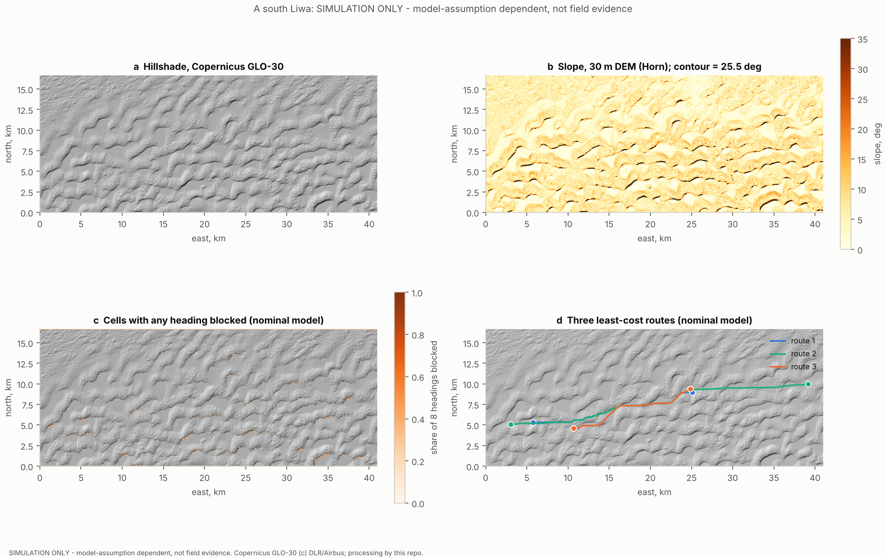
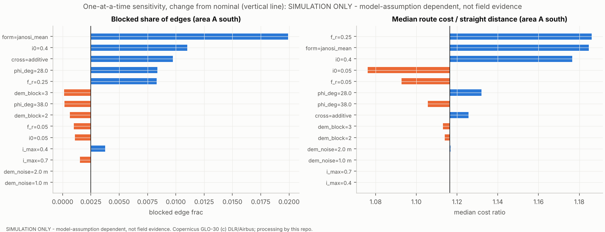
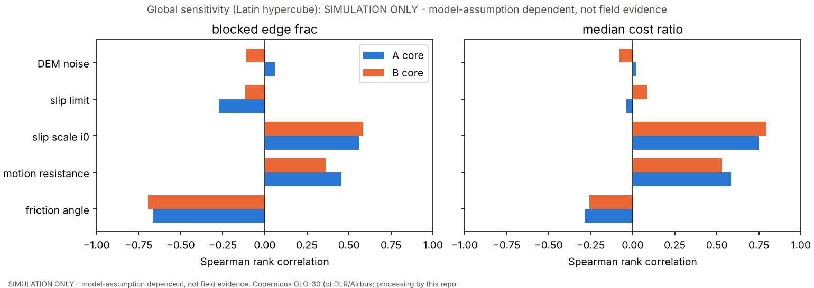
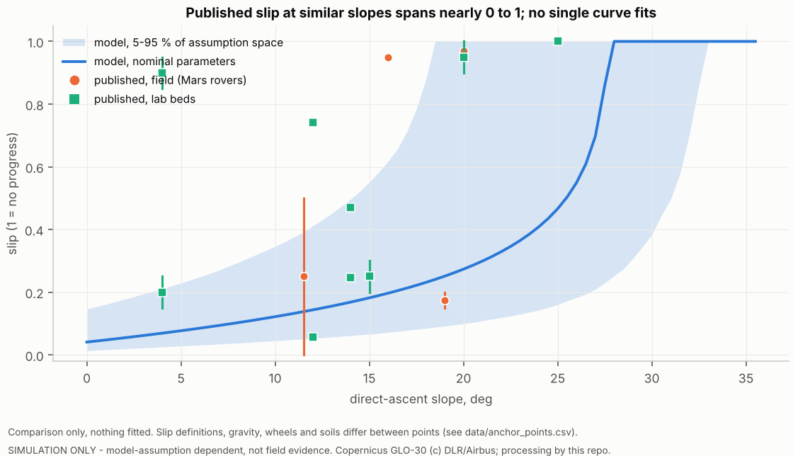
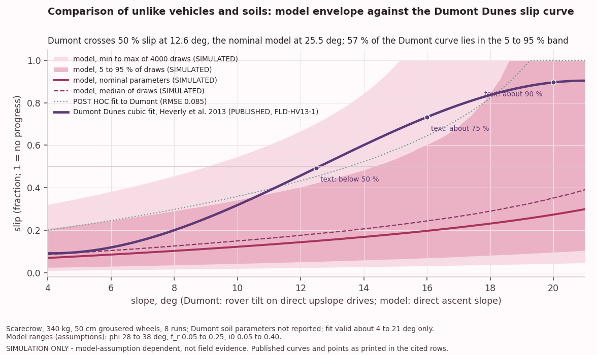
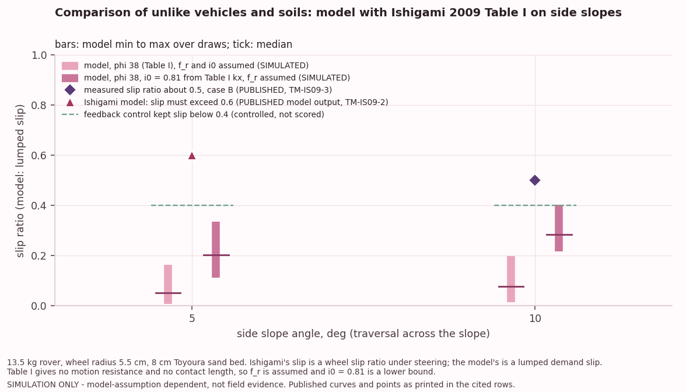

# Predicting slip, sinkage and traversability of wheeled robots on dry sand and dunes: a literature review, a gap analysis for Arabian dunes, and a minimal reproducible experiment plan

Author: Huda Mueen. Repository: `hudasol/dune-rover`. Retrieval dates: 2026-10-11 for the original sources; 2026-10-13 for five papers the author supplied as PDFs (per row in `research/evidence.csv`).
Related work, not repeated here: `hudasol/dhill` (heat and dust operating envelope). This project is about terrain mobility only.

> **Read this first.** This is a research document. It is not engineering approval, a safety case or a performance claim for any real vehicle.
> Three kinds of content appear and are always labelled:
> **PUBLISHED**: a number read in a retrieved source (every one is a row in the evidence table, Appendix A, with URL, passage and retrieval date).
> **SIMULATED BY ME**: output of code in this repository (section 8). It depends on stated model assumptions and is **never field evidence**.
> **PLANNED**: a protocol that has not been run (section 9).

---

## 0. Executive summary

**Question.** How well can slip, sinkage and traversability of wheeled (secondarily legged) robots on dry sand and dunes be predicted from terrain data and models; how well does that transfer from lab to field; and what would a minimal open data planner for Arabian dunes need that the literature does not provide?

**Method.** A written protocol (`docs/PROTOCOL.md`) came first. Five row extraction passes (terramechanics, simulation, learning, field and analog, legged and wheel design) collected 144 evidence rows from retrieved sources (26 more were read on 2026-10-13 from five papers the author supplied as PDFs, giving 170; one of them was split into a lab row and a field row on 2026-10-18, giving 171), and a sixth pass audited open data, dune morphology and UAE facts. Separate agents then re opened the sources for **every one of the 171 rows** (30 randomly drawn plus 7 flagged in phase 1, the other 107 in phase 2, the 26 supplied PDF rows in phase 3). A simulation only slope and slip traversability study was run on real Copernicus GLO-30 elevation data from the Liwa and Rub' al Khali areas, with one at a time and global (Latin hypercube) sensitivity analysis. Phase 2 added a sub grid slip face detector, a three class map (TRAVERSABLE, BLOCKED, UNKNOWN) with Monte Carlo over the four assumed parameters, a second morphology (linear dunes), and a pre registered field kit.

**Headline findings (published evidence).**

1. **Classical and granular models work only after per soil fitting, and mostly on level ground.** Bekker-Wong style drawbar pull errors are about 24 to 27 % (median) on two lunar simulant wheel datasets and sinkage errors 28 to 52 %, but reach 135 % and 385 % on a firm soil with a small light wheel (SIM-025 to SIM-027). Granular RFT gives drawbar mean absolute errors of roughly 5 to 7 N on medium sand and 15 N on a fine simulant (TM-001 to TM-004). The Janosi shear modulus K, which controls slip, differs about 75 fold between the papers first reviewed (0.0006 to 0.045 m, the top of the range from poppy seeds) and up to about 117 fold if the Toyoura sand model input of Ishigami et al. 2009 (kx 0.07 m, TM-IS09-2) is included, so it is tuned rather than transferred.
2. **Speed and slope break the quasi static assumptions.** On olivine sand the drawbar coefficient fell 8 % between 0.01 and 0.2 m/s and 63.7 % between 0.2 and 1 m/s (TM-018, TM-019). A rover scale Bekker-Wong slope model had untuned side slip errors of 14.8 % at 10 degrees and 25.9 % at 20 degrees on Toyoura sand (TM-022, TM-023, a thesis); the 0.49 % at 20 degrees came after tuning on that same case (TM-024, in sample).
3. **Field slip on sand is large, patchy and not predictable from slope or appearance alone.** On natural Earth dunes, the only slope curve found is from Dumont Dunes, California: a 340 kg test rover went from below 50 % slip at 12.5 degrees to about 75 % at 16 degrees and about 90 % at 20 degrees, with no soil parameters reported (FLD-HV13-1, FLD-HV13-2). Spirit measured 15 to 20 % slip at 19 degrees and 95 % slip at 16 degrees about 30 m later on terrain that looked alike (FLD-011, FLD-012). Opportunity's visual odometry slip stayed at 98.9 to 99.5 % at Purgatory ripple (FLD-002). Perseverance exceeded 94 % at about 20 degrees (FLD-025). Visual odometry, the field slip sensor, itself degrades on bland sand (FLD-041).
4. **Learned predictors are validated mostly in distribution.** The strongest held out result is a Perseverance model (AUROC 0.874 on held out sols, LRN-010) on Mars. No retrieved paper holds out terrain type (train without sand, test on sand), and none reports a learned slip or sinkage error on Earth dunes.
5. **Arabian evidence is almost empty.** The only Arabian wheeled robot field evidence found is qualitative: a rover in Dhofar, Oman, met looser sand than expected and got stuck (FLD-042). No Bekker or RFT parameters for Arabian dune sand, no grain size map of the Empty Quarter and no open LiDAR or drone elevation model of its dunes were found. The UAE authored wheel work found is single wheel lunar simulant testing (not sand).
6. **Open elevation data resolve dunes but not slip faces.** Copernicus GLO-30 (about 28 by 31 m posts at 23.5 N, free licence with attribution) resolves dune crests and interdune corridors for dunes tens to hundreds of metres high. Slip faces of the large Rub' al Khali dunes are only 1 to 4 posts wide, so slope read from the grid is biased low; 90 m products remove 80 to 100 % of the cells steeper than 25 degrees in the three windows used here.

**Headline findings (SIMULATED BY ME, model assumption dependent, not field evidence).** With a stated friction circle slip model and nominal assumptions, the 30 m grid blocks only 0.2 to 1 % of travel directions in three real dune windows, because few cells exceed the model's nominal climbing limit of 25.5 degrees. That is mostly a statement about grid resolution and assumptions, not evidence that the dunes are easy. Across the plausible assumption ranges the model's climbing limit varies from 7.6 to 34.7 degrees (5 to 95 %: about 15 to 32 degrees). The assumptions that change the map most are the friction angle, the form of the slip law, the DEM posting, the slip scale i0 and the motion resistance coefficient. DEM noise and the planning slip limit matter least (section 8).

**Headline findings, phase 2 (SIMULATED BY ME, model assumption dependent; detector validated on synthetic truth only).** A 30 m DEM cannot see slip faces, so each cell now carries a modelled probability that an unresolved active face lies inside it and the map has three classes. At 30 m the **UNKNOWN share is 8.6 % in A south Liwa, 10.9 % in B (megadunes) and 2.5 % in C (Saudi Rub' al Khali linear dunes)**; BLOCKED is under 0.1 % everywhere, because the DEM hardly shows slopes the model calls impassable. If a face within one post of the cell counts (a post hoc variant) the UNKNOWN share is 34.4 %, 32.2 % and 22.0 %. 99.1 % (A), 97.0 % (B) and 100.0 % (C) of cells have the same slope based verdict in at least 95 % of the 256 draws of the four assumed slip parameters, so the three class map is far more sensitive to the sub grid morphology assumptions and the resolution than to those four parameters (section 8.7). Of 47 pre registered predictions (stage 1: 1 hit, 2 mixed, 1 missed; stage 2: 3 hit, 1 mixed, 4 missed; stage 3: 2 hit, 1 mixed, 3 missed; stage 4: 1 hit, 0 mixed, 3 missed; stage 5: 9 hit, 1 mixed, 0 missed; stage 6: 5 hit, 0 mixed, 1 missed; stage 7: 4 hit, 0 mixed, 2 missed; stage 8: 3 hit, 0 mixed, 0 missed), the hits and misses are in `docs/PREDICTIONS.md`; most of the quantitative ones about the phase 2 and 3 simulation missed, and the stage 5 hits were partly informed by hand arithmetic on the model equation.

**Headline finding, published anchors (SIMULATED BY ME against PUBLISHED values; comparison of unlike vehicles and soils; section 8.8).** Run on the same slopes as the Dumont Dunes curve, the nominal model crosses 50 % slip at 25.5 degrees against 12.6 degrees for the published curve, and the curve lies above the 95th percentile of the model's assumption range between 10.7 to 17.9 degrees. With the Ishigami et al. 2009 Table I friction angle the model gives 0.01 to 0.20 slip on a 10 degree side slope (0.22 to 0.40 with the Table I shear modulus), where a slip ratio of about 0.5 was measured. **The model predicts too little slip on sand slopes; a post hoc refit at the edge of its ranges still misses the shape of the Dumont curve.**

**Verification.** All 171 rows of the current table have an independent re check against the source (section 11). In the first check of the 170 rows as extracted, material errors were **9 of 170 (5.3 %)**: 6 in the 107 rows checked in phase 2 (5.6 %), 3 in the 26 rows from supplied PDFs checked in phase 3 (11.5 %, all on validation type) and none in the 37 rows of phase 1; any discrepancy including minor label errors: 51 of 170 (30.0 %). All are corrected in the table. For the current table, taking each row's latest verdict (the two rows split from FLD-HV13-5 were checked again on 2026-10-18), material errors are **8 of 171 (4.7 %, Wilson 95 % interval 2.4 to 9.0 %)** and any discrepancy 51 of 171 (29.8 %). The phase 1 random sample (0 of 30 material) had understated the rate. The unit of the slope term in SIM-013 is not stated in its source, so that row is flagged and must not be used numerically outside the tested envelope.

**Biggest gap and first experiment.** There is no published slip versus slope dataset for a wheeled robot on dune sand with full soil characterisation; the nearest, from Dumont Dunes, reports no soil parameters (FLD-HV13-1), and none is from Arabian sand. The first field experiment to run is the **slope ladder** (section 9): one small rover with fixed wheels, one dune stoss slope, runs at about 0, 5, 10, 12.5, 15, 17.5 and 20 degrees (bins revised on 2026-10-15; 25 degrees only if allowed, and an open decision remains, section 9) with RTK ground truth and full soil description, calibrate on the gentle slopes and predict the steep slopes blind.

---

## 1. Scope, protocol and method

**Protocol.** Written before searching, as the file itself states (`docs/PROTOCOL.md`; no independent timestamp): search strategy by query family, inclusion criteria, comparability rules, extraction fields, a verification plan and a stopping rule. One deviation is documented: the verification pass was run on the draft evidence table, before this report's prose was written (an ordering from my recollection of the workflow, not logged), so the report quotes corrected values. A second, independent pass on this report's own claims is described in section 11.

**Evidence classes** are kept visibly separate (see the banner). Published results also carry a validation type: `lab` (bench, soil bin, tilt bed), `field` (real vehicle on real terrain, including Mars), `simulation-only`, and `sim-vs-lab` or `sim-vs-field` where a physical comparison is reported. Of 171 rows: 78 lab, 43 field, 21 simulation-only, 27 sim-vs-lab, 1 sim-vs-field, 1 none (an unreferenced capability statement kept for the record). A physical test on a prepared bed, tilt platform or engineered analog site (for example the JPL Mars Yard) is classed `lab`; a real vehicle on natural terrain, including Mars, is `field`.

**Inclusion.** A result became a row only if the number was found in retrieved text (table, caption or body), the terrain is dry granular or sand like (or flagged as a comparison), at least one mobility metric is reported, and vehicle and soil are described or marked "not reported". Paywalled sources not retrieved are listed in the per topic notes under `research/raw/` with the exact URL to fetch; no number is taken from them.

**Comparability.** Rows are never averaged or ranked across setups. Each row has a `comparability_warning` where slip definition (wheel odometry, visual odometry, velocity based, distance based), slope definition (terrain versus pitch, or emulated by horizontal pull), gravity, wheel geometry, soil, speed or validation type differ.

**Parameters.** No soil parameter is invented. Each is either cited with its location or labelled ASSUMPTION with a sensitivity range (section 8, Table 8.1).

**Quotation and licences.** Sources are paraphrased. The licence of every dataset and library used is in `docs/DATA_AND_LICENSES.md` (summarised in section 5).

**Limits of the search.** The search tool was US only and returned a limited number of hits per query. Arabic language and regional literature, paywalled journals (for example the Journal of Terramechanics, Science) and several standard references (Bekker 1969, Wong's textbook, Wong and Reece 1967) were not retrieved (five journal papers supplied as PDFs by the author on 2026-10-13 were read and added); absence of a result is therefore a statement about this search, not about the world.

---

## 2. Background in brief (for newcomers; see `docs/GLOSSARY.md`)

A wheel on loose sand sinks, pushes sand aside (motion resistance) and shears the sand beneath it to push the vehicle forward (traction). **Slip** measures how much the wheel turns without advancing. **Sinkage** is the depth the wheel penetrates. **Drawbar pull** is the traction left over after resistance is paid. On a slope, part of the vehicle's weight must be paid for with drawbar pull, so slip rises with slope until the vehicle can no longer climb (entrapment). Dry sand has almost no cohesion and a friction angle of roughly 28 to 38 degrees in the lab papers retrieved; wind blown dune slip faces sit near the angle of repose, 32 to 35 degrees (M05, Kroy et al.; `research/raw/morphology_rows.csv`).

The older family of models (Bekker; Wong and Reece; Janosi and Hanamoto) describes the soil with a pressure sinkage law (constants kc, kphi, n) and a shear law (cohesion, friction angle, shear modulus K), then integrates stress under the wheel. A newer family (granular resistive force theory, RFT) sums depth- and orientation dependent forces on small wheel elements. Discrete element methods (DEM) simulate individual grains, and Project Chrono offers fast deformable terrain (SCM) and continuum (CRM) alternatives. Learning methods predict slip or hazard from images, proprioception or both.

---

## 3. Evidence synthesis

Row identifiers refer to Appendix A. Every number below is **PUBLISHED** unless marked.

### 3.1 Classical Bekker-Wong style models

- **Parameters are soil-, geometry- and tuning dependent.** On dry Tottori sand the fitted kphi roughly doubles (about 430 to 800-880) when plate aspect ratio drops from 6 to 2-1.4, and kc rises about four fold (from about 2.5 to 3, up to 9 to 10); sinkage goodness of fit ranged 65 to 95 % (TM-029 and its table). Shear moduli K found in the retrieved papers range from 0.0006 m to 0.045 m (75-fold; the top is poppy seeds), so K behaves as a tuning knob. The Wong textbook table of dry sand constants was not retrieved; one secondary table found carries an apparent transcription error and is not used.
- **Error on benchmark wheels.** RoverDevKit's own evaluation of a Bekker-Wong wheel kernel against published single wheel data reports median drawbar errors of 24 % (Rashid-1 style wheel on FJS-1 simulant) and 27 % (Ding wheel data), sinkage errors of 28 and 52 %, and 135 % (drawbar) and 385 % (sinkage) for a small light wheel on dense simulant (SIM-025 to SIM-027). These are the authors' evaluations of other authors' data, sim-vs-lab, not field.
- **Slope.** Three sources report slope results. At Dumont Dunes a 340 kg test rover went from below 50 % slip at 12.5 degrees to about 75 % at 16 and about 90 % at 20 degrees, with no soil parameters reported (FLD-HV13-1, FLD-HV13-2), and two rovers embedded at about 17 degrees on prepared Marsyard sand (FLD-HV13-3). A 13.5 kg rover traversing a 10 degree side slope of Toyoura sand in a tilting bed showed a slip ratio of about 0.5 (TM-IS09-3). In a thesis, a Bekker-Wong-Ishigami model for a 7 kg rover on Toyoura sand gave side slip errors of 14.76 % at 10 degrees and 25.91 % at 20 degrees with parameters borrowed from another lab, and 0.49 % at 20 degrees after tuning on that case (TM-022 to TM-024). The error metric is a side slip distance ratio, not slip ratio, and the sandbox is 0.08 m deep.
- **Rate dependence.** Measured drawbar coefficient on olivine sand fell 8 % from 0.01 to 0.2 m/s and 63.7 % from 0.2 to 1 m/s at 20 % slip (TM-018, TM-019), against the quasi static assumption. Slip rate effects were also reported for grousered wheels (TM-021; the 85 % "accuracy" there is an in sample goodness of fit, per the verification).
- **Steering on loose sand (supplied paper, read 2026-10-13).** A Bekker type wheel model with lateral terms matched single wheel drawbar pull and side force well for slip angles of 5 to 20 degrees and less well at 25 degrees and above (TM-IS07-3, qualitative), and a rover model built on it reproduced four lab steering runs with position rms errors of 0.015 to 0.039 m (TM-IS07-4). Slip ratios of 0.1 to 0.3 were observed in those runs (TM-IS07-5). All are lab results on a prepared bed of lunar regolith simulant.

### 3.2 Granular RFT and scaling

- RFT predicts rigid wheel drawbar pull and sinkage from a small parameter set. On Quikrete medium sand the mean absolute drawbar error was 5.55 to 7.11 N across loads (TM-001, TM-002); on Mars Mojave Simulant (fines) 15.11 N and 18.41 mm sinkage at 190 N (TM-003, TM-004). Error grows with load; RFT under predicts drawbar at low positive slip and over predicts at |slip| above 0.4 (per the source's discussion). The response surfaces for both the medium sand and the fines were scaled from poppy seed data rather than measured directly, so the medium sand results carry that caveat too.
- On poppy seeds (not sand), RFT sinkage error was 2.73 mm against 26.07 mm for the Bekker type model but drawbar error was larger for RFT (5.05 N versus 3.41 N) (TM-005, TM-006; the plate in the Bekker fit was far smaller than the wheel patch).
- Granular scaling laws held within about 3 % on level Quikrete sand for pairs of wheels (TM-007). Their extension to slopes and lunar gravity has been checked only in DEM (slip RMSE 0.015, TM-020, simulation only). No physical sloped or low gravity scaling validation was found.
- Legged and plate RFT follow ups agree with controlled box experiments within roughly 3 to 15 % (up to 30 % for reversed legs; TM-008, TM-009, TM-011, TM-012), two of the four on poppy seeds rather than sand and 10.5 and 11.5 % mean speed and height error against a beach (TM-010, sim-vs-field, legged). A humanoid trained with an RFT based simulator walked on real dry sand at up to 2.5 m/s commanded (LEG-015).
- **3D RFT for rover wheels (supplied paper, read 2026-10-13).** Combined with a sand deformation model, 3D RFT gave mean absolute errors of 2.88 (smooth wheel) and 6.25 (grousered wheel) in the forward force over 45 slip and slip angle conditions, against 4.47 for plain 3D RFT on the smooth wheel; the table gives no unit (the force axes elsewhere in the paper are in newtons, not verified here), and the predicted trench profile was within 2.2 mm on average of lidar scans (TM-YU1, TM-YU2, TM-YU5). One prepared bed of Soil Direct #90 sand, small wheels on a gantry at 1 cm/s; no slope.

### 3.3 DEM, multibody and Project Chrono

- **Accuracy where a number exists.** A 2D DEM of a grouser wheel on Toyoura sand gave 12.1 % slip against 14.7 +/- 3.0 % in the lab (SIM-018). A 36-million-particle DEM of a rigid tyre gave pull 15 % of weight against 17 % lab and gross traction 20 % against 31 % at 20 % slip, under predicting sinkage and resistance (SIM-019). A soft foot in silica sand: mean pressure sinkage difference 13.5 % (SIM-021).
- **Many validations are plots only.** Chrono CRM and DEM wheel and rover comparisons against lab data (NASA flat and tilted beds, SIM-001, SIM-002, SIM-009; the Rashid-1 wheel rig, SIM-015) are described as close agreement but give no scalar error. Slope climbing limit error is not reported anywhere in the retrieved set.
- **Calibration is not independent evidence.** SCM parameters fitted to a DEM gave a negative Kc and a friction angle of about 21 degrees (a numerical fit, SIM-005); DEM used scaled particles and tuned friction (SIM-015, SIM-018).
- **Cost.** Wall clock to simulated time ranges from about 9 million (fine particle CPU DEM, SIM-020, derived) to hundreds or thousands (GPU DEM, SIM-016, SIM-024) to about 11 to 23 (Chrono CRM) and 18 to 51 (Chrono SCM) on one benchmark (SIM-011), and about 0.5 ms per closed form Bekker-Wong wheel solve (SIM-028; no simulated time ratio reported). The SCM versus CRM ordering depends on the benchmark.
- **Gravity.** Simulating a 440 kg rover at lunar gravity predicted far higher slip than a light 1 g comparison (about 85 % versus about 42 % at 30 degrees, SIM-003, where the source of the 42 % is not stated; about 75 % versus 18 % at 10 degrees, SIM-004), with no lunar validation (simulation only).
- Project Chrono is BSD-3 licensed (verified from its LICENSE file). **It is not used by this repository's code.** No retrieved source compares Chrono, DEM or any multibody simulator with a full rover on real dune sand.
- **High speed grouser wheels (supplied paper, read 2026-10-13).** In single wheel tests on a prepared bed of Tohoku silica sand at up to 1.0 m/s, a slick wheel reached a traction coefficient of only about 0.02 at slip 0.5 and 1.0 m/s, and its traction efficiency fell from about 0.2 at 0.2 m/s to about 0.03 at 1.0 m/s (TM-TK1, TM-TK2). The DEM simulation predicted negative traction for the slick wheel at every slip ratio and both speeds, where the experiment did not, and the paper gives no numeric error between DEM and experiment (TM-TK4). Speed matters for sand traction, and DEM did not capture it for the slick wheel.

### 3.4 Learning based slip and traversability

- **Data needs.** Visual slip prediction needed 1000 to 2000 stereo frames per terrain with slip labels from visual odometry (LRN-003, LRN-004). The Perseverance model used about 43,000 self labelled images from about 500 sols and 45 km (LRN-010). A proprioceptive slip classifier used about 13,000 samples (9235 train, 3958 test) from one single wheel testbed (LRN-009).
- **Best held out evidence.** AUROC 0.874, F1 0.758 on held out Perseverance sols, including a sand dune patch at about 0.3 slip (LRN-010, LRN-011). Held out by sol, not by terrain type; Mars, not Earth sand. Removing proprioceptive alignment dropped AUROC to 0.723 (LRN-011): appearance alone does not fix mechanics.
- **Documented failures.** Test error on gravel rose to 27.5 % against 7.16 % in training because the test roll/pitch combinations were absent from training (LRN-003). Misclassifying soil or gravel as sand inflated whole pipeline error from 11.2 to 21.8 % (LRN-004). The moderate slip class was the weakest in proprioceptive classification, about 75 % against about 85 % for low and high slip (LRN-009), and that test was a random hold out on one testbed.
- **Transfer.** A policy trained in simulation transferred zero shot to a rover on simulant at 20 degrees: travel loss fell from 81.9 to 43.0 % on dry sand and from 100 % (entrapment) to 30 % on wet sand (LRN-019, sim-vs-lab, trial count not stated).
- **Datasets.** No public dataset with Earth dune or desert sand and measured wheel or foot slip labels was found. TAIL (sandy sites, SLAM benchmark, GPLv3, no slip labels) and the Perseverance driving set (Martian, release pending, no licence seen) are the closest.

### 3.5 Field and analog evidence

- **Mars rovers.** Spirit: 15 to 20 % slip on 19 degrees, 95 % on 16 degrees (FLD-011, FLD-012), up to 50 % at 10 to 13 degrees (FLD-010), over 100 % in places (FLD-009, FLD-013). Opportunity: about 50 m of wheel travel for 2 m of track at Purgatory ripple (FLD-001), slip 98.9 to 99.5 % (FLD-002), ripple 30 cm high, trapped several weeks (FLD-040). Curiosity: 3D slip above 70 % on shallow megaripples (FLD-018). Perseverance: above 94 % at about 20 degrees (FLD-025), slip limits above 50 % needed on a 15 to 20 degree hill (FLD-024).
- **Not a clean function of slope.** Segment averaged Spirit slippage on sand sized terrain rose from 4.0 % (0 to 5 degrees) to 9.9 % (5 to 10 degrees) (FLD-015, FLD-016), while fine grain terrain approached 100 % at 10 to 15 degrees (FLD-014). The authors warn that steep segments were avoided or visual odometry corrected, so higher slopes sometimes show less slippage (warning on FLD-015). Do not fit a clean slip versus slope line to these aggregates.
- **Lab to field.** Engineering slip tables built from a dry sand tilt bed worked on pure sand but failed on mixed or hidden weak deposits (Maimone et al.); separately, Lamarre and Kelly report that vision based slip prediction fails on sand (both summarised in the field notes). The tilt bed figures that are quantitative (90 % slip at 20 degrees, 25 degrees climbing limit, FLD-006, FLD-007) come from a press release, so FLD-006 is excluded from the anchor comparison in section 8.
- **Tilt beds on Earth.** A smooth wheel 35 kg rover (El-Dorado-II) showed slip close to 0.9 at 4 degrees without grousers and about 0.2 with grousers (FLD-030, FLD-031); a 23 kg rover with 296 mm wheels made less than 10 mm progress per revolution at 30 degrees, the angle of repose, whatever the grouser length (FLD-035); a 400 kg Scarab exceeded 90 % at 20 degrees and had no uphill progress at 25 degrees (FLD-027, FLD-028).
- **Arabian and Gulf.** One qualitative report (FLD-042): the AMADEE-18 Husky rover in Dhofar, Oman, met much looser and softer sand than expected. Nothing with slip, sinkage or slope numbers was found for Rub' al Khali, Saudi, Qatari, Kuwaiti or Emirati dunes. The UAE authored single wheel rig results (slip 0 to 0.75, sinkage about 1 to 2 cm) use lunar simulant and are not evidence for desert sand. See also `research/raw/field_notes.md` for non Arabian desert trials, which were qualitative.

### 3.6 Legged and tracked comparisons (secondary)

- **Legs.** Gait dominates: the same SandBot ran about 2 cm/s with a hard ground gait and 8 cm/s with a soft ground gait (LEG-001, LEG-002), and about 20 cm/s versus 2 cm/s for a 5 % change in packing (LEG-003, LEG-004). On slopes a 350 g hexapod lost about two thirds of its speed between 0 and 20 to 24 degrees (LEG-007 to LEG-009; the same row set appears as FLD-037, FLD-038). On a 22 kg quadruped (SpaceBok) planar feet slipped near the soil friction angle while point feet sank up to 120 mm (LEG-010, LEG-012, LEG-013; testbed limit 25 degrees). All lab beds, none dune sand.
- **Wheel geometry.** Larger and wider wheels cut slip strongly on Toyoura sand: slip 0.741 at D = 116 mm versus 0.056 at D = 327 mm at an equivalent 12 degrees (LEG-017, LEG-018), and 0.471 at narrow versus 0.247 at wide at 14 degrees (LEG-019, LEG-020), with slope emulated by horizontal pull and from slides, not a paper. Grouser benefit saturates (LEG-021). A flexible metallic wheel gave more than twice the drawbar pull of a rigid one at 1 m/s on olivine sand (LEG-022).
- **Tracks.** The one direct wheel versus track comparison found could not be attributed unambiguously and is not entered as a row. No extractable numeric tracked vehicle sand data were retrieved. No same vehicle wheel versus leg versus track comparison on dry sand was found.

---

## 4. Taxonomy of prediction approaches and when each is appropriate

The table is a judgement made from the evidence above, not a ranking from head to head tests. No retrieved study compares these families on the same vehicle and the same dune sand.

| Family | Needs | Strengths (published) | Weaknesses (published) | Appropriate when | Not appropriate when |
|---|---|---|---|---|---|
| **Slope threshold or friction circle rules** (the model in section 8) | Slope, a friction angle, a few tuned constants | Costs almost nothing, runs on any elevation model, transparent | Constants for slip and resistance are not transferable (K varies about 75-fold, section 3.1); no sinkage; blind to sand state | Coarse screening of large areas, ranking assumptions, planning where entrapment is the worst case | Predicting actual slip or drawbar for a specific vehicle without calibration |
| **Classical Bekker-Wong, Wong-Reece** | Bevameter or plate tests, shear tests, wheel geometry and load | Interpretable, closed form, fast (SIM-028) | 24 to 52 % median error on benchmark wheels, worse on firm soil (SIM-025 to SIM-027); parameters depend on plate geometry (TM-029); quasi static (TM-018, TM-019) | Single wheel design trade studies on a characterised soil, with tuning on that soil | Transient or fast driving; sloped dune faces; soils not measured |
| **Granular RFT** | Depth and orientation force law from a plate or intruder test | Few parameters; wheel drawbar mean absolute error 5.6 to 15 N and sinkage error 18 mm at 190 N on sand and fines (TM-001 to TM-004); relative errors of about 2.6 to 15 %, up to 30 % for reversed legs, in legged and plate tests (TM-008 to TM-013) | Error grows with load; response surfaces scaled from poppy seeds; no sloped wheel field validation found | Slow quasi static locomotion on dry grains in a controlled bed, legged robots, fast what if studies | Wet, crusted or cohesive sand; high speed; steep slopes close to repose |
| **Scaling laws** | Matched wheel pairs | Collapse level ground data within about 3 % (TM-007) | Slopes and low gravity unvalidated physically (TM-020 is DEM only) | Transferring a lab result between wheel sizes on level sand | Slope or gravity changes |
| **DEM** | Particle contact calibration (friction, rolling resistance, cohesion), often scaled particles | Captures flow, avalanching and high slip behaviour; about 13 to 18 % where a scalar error exists (SIM-018, SIM-021), with larger gaps for gross traction (20 against 31 % of weight, SIM-019) | Wall clock hundreds to thousands of times simulated time with scaled particles on GPU (SIM-016, SIM-024) and about 9 million for fine particles on CPU (SIM-020), all derived; calibration is a tuning step, not independent evidence | Mechanism studies, generating training data, checking simpler models | Planning, anything needing many runs |
| **Chrono SCM / CRM, multibody** | Bekker-Wong constants (SCM) or density and friction angle (CRM) | Two to several orders of magnitude cheaper than DEM (SIM-007, SIM-008, SIM-011); BSD-3 | Validation mostly plots, no scalar errors (SIM-001, SIM-002, SIM-009); fitted SCM constants can be unphysical (SIM-005) | Rover scale simulation, controller testing, generating labelled data | Claiming predictions for unmeasured soils |
| **Learning from images or terrain class** | Slip labels per terrain from visual odometry or encoders | Held out AUROC 0.874 on Perseverance (LRN-010) | Needs labelled runs on each terrain; class confusion inflates error (LRN-004); fails outside training roll/pitch (LRN-003) | Onboard hazard ranking where the vehicle has driven similar sand | A new terrain type, or a regional sand never driven on |
| **Learning from proprioception** | Wheel speeds, currents, IMU | Detects slip as it happens (LRN-009, LRN-015, LRN-024) | Moderate slip is weakest (LRN-009); mostly binary events; random hold outs | Online slip detection and adaptation | Predicting slip in advance of driving |
| **Hybrid or physics informed learning** | Physical model plus onboard adaptation | Online soil adaptation lifted physical grass to sand completion in a small trial (NeSAM, notes; the physical dataset size was not located) | Few physical tests, small trial counts | Promising for adapting a planner to unseen sand | As proven evidence of generalisation |
| **Empirical field tables** (Mars slip tables) | Prior drives and operational constraints | Used in practice on Mars (FLD-020, FLD-021, FLD-024) | Failed on mixed terrain and hidden weak deposits (field notes) | Conservative operations with a human in the loop | Autonomy on unseen terrain |

**Selection rule used in this project.** Use a cheap slope and slip rule to map where the answer is sensitive to assumptions (section 8), use a calibrated single wheel model or RFT to choose wheel geometry on a characterised sand, and use proprioceptive or image based learning on board only after the vehicle has logged enough runs on that sand. Use DEM only to understand mechanisms.

---

## 5. Open data for an Arabian dune planner

All retrievals 2026-10-11. Licences are as read from provider pages; legal reading is the user's responsibility. Full table: `research/raw/data_audit.csv`; licences: `docs/DATA_AND_LICENSES.md`.

| Dataset | Resolution | Coverage | Licence (as read) | Access tested | Notes |
|---|---|---|---|---|---|
| Copernicus DEM GLO-30 (DSM, TanDEM-X, 2010 to 2015) | 1 arcsec; about 28.3 m E-W by 30.8 to 30.9 m N-S at 23.5 N (my arithmetic from tile geometry; the code uses 30.76 m) | Global land | Free with attribution (c) DLR and Airbus, EU/ESA; controlling licence (COP-DEM-GLO-30-F) read in full in phase 2: no commercial restriction, attribution and no liability notices required (`docs/DATA_AND_LICENSES.md`) | Yes, AWS COG tiles; used here | Published accuracy: absolute <4 m (LE90), relative <2 m on slopes <=20 % and <4 m above |
| Copernicus GLO-90 | 3 arcsec (about 90 m) | Global land | As GLO-30 | Yes (audit only) | Block mean of GLO-30 reproduces the official product's slope statistics closely in my check (max 27.7 degrees and 0.30 % above 20 degrees in both; 0.037 % against 0.029 % above 25 degrees) |
| SRTM derived "skadi" tiles | 1 arcsec | Global (mixed SRTM and other sources per the tiles page) | Joerd project attribution, SRTM courtesy USGS | Yes (audit only) | Spiky: maximum slope 66.5 degrees in the test window; mean +1.47 m and std 4.31 m against GLO-30 |
| NASADEM, ASTER GDEM v3 | 1 arcsec | NASADEM 60 N to 56 S; ASTER 83 N to 83 S | Openly shared; download needs an Earthdata login | No | Vertical accuracy numbers not retrieved |
| ALOS AW3D30 v4.1 | 1 arcsec | Global land within about 82 degrees latitude | Free after registration, JAXA terms not read | No | A quality flag "Good" at <5 m is not a validated accuracy |
| FABDEM v1-2 | 1 arcsec | Global | CC BY-NC-SA 4.0 (non commercial) | No | Corrects buildings and forests, which does little in open sand |
| TanDEM-X 90 m (DLR) | 3 arcsec | Global | Scientific use, registration | No | |
| ICESat-2 ATL08, GEDI L2A | 100 m segments; 25 m footprints | Tracks only; GEDI 54 N to 54 S | Free, Earthdata login | No | Possible ground truth profiles; none downloaded |
| Sentinel-2 L2A | 10, 20, 60 m | Global, frequent | Free, full and open | Catalogue search only | Imagery for dune context, not slope |
| Landsat 8/9 | 30 m | Global | No restrictions stated | Not downloaded | |
| Maxar Open Data | sub metre class (figure not stated on the page read) | Event based; no Gulf event found | CC BY-NC 4.0 | Catalogue only | |
| Planet NICFI, Pleiades Neo | n/a | n/a | Planet terms not verified; Pleiades Neo commercial | No | Not usable as open data |
| Abu Dhabi SDI open data (habitat and geology polygons) | vector | Abu Dhabi emirate | Licence field empty in service metadata | Metadata only | No elevation layer found |

**Not found.** Open airborne LiDAR or drone elevation models of Liwa or the Rub' al Khali dunes; any gridded sand colour or grain size map of the Empty Quarter; any open sub metre stereo for the region.

**Can slip faces and crests be resolved?** Evidence for the answer, all of it my arithmetic or computation unless marked published:

- Published dune sizes: Liwa dunes 50 to 80 m high (Lorenz et al., abstract); northern Rub' al Khali complex linear dunes 50 to 100 m (Lancaster et al., abstract); published mean wavelengths 0.63 to 3.17 km (USGS Professional Paper 1052 Landsat morphometry; `morphology_rows.csv`). At 30 m posting that is 20 to 110 posts per wavelength: well resolved. Small simple linear dunes of 10 to 25 m height and 200 to 300 m spacing (a secondary summary, to be re verified) are 7 to 10 posts at 30 m and 2 to 3 at 90 m.
- A slip face at 32 degrees has a horizontal run of about 1.6 times its height, so a 50 m dune face spans about 80 m, 2.7 posts at 30 m. In the Rub' al Khali window, runs of consecutive posts steeper than 25 degrees had a median length of 2 posts (90th percentile 4; 45 % a single post).
- A synthetic test of an ideal 32 degree face sampled at 30 m with random phase (SIMULATED BY ME, optimistic because it samples points rather than averaging over cells) recovers full steepness only if the face is 30 m or higher by forward difference (50 m or higher by central difference). A 10 m face reads as 9 to 18 degrees and a 20 m face as 18 to 26 degrees. At 90 m, even 50 m faces read 16 to 23 degrees.
- **Verdict.** Dune crests, ridges and interdune corridors of the large Liwa and Rub' al Khali dunes: resolved at 30 m. Slip faces of dunes above about 40 to 50 m: marginal, located as thin bands of high slope but biased low. Slip faces of dunes below about 20 m, brink sharpness, ripples (centimetre wavelength) and small barchans of 1 to 7 m: not resolved, and the barchans are at or below the published vertical error. A planner reading 30 m slope alone will under flag lee faces.
- **Caveats.** GLO-30 is a radar surface model; the size of X-band bias over dry sand was not retrieved. The epoch (2010 to 2015) is stale for fast small dunes (over 20 m/yr in Kuwait). No lidar truth was available, so slip face bias is estimated by synthetic and cross product comparison only.

---

## 6. UAE context (factual background; every item checked against retrieved sources, see `research/raw/uae_facts.csv`)

- **Rashid 1** (MBRSC, about 10 kg, four wheels, designed for slopes up to 20 degrees and rocks 10 cm high) never operated: the ispace Hakuto-R Mission 1 lander failed to land on 2023-04-26 (JST), which ispace attributed to altitude sensor handling in software (UAE01, UAE02, UAE10, UAE11).
- **Rashid 2** is built and was shipped to the US for Firefly's Blue Ghost Mission 2 (lunar far side). Launch dates conflict between sources (2026 in late-2025 coverage, not earlier than 2027 in an October 2026 report), so no flight data exist and the date is unresolved (UAE14, UAE15, UAE17).
- **Wheel work.** Khalifa University and MBRSC published single wheel rig results for the Rashid wheel on a lunar regolith sample (slip 0 to 0.75, sinkage about 1 to 2 cm, drawbar 5.2 to 24.1 N, UAE04, UAE06) and wheel and grouser studies (UAE07, UAE08). These concern lunar simulant, not Arabian sand.
- **Desert ground vehicles.** A TII desert unmanned ground vehicle (page date ambiguous, 2023 or 2025) and, at UMEX in January 2026, SteerAI's xRift (debuted 20 January 2026) and a Space42 vehicle (25 degree slope capability stated) were shown; the retrieved pages give no slip, sinkage or dune traversability data (UAE22 to UAE25).
- **Programmes that are not mobility evidence.** Hope is an orbiter (UAE19, UAE20); Mars Science City was announced as a simulated settlement with 3D-printed desert sand domes and its article does not mention rover testing (UAE21); the Emirates Robotics Competition task is indoor (UAE26).
- **Not verified or not found:** Rashid 2 wheel design, current Rashid 2 launch date, any rover testing on UAE dunes by UAE universities, current Mars Science City status. The 1963 archive item on wheeled vehicle sand trials could not be read.
- Thermal and dust effects on these vehicles are out of scope; see `hudasol/dhill`.

---

## 7. Gap analysis

### 7.1 Where lab to field transfer fails or is untested

1. **Every quantitative sand slope result is lab, a prepared Earth sand bed (SIM-012, SIM-013; the unit of the slope term is not stated in its source) or Mars, except one Earth dune curve from Dumont Dunes, California, for a 340 kg rover with no soil parameters reported (FLD-HV13-1, FLD-HV13-2); none is Arabian dune sand.** Lab slope beds use simulants or Toyoura sand, mostly small wheels (exception: the 400 kg Scarab, FLD-027, FLD-028) and slow speeds (FLD-027 to FLD-035, LEG-017 to LEG-020, TM-022 to TM-024). Mars field data are low gravity and on megaripples, crusts and sulfates (FLD-001 to FLD-025, apart from the Earth tilt bed rows FLD-006 to FLD-008).
2. **Engineering tables transferred from a lab bed work on uniform sand and fail on mixed or hidden weak ground** (field notes, Maimone et al.). The Spirit pair (15 to 20 % versus 95 % slip on terrain with no visible difference, FLD-011, FLD-012) shows the pattern; the source does not state the cause.
3. **Model validation uses in sample or borrowed parameters.** The rover scale slope error fell from 25.9 to 0.49 % only after tuning on the same case (TM-023, TM-024); DEM and SCM fits are calibrations (SIM-005, SIM-015, SIM-018).
4. **The quasi static models are outside their validated envelope when driving is fast or transient** (TM-018, TM-019, TM-021).
5. **Learning evidence is in distribution.** Hold outs are random, temporal or by sol, never by terrain type (LRN-003, LRN-007, LRN-009, LRN-015). The one held out soil result is a simulation (LRN-016).
6. **The field slip sensor is unreliable on exactly the terrain of interest.** Visual odometry degrades on featureless sand (FLD-041), and different papers define slip differently (wheel odometry, visual odometry, velocity based, distance based), so numbers are not interchangeable.

### 7.2 What is missing for dune terrain specifically

1. A **slip versus slope dataset with a wheeled vehicle on dune sand with complete soil and wheel description** and independent ground truth position. None found.
2. **Behaviour on and near the slip face**: avalanching and shear collapse near the angle of repose. Slope induced shear collapse is shown only for a foot on silica sand (sinkage 13 mm at 0 degrees to 36 mm at 35 degrees, SIM-022, SIM-023) and in a few legged tests. Simulators that omit it will under predict.
3. **Arabian sand properties**: grain size, rounding, packing, moisture and cementation below the surface, and Bekker or RFT constants. Nearest values are Kuwaiti barchans (mean grain 0.23 mm) and a Brazilian dune (d50 about 0.2 mm), not Gulf dunes (`morphology_rows.csv`).
4. **Dune scale terrain data at the resolution that matters** (open, metre scale elevation). None open for the region; GLO-30 under resolves slip faces (section 5).
5. **A common slip definition and a shared benchmark** so that rows can be compared.
6. **Dynamic effects**: crosswind and lateral slip on crests, slope at speed, repeated passes on the same track (not covered by any retrieved row).
7. **Tracked and legged vehicles on real dunes**, and any same vehicle comparison of the three.

### 7.3 What a minimal open data planner needs that the literature does not provide

- A slip law whose constants come from **measurements on the target sand and the target vehicle**, with stated uncertainty. This project supplies the structure and an analysis plan (sections 8 and 9) but not the constants.
- A **slip face and crest detector** that does not rely on a 30 m slope value: aspect, curvature, dune height and optical imagery are the open candidates, but none has been validated here.
- A **way to carry the assumption uncertainty into the plan**, for example by treating a route as acceptable only if it is acceptable across the plausible parameter range, which is what the sensitivity analysis in section 8 suggests is necessary.
- An **onboard log** (section 9.5) that lets the vehicle correct the model as it drives.

---

## 8. Simulation study (SIMULATED BY ME): slope and slip traversability from an open elevation model

> **SIMULATION ONLY, model assumption dependent. Nothing in this section is field evidence.** The model is a deliberately minimal planning screen, not a vehicle model. It omits sinkage, wheel geometry, vehicle mass, speed, avalanching and cohesion. The published evidence in section 3 shows that the slip it tries to represent varies from near 0 to near 1 at similar slopes, so the outputs below describe the **model**, not any real rover on any real dune.

### 8.1 What was run

- **Data.** Copernicus DEM GLO-30 tiles N23E053 and N22E054 (licence in section 5; tile hashes in `results/summary.json`). Three windows: **A-south Liwa** (23.02 to 23.17 N, 53.55 to 53.95 E, about 17 by 41 km, relief 139 m), **A north Liwa** (23.25 to 23.45 N, same longitudes; smaller crescentic dunes, relief 85 m) and **B Rub' al Khali megadunes** (22.20 to 22.50 N, 54.20 to 54.60 E, relief 211 m). The windows were chosen by me for visible dune texture, not at random.
- **Slope.** Horn 3 by 3 gradient with per latitude metric spacing (`src/dunerover/terrain.py`). A central difference check on the same A-south window gave 1.70 % of cells above 20 degrees in the earlier data audit against 1.45 % here (Horn): slope tails depend on the kernel by roughly 15 % relative.
- **Slip model** (`src/dunerover/slipmodel.py`). For an edge between neighbouring cells with along heading slope angle theta_a and cross slope theta_c:
  demand D = sqrt((tan theta_a + f_r)^2 + tan^2 theta_c) (friction circle), capacity mu_max = tan(phi), slip i = -i0 ln(1 - D / mu_max), entrapment if D >= mu_max. An edge is passable if i <= i_max; travel cost = distance / (1 - i). The exponential comes from the Janosi-Hanamoto shear law applied at the contact patch level.
- **Planner.** 8-neighbour directed graph, Dijkstra least cost routes (`scipy.sparse.csgraph`), ten deterministic origin destination pairs per window picked on gentle low ground (seed 20261011). Slope in each direction is taken from the elevation difference along the edge, cross slope from the Horn gradient at the edge midpoint.
- **Seeds and reproducibility.** Origin destination 20261011; Latin hypercube 20261012 (A core) and 20261013 (B core); 256 draws each, on core windows of 0.07 by 0.16 degrees (A core 23.06 to 23.13 N, 53.62 to 53.78 E; B core 22.28 to 22.35 N, 54.30 to 54.46 E); the full study was run twice and the area and sensitivity entries of the two `results/summary.json` files were identical (a one off comparison that is not stored in the repository; re run to confirm). Runtime about 330 s.

**Table 8.1: parameters of the slip model.** Only the friction angle has a published basis; the other three are assumptions with ranges. DEM noise is an additional assumption used in the sensitivity analysis only (spatially correlated, correlation length 3 posts, standard deviation 0 to 2 m).

| Parameter | Nominal | Range | Status | Basis |
|---|---|---|---|---|
| `phi_deg` | 33.0 | 28.0 to 38.0 | published range of laboratory sands (not measured for Arabian sand) | Internal friction angles printed in retrieved papers: 28 (Irani dry sand), 34 (Quikrete sand), 35 (Mojave simulant), about 35 (olivine sand), 38 (Toyoura, Tottori); angle of repose 32-35 deg (Kroy et al. 2002). See research/raw/terramechanics_notes.md and morphology_rows.csv (M05). |
| `f_r` | 0.12 | 0.05 to 0.25 | ASSUMPTION | Motion-resistance coefficient (resistance/weight) lumped for a small wheeled UGV in loose sand. No retrieved source gives a transferable value; range chosen to span light-to-heavy sinkage while keeping the vehicle able to move on flat sand. Replace with a measured value for the real vehicle. |
| `i0` | 0.2 | 0.05 to 0.4 | ASSUMPTION | Slip scale K/L. Published Janosi shear modulus K spans 0.0006-0.045 m between papers (terramechanics_notes.md), contact length L is vehicle specific, so i0 is a tuning parameter. |
| `i_max` | 0.5 | 0.4 to 0.7 | ASSUMPTION (planning threshold) | Slip above which an edge is treated as impassable. A Mars rover autonav slip table needed limits above 50 % on 15-20 deg terrain (evidence FLD-024); that is Mars-specific, used only as a pointer. |
| `noise_sigma_m` (sensitivity only) | 0 | 0 to 2 m | ASSUMPTION | Spatially correlated DEM error, correlation length 3 posts; no measured value for dune DEM error was retrieved. |

### 8.2 Elevation statistics (computed from the data, not from the slip model)

| Window | Posting, m | Block | Relief, m | Max slope, deg | % cells >10 | >15 | >20 | >25 | >30 |
|---|---|---|---|---|---|---|---|---|---|
| A_south_Liwa | 29.6 | 1 | 139 | 37.0 | 14.6 | 3.89 | 1.45 | 0.57 | 0.0549 |
| A_south_Liwa | 59.3 | 2 | 136 | 29.5 | 6.86 | 2.04 | 0.632 | 0.0931 | 0 |
| A_south_Liwa | 88.9 | 3 | 133 | 25.5 | 5.23 | 1.25 | 0.163 | 0.00463 | 0 |
| A_north_Liwa | 29.6 | 1 | 85 | 35.1 | 15.3 | 4.34 | 1.39 | 0.304 | 0.0242 |
| A_north_Liwa | 59.2 | 2 | 81 | 26.1 | 6.52 | 0.917 | 0.061 | 0.000386 | 0 |
| A_north_Liwa | 88.8 | 3 | 77 | 19.4 | 1.72 | 0.0365 | 0 | 0 | 0 |
| B_RubAlKhali_megadunes | 29.7 | 1 | 211 | 42.7 | 33.1 | 12.6 | 4.97 | 2.33 | 0.45 |
| B_RubAlKhali_megadunes | 59.4 | 2 | 205 | 33.8 | 25.4 | 7.94 | 3.09 | 1.15 | 0.0283 |
| B_RubAlKhali_megadunes | 89.1 | 3 | 200 | 29.9 | 20.8 | 5.86 | 1.91 | 0.437 | 0 |

Coarsening to 60 and 90 m (block mean) removes most steep cells: the share of A-south cells above 25 degrees falls from 0.57 % at about 30 m to 0.093 % at about 60 m and 0.0046 % at about 90 m. This is the resolution effect discussed in section 5, reproduced on real tiles.

### 8.3 Nominal results

Under nominal parameters the model's critical direct ascent slope (slip equal to i_max) is **25.5 degrees**; the slip curve reaches entrapment at about 28 degrees. Model slip at 0, 5, 10, 15, 20 and 25 degrees of direct ascent is about 0.04, 0.08, 0.12, 0.18, 0.27 and 0.47.

| Window | Grid (rows x cols) | Blocked edges | Reachable share | Median cost ratio | Median length ratio | Steepest uphill on any route, deg | Origin destination pairs |
|---|---|---|---|---|---|---|---|
| A_south_Liwa | 541 x 1441 | 0.25 % | 1.0000 | 1.116 | 1.063 | 20.4 | 10 (0 unreachable) |
| A_north_Liwa | 721 x 1441 | 0.20 % | 1.0000 | 1.115 | 1.064 | 18.1 | 10 (0 unreachable) |
| B_RubAlKhali_megadunes | 1081 x 1441 | 0.97 % | 0.9999 | 1.115 | 1.056 | 23.1 | 10 (0 unreachable) |

*Figure 8.1. (a) hillshade of GLO-30, (b) slope with the nominal critical angle contoured, (c) cells where at least one of eight headings is blocked, (d) three least cost routes. SIMULATION ONLY, model assumption dependent, not field evidence. The Rub' al Khali window is `results/figures/fig_area_B_RubAlKhali_megadunes.png`.*

**How to read these numbers.**

- The blocked share is tiny (0.2 to 1 % of edges). That follows from two things, not from the dunes being easy: at 30 m posting only a small share of cells exceed the nominal critical angle (section 8.2), and slip face slopes are biased low by the grid (section 5). A real rover facing the steepest faces would be blocked far more often than this map shows.
- The median route cost ratio (about 1.115 in all three windows) is **almost entirely a grid and baseline effect**: an 8-neighbour path is about 6 % longer than the straight line (column "Median length ratio" above) and nominal flat sand slip of about 0.04 adds a factor near 1.04. It should not be read as a dune effect. The routes avoid steep cells at small cost because the origin and destination are on gentle ground.
- Reachability is about 0.9999 in every window: the interdune corridors connect everything at nominal parameters.

### 8.4 Sensitivity analysis: which assumptions change the map most

Two analyses were run. **One at a time (OAT):** each parameter to its low and high value, plus structural alternatives (slip law form, cross slope rule, DEM posting, DEM noise). **Global:** 256 Latin hypercube draws of the five continuous assumptions on a core window of A and of B, with Spearman rank correlations against each output (ranks are used because the outputs are monotonic but non linear; the rank regression R squared values in `results/summary.json` are 0.86 to 0.96 for blocked share, reachability and climbing limit, so the ranking explains most of the variance).

**Table 8.2: one at a time sensitivity, area A-south (SIMULATED BY ME).**

| Case | A-south blocked share | x nominal | A-south median cost ratio | B blocked share | B median cost ratio | Critical uphill, deg |
|---|---|---|---|---|---|---|
| nominal | 0.0025 | 1 | 1.116 | 0.0097 | 1.115 | 25.5 |
| phi_deg=28.0 | 0.0084 | 3.38x | 1.132 | 0.0271 | 1.139 | 20.2 |
| phi_deg=38.0 | 0.0002 | 0.07x | 1.106 | 0.0009 | 1.103 | 30.8 |
| f_r=0.05 | 0.0010 | 0.40x | 1.093 | 0.0051 | 1.093 | 28.6 |
| f_r=0.25 | 0.0083 | 3.35x | 1.186 | 0.0243 | 1.188 | 19.1 |
| i0=0.05 | 0.0011 | 0.44x | 1.076 | 0.0048 | 1.070 | 27.9 |
| i0=0.4 | 0.0110 | 4.43x | 1.177 | 0.0344 | 1.198 | 18.9 |
| i_max=0.4 | 0.0038 | 1.51x | 1.116 | 0.0136 | 1.115 | 23.8 |
| i_max=0.7 | 0.0015 | 0.61x | 1.116 | 0.0064 | 1.115 | 27.0 |
| form=janosi_mean | 0.0199 | 8.02x | 1.185 | 0.0561 | 1.217 | 16.2 |
| cross=additive | 0.0097 | 3.92x | 1.126 | 0.0325 | 1.134 | 25.5 |
| dem_block=2 | 0.0006 | 0.25x | 1.114 | 0.0049 | 1.113 | 25.5 |
| dem_block=3 | 0.0001 | 0.05x | 1.113 | 0.0023 | 1.111 | 25.5 |
| dem_noise=1.0 m | 0.0025 | 1.00x | 1.116 | 0.0096 | 1.115 | 25.5 |
| dem_noise=2.0 m | 0.0025 | 1.01x | 1.117 | 0.0096 | 1.115 | 25.5 |

*Figure 8.2. Change from nominal in blocked share (left) and median route cost ratio (right), area A-south. SIMULATION ONLY.*

**Table 8.3: global sensitivity, Spearman rank correlation of each assumption with each output (Latin hypercube, n = 256, SIMULATED BY ME).**

| Assumption | A: blocked share | A: cost ratio | A: critical uphill | B: blocked share | B: cost ratio | B: critical uphill |
|---|---|---|---|---|---|---|
| friction angle phi | -0.67 | -0.29 | +0.63 | -0.69 | -0.26 | +0.63 |
| resistance f_r | +0.46 | +0.58 | -0.53 | +0.36 | +0.53 | -0.51 |
| slip scale i0 | +0.56 | +0.75 | -0.54 | +0.59 | +0.79 | -0.54 |
| slip limit i_max | -0.27 | -0.04 | +0.26 | -0.12 | +0.08 | +0.08 |
| DEM noise | +0.06 | +0.02 | -0.05 | -0.11 | -0.08 | +0.10 |

**Table 8.4: spread of outputs across the assumption ranges (5th, 50th and 95th percentile, and extremes; SIMULATED BY ME).**

| Core window | Output | min | 5 % | median | 95 % | max |
|---|---|---|---|---|---|---|
| A_core | blocked share | 0.0000 | 0.0002 | 0.0043 | 0.0240 | 0.0509 |
| A_core | median cost ratio | 1.079 | 1.087 | 1.133 | 1.272 | 1.369 |
| A_core | reachable share | 0.9964 | 0.9994 | 1.0000 | 1.0000 | 1.0000 |
| A_core | critical uphill, deg | 11.3 | 14.7 | 23.4 | 31.4 | 34.7 |
| B_core | blocked share | 0.0001 | 0.0003 | 0.0132 | 0.0550 | 0.1950 |
| B_core | median cost ratio | 1.090 | 1.099 | 1.152 | 1.295 | 1.581 |
| B_core | reachable share | 0.9757 | 0.9895 | 1.0000 | 1.0000 | 1.0000 |
| B_core | critical uphill, deg | 7.6 | 15.3 | 23.4 | 31.6 | 34.5 |

*Figure 8.3. Spearman rank correlations (Latin hypercube). SIMULATION ONLY.*

**Reading of the sensitivity results.**

1. **Structural modelling choices move the map as much as the parameter ranges.** Replacing the point wise exponential with the contact patch averaged Janosi form raises the blocked share in A-south from 0.0025 to 0.0199 (8-fold, the largest single upward change in Table 8.2) and lowers the model's critical slope to 16.2 degrees (independent of the DEM). The additive cross slope rule (instead of the friction circle) raises the blocked share about 4-fold. Neither choice has published validation for dune sand. For comparison, moving the friction angle from 28 to 38 degrees changes the blocked share about 50-fold (0.0084 to 0.0002), so the friction angle gives the largest swing of any single parameter.
2. **DEM posting matters as much as the parameters.** Block averaging to 60 m and 90 m cuts the blocked share to 0.25 and 0.05 times nominal in A-south and to about 0.5 and 0.24 times in B (Table 8.2), because slip faces disappear (section 5). A map built from a coarser product would look easier than the 30 m map, and the 30 m map is itself likely too easy.
3. **Among the continuous parameters, the slip scale i0, the friction angle and the resistance coefficient dominate.** In both cores, the friction angle has the strongest rank correlation with blocked share (about -0.67 to -0.69), then i0 (+0.56 to +0.59), then f_r (+0.36 to +0.46). For the route cost ratio, i0 and f_r come first. The model's climbing limit spans 7.6 to 34.7 degrees across the draws (5 to 95 %: 14.7 to 31.4 in A, 15.3 to 31.6 in B). Two of these three (i0, f_r) are assumptions with no transferable published value, and the third (phi) differs by 10 degrees between published lab sands, so this is where measurements pay off most.
4. **The slip limit i_max and spatially correlated DEM noise matter least** in this setup (rank correlation magnitudes at most 0.27 and 0.11). The noise result is conditional on the assumed noise model; real DEM error over dunes (X-band penetration, slip face bias) is not modelled.
5. **Blocked share varies by about two orders of magnitude** between the 5th and 95th percentiles of the assumption space (A core 0.02 to 2.4 %; B core 0.03 to 5.5 %), with extremes of 0 to 5 % (A) and 0.01 to 19.5 % (B), while the OAT ranking is similar in the two areas. The conclusion that matters for a planner is that **the map is controlled by assumptions that field data have not yet measured**.

### 8.5 Comparison with published slip (descriptive only, nothing fitted)

Thirteen published slip versus slope points were transcribed by hand (`data/anchor_points.csv`: nine from FLD-010, FLD-011, FLD-012, FLD-025 and FLD-027 to FLD-031, and four from LEG-017 to LEG-020). They differ in slip definition, gravity, wheel and soil (see the warning column) and **should not be used as a test of the model**. The comparison shows only whether the assumption envelope overlaps them.

| Row | Slope, deg | Published validation | Published slip | Model nominal (SIM) | Model envelope min to max (SIM) | Envelope overlaps | Definition warning |
|---|---|---|---|---|---|---|---|
| FLD-010 | 11.5 | field | 0.00 to 0.50 (upper_bound) | 0.14 | 0.02 to 0.67 | yes | slip = 1 - achieved/commanded distance; Mars; slope range; 'up to 50 %' used as an upper bound |
| FLD-011 | 19.0 | field | 0.15 to 0.20 (range) | 0.25 | 0.04 to 1.00 | yes | VO-based slip; Mars; appearance-identical terrain to FLD-012 |
| FLD-012 | 16.0 | field | 0.95 | 0.20 | 0.03 to 1.00 | yes | VO-based slip; Mars |
| FLD-025 | 20.0 | field | 0.94 to 1.00 (lower_bound) | 0.27 | 0.04 to 1.00 | yes | rover-level VO slip; slope 'about 20'; '>94 %' used as a lower bound |
| FLD-027 | 20.0 | lab | 0.90 to 1.00 (lower_bound) | 0.27 | 0.04 to 1.00 | yes | velocity-based slip; lunar simulant, rigid wheels without grousers; '>90 %' used as a lower bound |
| FLD-028 | 25.0 | lab | 1.00 | 0.47 | 0.06 to 1.00 | yes | no uphill progress at 25 deg direct ascent, treated as slip = 1 |
| FLD-029 | 15.0 | lab | 0.20 to 0.30 (range) | 0.18 | 0.03 to 1.00 | yes | descriptive capability statement; lunar simulant |
| FLD-030 | 4.0 | lab | 0.85 to 0.95 (range) | 0.07 | 0.01 to 0.33 | NO | text says close to 0.9; band +/-0.05 is mine |
| FLD-031 | 4.0 | lab | 0.15 to 0.25 (range) | 0.07 | 0.01 to 0.33 | yes | text says around 0.2; band +/-0.05 is mine |
| LEG-017 | 12.0 | lab | 0.74 | 0.14 | 0.02 to 0.71 | NO | slope emulated by horizontal pull; slides not a paper |
| LEG-018 | 12.0 | lab | 0.06 | 0.14 | 0.02 to 0.71 | yes | slope emulated by horizontal pull; diameter and lug height varied together |
| LEG-019 | 14.0 | lab | 0.47 | 0.17 | 0.03 to 0.93 | yes | slope emulated by horizontal pull |
| LEG-020 | 14.0 | lab | 0.25 | 0.17 | 0.03 to 0.93 | yes | slope emulated by horizontal pull |

*Figure 8.4. Blue line and band: model at nominal parameters and its 5 to 95 % range over the assumption space (SIMULATED BY ME). Orange circles: published field results (Mars rovers). Green squares: published lab beds. Bars show reported ranges or bounds. Published points at similar slopes span nearly 0 to 1 and no single curve fits them.*

The assumption envelope overlaps 11 of the 13 published points, which says mostly that it is wide, not that the model is valid. The nominal curve is more than 0.5 slip away from six of them (FLD-012, FLD-025, FLD-027, FLD-028, FLD-030, LEG-017), and the envelope misses two (FLD-030, a smooth wheeled lab rover at 0.9 slip at 4 degrees, and LEG-017, a 116 mm wheel at 0.741 at 12 degrees). These are cases a slope only model with lumped constants cannot represent.

### 8.6 Limitations specific to this study

- Quasi static, point mass, no sinkage, speed or avalanching; no wheel geometry or vehicle mass; i0 and f_r absorb everything.
- Slope is taken from a 30 m radar surface model whose slip face slopes are biased low (section 5); the blocked shares of phase 1 are lower bounds in that sense. Section 8.7 adds a modelled sub grid face probability and an UNKNOWN class to address this, with its own assumptions.
- The windows are not random samples of any dune field. Origins and destinations sit on gentle low ground, so route statistics say nothing about crossing slip faces.
- Descent is treated with the same symmetric friction circle demand (|tan theta_a + f_r|); descending stability and avalanching are not modelled.
- Parameters were not fitted to any data. No claim is made that the nominal values represent Arabian sand or any vehicle.
- Code is tested (`tests/test_core.py`: 14 tests covering exact planar slope, aspect, slip monotonicity and entrapment, cross slope behaviour, graph blocking, flat ground cost ratio, determinism of origin destination pairs and sampling, coarsening, noise reproducibility and metres per degree), but passing tests show the code does what it says, not that the model is right.

### 8.7 Phase 2: what the elevation model cannot see (SIMULATED BY ME, model assumption dependent)

> **SIMULATION ONLY, model assumption dependent.** Everything below describes a synthetic detector and a model, validated only against synthetic truth. No lidar, drone or field profile of a real Arabian slip face was retrieved, so the detector has never been tested against reality. The predictions for this stage were committed before the code was run (`docs/PREDICTIONS.md`, stage 2) and the hits and misses are recorded there.

**Problem.** A 30 m GLO-30 post spacing cannot resolve an active slip face, whose horizontal run is only about 1.4 to 1.7 times its height (morphology row PM10): a few metres to a few tens of metres. A cell that contains a face reads as a gentle slope. The phase 1 map was therefore binary and optimistic.

**Sub grid face probability.** For each cell I estimate the probability that an unresolved active face (28 degrees or steeper) lies inside the cell from four features the DEM does see: slope, crest convexity along the steepest direction, slope break (largest change of the signed slope component between the cell and its eight neighbours) and local relief in a 7 by 7 window (a proxy for dune height). The mapping is a logistic regression fitted on a synthetic ensemble of straight crested asymmetric dunes (stoss, brink, active face, apron, flat interdune) that are sampled the way a DEM samples them (mean over a post, or a point sample), separately for each posting (`src/dunerover/subgrid.py`). Truth in the ensemble is known exactly. Every range used is in Table 8.7a; only the stoss slope, the active face slope and part of the face height fraction have a published basis (retrieved morphology rows), and the rest are labelled assumptions. The share of dune crests that carry an active face is **not published** (not found), so the baseline assumes all of them do (pi = 1, the worst case) and the result is shown for pi = 0.6 and 0.3.

**Table 8.7a: ranges of the sub grid ensemble.**

| Sub grid quantity | Range used | Status | Basis (morphology row ids in research/phase2/phase2_morphology.csv) |
|---|---|---|---|
| `stoss_slope_deg` | 6.0 to 20.0 | published (barchan and transverse dunes, small and medium) | PM01 (barchan 8 to 20), PM02/PM06 (transverse about 6). No distribution for dunes of tens of metres was found, so extrapolated. |
| `face_slope_deg` | 29.5 to 32.5 | published (lidar, two US fields) | PM18: sharp peak at 32.5 deg (White Sands) and 29.5 deg (Great Sand Dunes). Not shown to hold in Arabia. |
| `face_height_fraction` | 0.2 to 1.0 | partly published, mostly ASSUMPTION | PM08: 0.54 to 1.0 for six transverse dunes of 7 to 10 m. The 0.2 lower end is an assumption for tall compound dunes (no source found). |
| `dune_height_m` | 5.0 to 120.0 | published range, log-uniform is an ASSUMPTION | PM29 to PM35: Rub' al Khali dunes from under 5 m to over 155 m; 50 to 130 m for the linear and star types. |
| `interdune_flat_ratio` | 0.0 to 2.0 | ASSUMPTION | Flat interdune width as a multiple of the dune footprint; no source used. |
| `apron_slope` | equal to stoss slope | ASSUMPTION | Slope of the slip face base below the face; no source. |
| `no_face_lee_slope_deg` | 10.0 to 25.0 | ASSUMPTION | Lee slope when the face is inactive; the morphology search found no source for it (PM20). |
| `p_active_face (pi)` | 0.3 to 1.0 | ASSUMPTION | Share of dune crests with an active face; no source found. Baseline 1.0 (worst case). |

**Three classes.** For each of 256 Latin hypercube draws of the four assumed slip parameters (friction angle, f_r, i0, i_max; fixed seeds 20261014, 20261015 and 20261016) a cell is passable if at least 4 of its 8 headings are passable; q is the share of draws in which it is passable. **BLOCKED** if q is at most 0.05. **TRAVERSABLE** if q is at least 0.95 and the face probability is below tau = 0.20. **UNKNOWN** otherwise, with the cause recorded: assumption sensitive (q between 0.05 and 0.95), sub grid face risk (face probability at least tau), or both. The threshold tau is a free choice; the coverage versus certainty table shows what it trades. Third area **C** is a window of linear dunes in the Saudi Arabian Rub' al Khali (20.40 to 20.55 N, 52.30 to 52.70 E, tile N20E052; not in the UAE), chosen because the UAE tiles held here show star and network dunes. It has a different morphology from windows A and B and is a robustness check, not a study of the UAE.

**Table 8.7b: class shares by DEM posting.** Coarser postings are block means of the 30 m grid (a stand in for GLO-90; the real GLO-90 product differs).

| Area | Posting, m | TRAVERSABLE | BLOCKED | UNKNOWN total | UNKNOWN: assumption sensitive only | UNKNOWN: sub-grid face risk only | UNKNOWN: both |
|---|---|---|---|---|---|---|---|
| A_south_Liwa | 29.6 | 91.4 % | 0.00 % | 8.6 % | 0.0 % | 7.8 % | 0.8 % |
| A_south_Liwa | 59.2 | 90.9 % | 0.00 % | 9.1 % | 0.0 % | 8.9 % | 0.2 % |
| A_south_Liwa | 88.8 | 92.9 % | 0.00 % | 7.1 % | 0.0 % | 7.0 % | 0.0 % |
| B_RubAlKhali_megadunes | 29.7 | 89.1 % | 0.01 % | 10.9 % | 0.0 % | 7.9 % | 2.9 % |
| B_RubAlKhali_megadunes | 59.4 | 80.1 % | 0.00 % | 19.9 % | 0.1 % | 18.3 % | 1.5 % |
| B_RubAlKhali_megadunes | 89.1 | 85.6 % | 0.00 % | 14.4 % | 0.0 % | 13.6 % | 0.7 % |
| C_RubAlKhali_linear | 29.9 | 97.5 % | 0.00 % | 2.5 % | 0.0 % | 2.5 % | 0.0 % |
| C_RubAlKhali_linear | 59.7 | 89.8 % | 0.00 % | 10.2 % | 0.0 % | 10.2 % | 0.0 % |
| C_RubAlKhali_linear | 89.6 | 72.5 % | 0.00 % | 27.5 % | 0.0 % | 27.5 % | 0.0 % |

At 30 m the UNKNOWN share is 8.6 % in A south Liwa, 10.9 % in B (megadunes) and 2.5 % in C (linear dunes); BLOCKED is 0.00 %, 0.01 % and 0.00 %. The BLOCKED class is almost empty because the 30 m map hardly contains slopes the model calls impassable in every draw: that is a statement about what the DEM can show, not about the dunes (section 5 and the sub grid problem above). At 60 and 90 m the UNKNOWN share is 9.1 % and 7.1 % (A), 19.9 % and 14.4 % (B), 10.2 % and 27.5 % (C). It is not monotone in A, because coarser cells average out relief and slope break and the detector, trained per posting, also shifts.

**How much of the map is robust to the four assumed parameters.** Slope based verdicts (before the sub grid step) are unanimous across the draws for 99.1 % (A), 97.0 % (B) and 100.0 % (C) of cells at 30 m; only 0.85 %, 2.96 % and 0.00 % are sensitive to them. The slip parameters therefore matter far less for the three class map than the **resolution and the face question**, because almost every 30 m cell is gentle enough to pass under every assumed parameter set. This does not contradict the phase 1 sensitivity result (the climbing limit itself varies from 7.6 to 34.7 degrees across the ranges): the DEM simply rarely shows slopes near that limit.

**Table 8.7c: robustness to the four assumed slip parameters.**

| Area | Posting, m | Robust: same verdict in at least 95 % of draws | Sensitive to the four assumptions | Passable in all 256 draws | Passable in no draw |
|---|---|---|---|---|---|
| A_south_Liwa | 29.6 | 99.15 % | 0.85 % | 98.33 % | 0.00 % |
| A_south_Liwa | 59.2 | 99.82 % | 0.18 % | 99.50 % | 0.00 % |
| A_south_Liwa | 88.8 | 99.95 % | 0.05 % | 99.88 % | 0.00 % |
| B_RubAlKhali_megadunes | 29.7 | 97.04 % | 2.96 % | 94.95 % | 0.00 % |
| B_RubAlKhali_megadunes | 59.4 | 98.39 % | 1.61 % | 97.00 % | 0.00 % |
| B_RubAlKhali_megadunes | 89.1 | 99.25 % | 0.75 % | 98.23 % | 0.00 % |
| C_RubAlKhali_linear | 29.9 | 100.00 % | 0.00 % | 99.95 % | 0.00 % |
| C_RubAlKhali_linear | 59.7 | 100.00 % | 0.00 % | 99.99 % | 0.00 % |
| C_RubAlKhali_linear | 89.6 | 100.00 % | 0.00 % | 99.99 % | 0.00 % |

**Sensitivity to the sub grid assumptions.** The UNKNOWN share (30 m) when the share of crests with an active face falls from 1.0 to 0.3 is 2.9 % (A), 5.9 % (B) and 0.2 % (C). The most important choice is the definition of "inside the cell". The pre registered definition counts a face only if it lies within the cell itself. A **post hoc variant** (added after the baseline result was seen, so not pre registered) counts a face within one post of the cell, which is closer to the question a route cares about; it gives UNKNOWN shares of 34.4 % (A), 32.2 % (B) and 22.0 % (C) at 30 m. Both are shown because the plausible range is wide.

**Table 8.7d: UNKNOWN share under the sub grid variants.**

| Area (30 m) | Sub grid variant | pi (share of crests with an active face) | UNKNOWN total | Mean face probability |
|---|---|---|---|---|
| A_south_Liwa | base | 1.0 | 8.6 % | 7.3 % |
| A_south_Liwa | base | 0.6 | 5.0 % | 4.9 % |
| A_south_Liwa | base | 0.3 | 2.9 % | 3.1 % |
| A_south_Liwa | gentle | 1.0 | 12.3 % | 8.9 % |
| A_south_Liwa | steep | 1.0 | 8.6 % | 7.8 % |
| A_south_Liwa | POST HOC: face within +/-1 post (3-post footprint) | 1.0 | 34.4 % | 21.7 % |
| A_south_Liwa | base, point sampling | 1.0 | 8.2 % | 7.1 % |
| B_RubAlKhali_megadunes | base | 1.0 | 10.9 % | 9.6 % |
| B_RubAlKhali_megadunes | base | 0.6 | 8.1 % | 7.2 % |
| B_RubAlKhali_megadunes | base | 0.3 | 5.9 % | 4.8 % |
| B_RubAlKhali_megadunes | gentle | 1.0 | 13.4 % | 9.5 % |
| B_RubAlKhali_megadunes | steep | 1.0 | 22.4 % | 11.9 % |
| B_RubAlKhali_megadunes | POST HOC: face within +/-1 post (3-post footprint) | 1.0 | 32.2 % | 23.1 % |
| B_RubAlKhali_megadunes | base, point sampling | 1.0 | 10.9 % | 9.3 % |
| C_RubAlKhali_linear | base | 1.0 | 2.5 % | 4.4 % |
| C_RubAlKhali_linear | base | 0.6 | 0.8 % | 2.7 % |
| C_RubAlKhali_linear | base | 0.3 | 0.2 % | 1.5 % |
| C_RubAlKhali_linear | gentle | 1.0 | 3.5 % | 3.4 % |
| C_RubAlKhali_linear | steep | 1.0 | 3.7 % | 6.4 % |
| C_RubAlKhali_linear | POST HOC: face within +/-1 post (3-post footprint) | 1.0 | 22.0 % | 14.4 % |
| C_RubAlKhali_linear | base, point sampling | 1.0 | 2.1 % | 4.3 % |

**Coverage versus certainty.** Coverage is the share of cells that are not UNKNOWN. Certainty is the share of cells declared face free that are truly face free. On the synthetic ensemble (known truth) and on the real maps (model expected certainty, not a measured accuracy):

| Posting, m | tau | Coverage (declared face free) | Certainty (truly face free among declared) | Missed face rate among declared |
|---|---|---|---|---|
| 29.6 | 0.05 | 32.3 % | 99.9 % | 0.1 % |
| 29.6 | 0.1 | 55.5 % | 97.7 % | 2.3 % |
| 29.6 | 0.2 | 66.3 % | 95.0 % | 5.0 % |
| 29.6 | 0.5 | 83.0 % | 90.4 % | 9.6 % |
| 59.2 | 0.05 | 18.6 % | 99.9 % | 0.1 % |
| 59.2 | 0.1 | 25.3 % | 99.4 % | 0.6 % |
| 59.2 | 0.2 | 34.4 % | 97.5 % | 2.5 % |
| 59.2 | 0.5 | 70.4 % | 77.2 % | 22.8 % |
| 88.8 | 0.05 | 14.6 % | 99.8 % | 0.2 % |
| 88.8 | 0.1 | 19.4 % | 99.1 % | 0.9 % |
| 88.8 | 0.2 | 26.1 % | 97.1 % | 2.9 % |
| 88.8 | 0.5 | 50.9 % | 84.6 % | 15.4 % |

| Area (30 m) | Face probability threshold tau | Coverage (not UNKNOWN) | Model expected certainty of TRAVERSABLE cells (1 minus mean face probability) |
|---|---|---|---|
| A_south_Liwa | 0.02 | 42.3 % | 99.1 % |
| A_south_Liwa | 0.05 | 67.3 % | 98.2 % |
| A_south_Liwa | 0.1 | 83.6 % | 97.2 % |
| A_south_Liwa | 0.2 | 91.4 % | 96.2 % |
| A_south_Liwa | 0.3 | 94.3 % | 95.6 % |
| A_south_Liwa | 0.5 | 97.0 % | 94.6 % |
| A_south_Liwa | 0.8 | 98.7 % | 93.7 % |
| B_RubAlKhali_megadunes | 0.02 | 37.8 % | 99.1 % |
| B_RubAlKhali_megadunes | 0.05 | 55.5 % | 98.4 % |
| B_RubAlKhali_megadunes | 0.1 | 82.4 % | 96.4 % |
| B_RubAlKhali_megadunes | 0.2 | 89.1 % | 95.7 % |
| B_RubAlKhali_megadunes | 0.3 | 91.8 % | 95.1 % |
| B_RubAlKhali_megadunes | 0.5 | 94.5 % | 94.1 % |
| B_RubAlKhali_megadunes | 0.8 | 96.4 % | 93.0 % |
| C_RubAlKhali_linear | 0.02 | 36.8 % | 98.8 % |
| C_RubAlKhali_linear | 0.05 | 75.5 % | 97.8 % |
| C_RubAlKhali_linear | 0.1 | 91.6 % | 97.0 % |
| C_RubAlKhali_linear | 0.2 | 97.5 % | 96.3 % |
| C_RubAlKhali_linear | 0.3 | 98.8 % | 96.0 % |
| C_RubAlKhali_linear | 0.5 | 99.7 % | 95.7 % |
| C_RubAlKhali_linear | 0.8 | 100.0 % | 95.6 % |

**Detector skill on held out synthetic profiles.** The detector separates cells with and without a face better than chance (AUC well above 0.5) and better than always predicting the base rate (Brier). It was also tested on ensembles with a different prior than the one it was trained on (gentle and steep dunes, and a lower share of active faces), where the skill changes only moderately. **This is skill against the synthetic world it was trained on; it is not evidence about real dunes.**

| Posting, m | Held out synthetic ensemble (detector trained on base, pi 1.0) | Face rate | AUC | Brier | Brier of always predicting the base rate |
|---|---|---|---|---|---|
| 29.6 | base pi=1.0 | 22.2 % | 0.924 | 0.086 | 0.173 |
| 29.6 | gentle pi=1.0 | 13.7 % | 0.954 | 0.057 | 0.118 |
| 29.6 | steep pi=1.0 | 34.2 % | 0.892 | 0.119 | 0.225 |
| 29.6 | base pi=0.3 | 6.8 % | 0.886 | 0.084 | 0.063 |
| 59.2 | base pi=1.0 | 35.0 % | 0.843 | 0.149 | 0.227 |
| 59.2 | gentle pi=1.0 | 23.0 % | 0.827 | 0.135 | 0.177 |
| 59.2 | steep pi=1.0 | 49.0 % | 0.846 | 0.161 | 0.250 |
| 59.2 | base pi=0.3 | 10.7 % | 0.778 | 0.151 | 0.095 |
| 88.8 | base pi=1.0 | 44.7 % | 0.857 | 0.151 | 0.247 |
| 88.8 | gentle pi=1.0 | 31.6 % | 0.794 | 0.170 | 0.216 |
| 88.8 | steep pi=1.0 | 59.1 % | 0.893 | 0.135 | 0.242 |
| 88.8 | base pi=0.3 | 13.5 % | 0.760 | 0.216 | 0.117 |

**Effect on routes.** Treating UNKNOWN cells as impassable, the share of the 10 origin destination pairs per window that stay reachable is:

| Area | Posting, m | Pairs reachable (phase 1 rule, 10 pairs) | Pairs reachable with UNKNOWN impassable | Endpoints not TRAVERSABLE |
|---|---|---|---|---|
| A_south_Liwa | 29.6 | 100 % | 100 % | 0 % |
| A_south_Liwa | 59.2 | 100 % | 70 % | 20 % |
| A_south_Liwa | 88.8 | 100 % | 80 % | 10 % |
| B_RubAlKhali_megadunes | 29.7 | 100 % | 100 % | 0 % |
| B_RubAlKhali_megadunes | 59.4 | 100 % | 20 % | 55 % |
| B_RubAlKhali_megadunes | 89.1 | 100 % | 40 % | 45 % |
| C_RubAlKhali_linear | 29.9 | 100 % | 100 % | 0 % |
| C_RubAlKhali_linear | 59.7 | 100 % | 80 % | 10 % |
| C_RubAlKhali_linear | 89.6 | 100 % | 60 % | 20 % |

**What this section establishes and does not.** It establishes that, under stated assumptions about dune shape, a 30 m DEM leaves a modest share of cells (about a tenth in the Liwa and megadune windows, a few percent in the linear dune window) with a face probability above 0.20, that this share rises to roughly a quarter to a third if a face within one post counts, and that it is driven by the assumed morphology and the cell definition far more than by the four slip parameters. It does **not** establish that any cell is safe: a TRAVERSABLE cell has a face probability below 0.20, not zero. No claim is made that the detector would find real faces; the way to test it is to compare it with an RTK or drone profile of a real dune (planned in `docs/FIELD_VALIDATION_PLAN.md` and as milestone M5 of `docs/PROPOSAL_EDGE.md`).

### 8.8 Two published anchors: Dumont Dunes and Ishigami 2009 (SIMULATED BY ME against PUBLISHED values; simulation only, model assumption dependent)

**Both comparisons are of unlike vehicles and soils.** They test whether the unchanged slip model (section 8.1, `src/dunerover/slipmodel.py`) and its assumed parameter ranges are consistent with two published slope results, not whether the model is right for any rover on Arabian sand. Design, seeds and tolerances were committed before the script existed (`docs/PREDICTIONS.md`, stage 5). Script `scripts/anchor_comparisons.py`; outputs `results/anchors/` (CSVs, `summary.json`, `run_log.txt`, `figures/fig_dumont_vs_model.png`, `figures/fig_ishigami2009_vs_model.png`).

**(a) Dumont Dunes (PUBLISHED: Heverly et al. 2013, Sec 6.3, rows FLD-HV13-1 and FLD-HV13-2).** The published curve (FLD-HV13-1; slope as rover tilt and the S shape explanation are in that row's notes) is a cubic fit of slip (%) against slope (deg) from eight direct upslope runs of the Scarecrow rover (340 kg, six 50 cm grousered wheels) in natural dune sand, valid only from about 4 to 21 degrees. No soil parameters are reported, slope is the rover tilt, and slip is one minus traverse over commanded distance. The model was evaluated on the same slope grid at nominal parameters and over 4000 Latin hypercube draws of its assumed ranges (phi 28 to 38 deg, f_r 0.05 to 0.25, i0 0.05 to 0.40).

| Slope, deg | Dumont cubic (PUBLISHED fit, FLD-HV13-1) | Model, nominal (SIMULATED) | Model, 95th percentile of draws (SIMULATED) |
|---|---|---|---|
| 4.0 | 0.09 | 0.07 | 0.21 |
| 10.0 | 0.32 | 0.12 | 0.34 |
| 12.5 | 0.49 | 0.15 | 0.42 |
| 16.0 | 0.73 | 0.20 | 0.60 |
| 20.0 | 0.90 | 0.27 | 1.00 |
| 21.0 | 0.90 | 0.30 | 1.00 |

- The Dumont curve crosses 50 % slip at 12.6 degrees; the nominal model crosses it at 25.5 degrees and the median of the draws at 22.9 degrees. Against this vehicle and dune, the nominal model is far too permissive above about 10 degrees.
- 100.0 % of the Dumont curve lies inside the min to max envelope, which only shows how wide the assumed ranges are. 57.3 % lies inside the 5 to 95 % band. **The envelope fails** between 10.7 to 17.9 degrees, where Dumont slip is above the 95th percentile of the draws; the band rejoins the curve near 18 degrees only because many draws reach entrapment (slip 1) there.
- 0 of 4000 draws stay within 0.10 of the Dumont curve at every slope.
- **POST HOC recalibration test (not a validation).** A bounded least squares fit of the three parameters to the Dumont curve ends at the edges of the ranges (phi 28.0 deg, f_r 0.139, i0 0.40) with RMSE 0.085 and a largest error of 0.13; it crosses 50 % at 13.5 degrees. The model form rises smoothly to entrapment and cannot reproduce the S shaped Dumont curve (slow rise, rapid transition between about 10 and 17 degrees, then saturation near 90 %), which Heverly et al. attribute to sinkage and bulldozing growing with slip. No parameter of the model was changed on the basis of this fit.

**(b) Ishigami et al. 2009 (PUBLISHED: Table I and Sec 3.2.2, 4.3, 6.3; rows TM-IS09-1 to TM-IS09-5).** A 13.5 kg four wheel rover (wheel radius 5.5 cm) traversed 5 and 10 degree side slopes in a tilting bed of Toyoura sand, steering to hold a straight line. Table I gives a friction angle of 38 degrees and zero cohesion, which map directly onto the model; it gives no motion resistance and no contact length, so f_r stays assumed. The measured slip ratio of about 0.5 is recorded in the passage and notes of row TM-IS09-3 (Sec 4.3, p. 275), whose value field holds the slip angle of about 23 degrees from the same run; the verifier confirmed both on p. 275. Variant b1 keeps i0 over its assumed range. Variant b2 sets i0 = kx / (largest contact arc) = 0.07 m / (r pi / 2) = 0.81, a lower bound on i0 under the model's own definition (i0 = K/L), which lies outside the assumed range of 0.05 to 0.40. The model was run across the slope (no along slope component). Ishigami's slip is a wheel slip ratio under steering; the model's is a lumped demand slip.

| Row | Side slope, deg | Published | What it is | Model variant | Model min to max (SIMULATED) | Compatible | Scored |
|---|---|---|---|---|---|---|---|
| TM-IS09-3 | 10 | 0.5 (point) | measured slip ratio, about 0.5, feed forward control, case B | b1 | 0.01 to 0.20 | NO | yes |
| TM-IS09-3 | 10 | 0.5 (point) | measured slip ratio, about 0.5, feed forward control, case B | b2 | 0.22 to 0.40 | NO | yes |
| TM-IS09-2 | 5 | 0.6 (lower bound) | Ishigami model: slip ratio must exceed 0.6 for positive thrust (model to model) | b1 | 0.01 to 0.16 | NO | yes |
| TM-IS09-2 | 5 | 0.6 (lower bound) | Ishigami model: slip ratio must exceed 0.6 for positive thrust (model to model) | b2 | 0.11 to 0.34 | NO | yes |
| TM-IS09-5 | 5 | 0.4 (upper bound) | feedback control kept slip ratio below 0.4 (controlled, not scored) | b1 | 0.01 to 0.16 | yes | no |
| TM-IS09-5 | 5 | 0.4 (upper bound) | feedback control kept slip ratio below 0.4 (controlled, not scored) | b2 | 0.11 to 0.34 | yes | no |
| TM-IS09-5 | 10 | 0.4 (upper bound) | feedback control kept slip ratio below 0.4 (controlled, not scored) | b1 | 0.01 to 0.20 | yes | no |
| TM-IS09-5 | 10 | 0.4 (upper bound) | feedback control kept slip ratio below 0.4 (controlled, not scored) | b2 | 0.22 to 0.40 | yes | no |

- At 10 degrees the model spans 0.01 to 0.20 (b1) and 0.22 to 0.40 (b2). **Neither reaches the measured slip ratio of about 0.5** (case B, TM-IS09-3). At 5 degrees the model spans 0.01 to 0.16 (b1) and 0.11 to 0.34 (b2), far below Ishigami's own model statement that slip must exceed 0.6 for positive thrust (a model to model comparison).
- The feedback runs (slip kept below 0.4) are compatible with every variant but are a controlled slip, so they test nothing and are not scored.
- Using the Table I shear modulus pushes i0 above the assumed range: the published value kx = 0.07 m is also larger than the spread of Janosi moduli recorded in `research/raw/terramechanics_notes.md` (0.0006 to 0.045 m), so the assumed i0 range may be too narrow for small wheels in loose sand.

**Verdict.** On both anchors the model, at nominal parameters and over most of its assumed ranges, predicts too little slip on sand slopes, by a wide margin above about 10 degrees. Its envelope contains the Dumont curve only because the ranges are wide, it does not reach the slip Ishigami measured at 10 degrees even with the Table I shear modulus, and a post hoc fit at the edge of the ranges still misses the shape of the Dumont curve. This is a negative result for the model as a predictor on sand slopes and is consistent with the stage 3 finding that the calibrate then predict protocol is weak above 15 degrees. It does not change the published inputs to section 8.7 or the earlier results, which stay as they were; it strengthens the case for measuring slip against slope directly (section 9). The Dumont cubic also gives the slope ladder a published comparison curve for a different and heavier vehicle (`docs/NEXT_STEPS.md`).

### 8.9 Stretch study: the Dumont curve as a prior for i0 (SIMULATED BY ME; simulation only, model assumption dependent)

Pre registered as stage 7 in `docs/PREDICTIONS.md`; script `scripts/study_dumont_prior.py`; outputs `results/dumont_prior/`. In each of the 256 phase 2 draws, i0 was replaced by the value that best fits the Dumont curve given that draw's friction angle and resistance, treating a heavier vehicle on a different dune as if it described the rover the map is for (an unsupported assumption, which is what is being tested). In area A the fitted i0 has a median of 0.58, above the assumed range of 0.05 to 0.40 in 81 % of draws, and even the best i0 leaves a median RMSE of 0.10 against the curve. The 30 m map hardly changes: in area A, UNKNOWN goes from 8.60 % to 8.95 % and BLOCKED from 0.00 % to 0.32 %; in area B from 10.89 % to 12.24 % and from 0.01 % to 1.68 %; in area C from 2.54 % to 2.56 % (`results/dumont_prior/class_shares_30m.csv`). The baseline reproduced phase 2 exactly. Two pre registered predictions, a large rise in UNKNOWN and in BLOCKED, missed. The reading: at 30 m the elevation model shows few slopes in the range where a higher slip scale changes the verdict, so the map's uncertainty is dominated by what the grid cannot see (section 8.7), not by the slip law. A larger slip scale matters for a rover on a real slope; it matters little for this map.

---

## 9. Field validation plan (PLANNED; nothing here has been run)

Full plan: `docs/FIELD_VALIDATION_PLAN.md`. Summary:

1. **Vehicle.** One small four wheel rover (5 to 25 kg, wheels at least 150 mm, mass and wheel load known and kept fixed). Wheel diameter and width alter slip by large factors in the published lab data (LEG-017 to LEG-020), so the wheel must be fully described.
2. **Measurements.** Per wheel encoders and motor current at 50 Hz or better, RTK GNSS ground truth (not rover odometry), a 6-axis IMU, rut depth by gauge at three stations per run, and tow tension if a load cell is available. Slip is computed against ground truth speed with a calibrated effective radius, and distance based slip is reported alongside because published studies use both.
3. **Soil, at every station.** Sieve grain size, bulk density, moisture at two depths, crust thickness, angle of repose, hand penetrometer profile and a plate pressure sinkage set, with local slope from the RTK profile.
4. **Run design (about 60 runs).** Slope bins at 0, 5, 10, 15, 20 and 25 degrees (plus or minus 2) in the original plan, revised on 2026-10-15 (below), randomised order within a day, fresh track each run; a 12-run pilot to measure run to run scatter, then about 30 main runs; 9 cross slope, 6 tethered descent and 3 repeated pass runs. Run counts follow n = (1.96 sigma / E)^2: for sigma = 0.10 to 0.15 and E = 0.10 that is 4 to 9 runs per bin.
5. **Pre registered analysis.** Calibrate the section 8 model on 0 to 10 degree runs only, **record dated predictions** for 15, 20 and 25 degrees (original bins; 12.5 to 20 degrees in the revision below) before running them, then compare mean and root mean square error, the calibration slope and the entrapment slope, against a constant slip baseline and a slope threshold baseline. **Pre data predictions are committed** (`docs/predictions/slope_ladder_predictions_2026-10-12.csv`, SIMULATED BY ME, from the assumption ranges only) and a script writes the post calibration predictions from the gentle slope runs before the steep runs. **Tolerance rule (assumption, fixed before the main block):** tolerance = the larger of 3 times the pilot sigma and 0.05, with pilot sigma the pooled within bin standard deviation of the 12 pilot runs; the model is called adequate if at least 80 % of held out runs fall within the tolerance and the entrapment slope is within 3 degrees; if 3 times the pilot sigma exceeds 0.30 the experiment is flagged uninformative. **Synthetic test with known truth (SIMULATED BY ME, `scripts/field_analysis_power.py`)** shows this rule discriminates weakly:

| Synthetic truth | Noise sigma | Replicates | Called adequate | Failed | Flagged uninformative (3 x pilot sigma above 0.30) | Median tolerance |
|---|---|---|---|---|---|---|
| model | 0.03 | 300 | 46 % | 54 % | 0 % | 0.098 |
| model | 0.06 | 300 | 39 % | 61 % | 0 % | 0.178 |
| model | 0.1 | 300 | 34 % | 66 % | 42 % | 0.285 |
| janosi_mean | 0.03 | 300 | 24 % | 76 % | 0 % | 0.114 |
| janosi_mean | 0.06 | 300 | 56 % | 44 % | 7 % | 0.183 |
| janosi_mean | 0.1 | 300 | 78 % | 22 % | 43 % | 0.286 |
| collapse | 0.03 | 300 | 31 % | 69 % | 20 % | 0.208 |
| collapse | 0.06 | 300 | 35 % | 65 % | 34 % | 0.255 |
| collapse | 0.1 | 300 | 38 % | 62 % | 64 % | 0.340 |

The rule passes an exactly right model in under half of the replicates and fails a model that is wrong by construction (`collapse`: slip jumps to 0.85 from 22 degrees) in less than 70 %; at high noise it is lenient and flagged. **So an adequacy pass or fail from one ladder must not be over read. Report the per bin predicted against observed slip with intervals and the entrapment slope as the primary result, and treat the pass or fail as secondary.** Table 9.1 shows what the protocol can and cannot predict before any data:

**Table 9.1: pre data slope ladder predictions** (prior predictive from the assumption ranges, and the error band of the calibrate then predict protocol on synthetic truths).

| Slope, deg | Role | Prior predictive slip, 5 to 95 % (phi 28 to 38) | Same with phi 33 plus or minus 2 | P(slip at least 0.8), phi unknown | Protocol error band (predicted minus true), sigma 0.06 |
|---|---|---|---|---|---|
| 0 | calibration | 0.01 to 0.14 (median 0.05) | 0.01 to 0.14 | 0 % | n/a (calibration slope) |
| 5 | calibration | 0.03 to 0.23 (median 0.10) | 0.03 to 0.22 | 0 % | n/a (calibration slope) |
| 10 | calibration | 0.05 to 0.34 (median 0.15) | 0.05 to 0.33 | 0 % | n/a (calibration slope) |
| 15 | held out prediction | 0.07 to 0.53 (median 0.23) | 0.07 to 0.49 | 1 % | -0.05 to +0.07 |
| 20 | held out prediction | 0.10 to 1.00 (median 0.36) | 0.11 to 0.87 | 14 % | -0.08 to +0.41 |
| 25 | held out prediction | 0.16 to 1.00 (median 0.76) | 0.18 to 1.00 | 48 % | -0.40 to +0.49 |

Calibrating on 0 to 10 degrees constrains the 15 degree prediction well, the 20 degree prediction weakly, and the 25 degree prediction hardly at all: the slip diverges near entrapment and gentle runs do not fix where that happens. The 25 degree bin is therefore mainly a test of the entrapment slope, not of the slip value. The same check found that calibration needs bounds on f_r and i0, because the two trade off at gentle slopes.

   **Revision of 2026-10-15 (PLANNED; pre registered as stage 6 in `docs/PREDICTIONS.md`).** The Dumont Dunes curve (section 8.8) and the Marsyard sand result (FLD-HV13-3) put the change from moderate to high slip between about 10 and 17 degrees, so the bins became 0, 5, 10, 12.5, 15, 17.5 and 20 degrees (plus or minus 1 degree from 10 to 20), with 25 degrees only if fewer than half of the 20 degree runs entrap. The original file is kept; the revised expected ranges add the Dumont value and widen the upper end of the planning range where it lies above the model band (`docs/predictions/slope_ladder_predictions_2026-10-15.csv`):

| Slope, deg | Role | Tolerance, deg | Model prior 5 to 95 % (SIMULATED, unchanged) | Dumont cubic (PUBLISHED, heavier vehicle) | Planning range (PLANNED) |
|---|---|---|---|---|---|
| 0 | calibration | plus or minus 2 | 0.01 to 0.14 | outside 4 to 21 deg | 0.01 to 0.14 |
| 5 | calibration | plus or minus 2 | 0.03 to 0.23 | 0.10 | 0.03 to 0.23 |
| 10 | calibration | plus or minus 1 | 0.05 to 0.34 | 0.32 | 0.05 to 0.34 |
| 12.5 | held out prediction | plus or minus 1 | 0.06 to 0.42 | 0.49 | 0.06 to 0.49 |
| 15 | held out prediction | plus or minus 1 | 0.07 to 0.53 | 0.67 | 0.07 to 0.67 |
| 17.5 | held out prediction | plus or minus 1 | 0.08 to 0.76 | 0.81 | 0.08 to 0.81 |
| 20 | held out prediction | plus or minus 1 | 0.10 to 1.00 | 0.90 | 0.10 to 1.00 |
| 25 | held out prediction (conditional: only if fewer than half the 20 deg runs entrap) | plus or minus 2 | 0.16 to 1.00 | outside 4 to 21 deg | 0.16 to 1.00 |

   **The revision has a cost that the synthetic re run exposed** (`results/field_kit/power_study_2026-10-15.csv`, SIMULATED BY ME, synthetic data only):

| Synthetic truth | Noise sigma | Replicates | Called adequate | Failed | Flagged uninformative (3 x pilot sigma above 0.30) | Median tolerance |
|---|---|---|---|---|---|---|
| model | 0.03 | 300 | 1 % | 99 % | 0 % | 0.090 |
| model | 0.06 | 300 | 0 % | 100 % | 0 % | 0.169 |
| model | 0.1 | 300 | 1 % | 99 % | 39 % | 0.272 |
| janosi_mean | 0.03 | 300 | 2 % | 98 % | 0 % | 0.092 |
| janosi_mean | 0.06 | 300 | 34 % | 66 % | 2 % | 0.162 |
| janosi_mean | 0.1 | 300 | 65 % | 35 % | 40 % | 0.277 |
| collapse | 0.03 | 300 | 53 % | 47 % | 1 % | 0.158 |
| collapse | 0.06 | 300 | 48 % | 52 % | 13 % | 0.217 |
| collapse | 0.1 | 300 | 45 % | 55 % | 56 % | 0.312 |
| dumont | 0.03 | 300 | 0 % | 100 % | 0 % | 0.107 |
| dumont | 0.06 | 300 | 0 % | 100 % | 12 % | 0.179 |
| dumont | 0.1 | 300 | 5 % | 95 % | 60 % | 0.321 |

   Without a bin beyond the synthetic truth's entrapment slope (26.3 degrees), the observed entrapment slope is usually undefined and the adequacy rule fails even a correct model. The rule and the revised bins are incompatible as written; the choice between amending the rule, keeping a tethered 25 degree bin, or returning to the original bins is left to the author (`docs/QUESTIONS_FOR_HUDA.md`). The Dumont shaped truth is failed in nearly every replicate, but so is a correct model, so that detection is uninformative.
6. **Safety and scope.** Tether and recovery line, a second person at all times; slip faces near repose can avalanche. Not a safety case. Heat and dust are handled in `hudasol/dhill`.
7. **What to log for future prediction.** Wheel speeds and currents, RTK and IMU synchronised, effective radius, DEM and RTK slope and aspect, the soil state list, wheel state, ambient conditions, pass number and outcome flags.

The helper script `scripts/analyze_field_runs.py` and the log template `docs/field_log_template.csv` implement the analysis and logging; the script is tested on synthetic data only (including a wrong model case) and has never seen a field measurement. A one page checklist for the field day is `docs/FIELD_DAY_CHECKLIST.md`; low cost rover and measurement kit options, with costs only where a source was retrieved, are in `docs/ROVER_OPTIONS.md`; a proposal outline for a funded validation is `docs/PROPOSAL_SEED.md` (a proposal, not an achievement).

---

## 10. Limitations

**What this work cannot say without field data.**

- It cannot say how well any model predicts slip, sinkage or entrapment of any rover on Arabian dune sand. No published number does either, and the simulation here is not evidence.
- It cannot say that any route is traversable. The model map is lower bound optimistic (30 m grid) and its assumptions are unmeasured.
- It cannot say which model family (RFT, Bekker-Wong, SCM, DEM, learned) is best for dunes; no head to head test exists.
- It cannot give soil parameters for Gulf sand. The only grain sizes of natural dune sand retrieved are from Kuwait and Brazil.

**Limits of the review.**

- Retrieval was constrained to sources reachable from the sandbox and found by a US only search tool. Paywalled journals and standard textbooks were not read, except five papers the author supplied as PDFs on 2026-10-13; the per topic notes list the exact URLs to fetch (`research/raw/*_notes.md`, sections NOT_RETRIEVED).
- Several values are secondary: tilt bed slip numbers for a Mars rover engineering model from a JPL press release (FLD-006, excluded from the comparison), a thesis (TM-022 to TM-024), conference slides (LEG-017 to LEG-020), and RoverDevKit's own re evaluation of other authors' data (SIM-025 to SIM-027).
- Slip is defined differently across papers; several rows in the same figure measure different things. The warning column says how.
- Many simulation validations are plot only. Rows with "qualitative" values carry no error.
- The rows' extraction and the first verification were done by language model agents using the same search tools; shared blind spots (especially on figure only values) are possible.
- UAE items are as of 2026-10-11 and some, such as the Rashid 2 launch date, conflict between sources.

**Not done.** Chrono, DEM and RFT were reviewed but not run. No dataset with slip labels from dunes was available, so no learning model was trained. The GLO-30 licence (COP-DEM-GLO-30-F) was read in full in phase 2 (`docs/DATA_AND_LICENSES.md`). Ishigami et al. 2007 and 2009, Heverly et al. 2013, Yu et al. 2024 and Takehana et al. 2025 were supplied by the author as PDFs on 2026-10-13, read in full and added as 26 rows (verified 2026-10-15). Still not retrieved: Wong and Reece 1967 and the Wong textbook parameter table; neither is cited for any number. The sub grid detector (section 8.7) has never been compared with a real lidar or drone profile of a slip face; the share of dune crests with an active face and the face height fraction of tall dunes are not published and are assumptions.

**Licence.** All rights reserved: the work is public for reading and review, and any use, modification, distribution or sale needs the author's prior permission (`LICENSE`, `LICENSE-DOCS.md`). Source PDFs and raw downloads are excluded by a CI check.

---

## 11. Verification

**Evidence table, all 171 rows.** Separate agents with no access to the extraction notes re read sources. Phase 1 checked **30 rows drawn at random** (seed 20261011) from the 137 rows the extractors had not flagged, plus all 7 flagged rows; phase 2 checked the **remaining 107 rows** in four batches; phase 3 (2026-10-15) checked the **26 rows read from the PDFs the author supplied**, one verifier per source, each seeing the claim fields only. Material error means a wrong value, unit, metric meaning, validation type, vehicle, terrain or slope; minor error means a correct number with a wrong label, section reference or descriptive detail.

| Group | n | correct | minor | material | material rate | any discrepancy rate |
|---|---|---|---|---|---|---|
| random sample, phase 1 (n=30 of 137 unflagged) | 30 | 24 | 6 | 0 | 0 % (exact 95 % upper bound 9.5 %) | 20.0 % (Wilson 95 % CI 9.5 to 37.3 %) |
| flagged sample, phase 1 | 7 | 4 | 3 | 0 | 0 % (exact 95 % upper bound 34.8 %) | 42.9 % (Wilson 95 % CI 15.8 to 75.0 %) |
| remaining rows, phase 2 full re-check | 107 | 80 | 21 | 6 | 5.6 % (Wilson 95 % CI 2.6 to 11.7 %) | 25.2 % (Wilson 95 % CI 18.0 to 34.2 %) |
| ALL 144 ROWS | 144 | 108 | 30 | 6 | 4.2 % (Wilson 95 % CI 1.9 to 8.8 %) | 25.0 % (Wilson 95 % CI 18.6 to 32.7 %) |
| supplementary rows from supplied PDFs, phase 3 | 26 | 11 | 12 | 3 | 11.5 % (Wilson 95 % CI 4.0 to 29.0 %) | 57.7 % (Wilson 95 % CI 38.9 to 74.5 %) |
| ALL 170 ROWS | 170 | 119 | 42 | 9 | 5.3 % (Wilson 95 % CI 2.8 to 9.8 %) | 30.0 % (Wilson 95 % CI 23.6 to 37.3 %) |
| split rows, phase 4 | 2 | 1 | 1 | 0 | 0 % (exact 95 % upper bound 77.6 %) | 50.0 % (Wilson 95 % CI 9.5 to 90.5 %) |
| CURRENT TABLE, latest verdict per row | 171 | 120 | 43 | 8 | 4.7 % (Wilson 95 % CI 2.4 to 9.0 %) | 29.8 % (Wilson 95 % CI 23.5 to 37.1 %) |
| CURRENT SUPPLEMENTARY ROWS, latest verdict per row | 27 | 12 | 13 | 2 | 7.4 % (Wilson 95 % CI 2.1 to 23.4 %) | 55.6 % (Wilson 95 % CI 37.3 to 72.4 %) |

All errors were corrected through `research/corrections.csv` (old values in `research/dedup_log.md`). The six material errors found in phase 2: LRN-017 (a three wheeled prototype labelled four wheel), SIM-012 and LRN-006 (validation type: a prepared sand bed and the engineered JPL Mars Yard are `lab`, not `field`), LRN-019 (physical rover results only, `lab`, not `sim-vs-lab`), TM-020 (0.015 was a best case grid entry, the worst case is 0.070) and FLD-029 (an unreferenced capability statement presented as a lab measurement; now validation type `none`). SIM-013 was set to `lab` for consistency with SIM-012 and carries the unit warning. The phase 1 sample had suggested zero material errors; the 107 rows showed that estimate was optimistic, which is why all rows were checked. Verifiers are language model agents using the same search tools, so shared blind spots (for example on figure only values) remain possible; a human spot check of a few rows is advisable. Phase 3 found 3 material errors in 26 rows (11.5 %), all on validation type and none on a value: TM-TK5 and TM-IS07-5 were labelled as model comparisons although the source compares no simulation with them (now `lab`), and FLD-HV13-5 was labelled `field` although its bedrock limit and its 75 % slip at 20 degrees come from the JPL Marsyard (set to `lab and field`, then split on 2026-10-18 at the author's request into FLD-HV13-5a, `lab`, and FLD-HV13-5b, `field`, both checked again in phase 4). Any discrepancy was 15 of 26 (57.7 %), mostly page labels. The phase 3 verifiers read the PDFs through their text layer and could not render page images, so figure only values were checked against the text. Duplicate rows between agents were removed (`research/dedup_log.md`); seven Kern et al. candidate rows read in phase 2 duplicate SIM-012 to SIM-014 and were not added.

**Predictions register.** Predictions were written and committed before each run (`docs/PREDICTIONS.md`). Hits and misses so far:

| Stage | HIT | MIXED (part hit) | MISSED | pending |
|---|---|---|---|---|
| Stage 1 | 1 | 2 | 1 | 0 |
| Stage 2 | 3 | 1 | 4 | 0 |
| Stage 3 | 2 | 1 | 3 | 0 |
| Stage 4 | 1 | 0 | 3 | 0 |
| Stage 5 | 9 | 1 | 0 | 0 |
| Stage 6 | 5 | 0 | 1 | 0 |
| Stage 7 | 4 | 0 | 2 | 0 |
| Stage 8 | 3 | 0 | 0 | 0 |

**Report claims, second pass.** A separate subagent that had not written the report checked the prose of the 2026-10-11 draft of this report (everything before Appendix A at that time) against `research/evidence.csv`, `research/raw/*` and `results/*`, after the draft was complete. It examined 225 claim groups (every number in the simulation tables was compared individually and the statistics were recomputed): 188 correct, 26 minor (right number but a wrong label, row identifier or imprecise wording), 5 wrong and 6 unverifiable (WRONG rate 2.2 %; wrong plus minor 13.8 %). The five wrong items were a kc statement that belonged to another source (TM-029), percentage units applied to drawbar errors given in newtons (TM-001 to TM-004), a data-coverage cell that belonged to another product, a UAE vehicle date, and a tilt-bed row called a Mars measurement (FLD-006). **All 31 wrong and minor items were corrected in this text**; the six unverifiable statements were softened or removed. The full finding table is `research/factcheck_report_pass.md`. This checker is also a language-model agent working from the repository files, so it shares any error that is present in those files; it cannot catch a mistake that traces back to a source misread twice. That pass did not cover text added later: sections 8.7 and 8.8, the 2026-10-15 revision in section 9, phase 3 in section 11 and the slope evidence added to section 3; those parts were checked only by the adversarial review of 2026-10-15 (`docs/REVIEW_2026-10-15.md`).

---

## 12. Open questions

1. **Sand variability.** How do grain size and shape distribution, packing, moisture and subsurface cementation (Liwa has sabkha interdunes with a shallow water table) change slip and sinkage, at one vehicle and slope? No quantitative Gulf data were found.
2. **Sim to field gaps.** Does a model calibrated on a flat or gentle slope predict slip at 15 to 25 degrees on the same dune sand? Is slope induced shear collapse near repose important enough that a model must include avalanching?
3. **Resolution.** How far does a 30 m radar DEM understate the slope a rover feels at a slip face, measured against RTK profiles? Can aspect, curvature and dune height infer slip faces better than slope?
4. **Slip measurement.** Can a low cost rover (RTK or total station, wheel encoders, IMU) give a slip estimate that agrees across the definitions used in the literature?
5. **Learning.** Does a model trained on non sand terrain transfer to sand? Does a physical prior hybrid generalise to Arabian dunes with a handful of onboard runs?
6. **Legged and tracked.** What are the same vehicle differences on the same dune slope?
7. **Dynamics.** Crosswind, lateral slip on crests, speed and repeated passes.

---

## Sources and appendices

Appendix A lists every evidence row. Appendix B lists the UAE facts used. Appendix C lists the sources, one line each, with the rows that cite them. All are generated from `research/evidence.csv` and `research/raw/uae_facts.csv` by `scripts/build_report.py`.

---

## Appendix A. Evidence table (all PUBLISHED; condensed, full fields in `research/evidence.csv`)

171 rows. Validation types: field 43, lab 78, none 1, sim-vs-field 1, sim-vs-lab 27, simulation-only 21. Values are as printed in the source; read the comparability warning before comparing any two rows. Verification status of each row is in the CSV (column `verification`).

| ID | Vehicle or wheel | Terrain | Slope, deg | Method family | Metric | Value | Validation | Source | Location | Retrieved | Comparability warning |
|---|---|---|---|---|---|---|---|---|---|---|---|
| TM-001 | Wheel C: aluminium cylinder coated with simulant, radius 130 mm, aspe… | Quikrete 1962 Medium Sand (MS), silica, 0.3-0.8 mm, loosely packed be… | 0 (level) | RFT-granular | Drawbar mean absolute error (RFT vs experiment) | 5.55 N | lab | [link](https://arxiv.org/abs/1901.10667) | Table 5 (MS, 80 N, RFT drawbar row, Delta); text… | 2026‑10‑11 | Forced-slip single-wheel rig on level bed; slip s=1-V/(omega*r) (Eq.15); error = mean absolute error over the tested slip values in range about -1..1, vs exper… |
| TM-002 | Wheel C: aluminium cylinder coated with simulant, radius 130 mm, aspe… | Quikrete 1962 Medium Sand (MS), dry, loosely packed | 0 (level) | RFT-granular | Drawbar mean absolute error (RFT vs experiment) | 7.11 N | lab | [link](https://arxiv.org/abs/1901.10667) | Table 5 (MS, 190 N, RFT drawbar row, Delta) | 2026‑10‑11 | Forced-slip single-wheel rig on level bed; slip s=1-V/(omega*r) (Eq.15); error = mean absolute error over the tested slip values in range about -1..1, vs exper… |
| TM-003 | Wheel C: aluminium cylinder coated with simulant, radius 130 mm, aspe… | Mars Mojave Simulant (MMS), crushed basalt, fines present, dry | 0 (level) | RFT-granular | Drawbar mean absolute error (RFT vs experiment) | 15.11 N | lab | [link](https://arxiv.org/abs/1901.10667) | Table 5 (MMS, 190 N, RFT drawbar row, Delta) | 2026‑10‑11 | Forced-slip single-wheel rig on level bed; slip s=1-V/(omega*r) (Eq.15); error = mean absolute error over the tested slip values in range about -1..1, vs exper… |
| TM-004 | Wheel C: aluminium cylinder coated with simulant, radius 130 mm, aspe… | Mars Mojave Simulant (MMS), dry | 0 (level) | RFT-granular | Sinkage mean absolute error (RFT vs experiment) | 18.41 mm | lab | [link](https://arxiv.org/abs/1901.10667) | Table 5 (MMS, 190 N, RFT sinkage row, Delta); Sec… | 2026‑10‑11 | Forced-slip single-wheel rig on level bed; slip s=1-V/(omega*r) (Eq.15); error = mean absolute error over the tested slip values in range about -1..1, vs exper… |
| TM-005 | Wheel C smooth cylinder, radius 130 mm, vertical load 120 N | Poppy seeds (about 1 mm, NOT sand), dense (phi about 0.605) and loose… | 0 (level) | classical-terrame… | Drawbar mean absolute error (TM, compacted) | 3.41 N | lab | [link](https://arxiv.org/abs/1901.10667) | Table 3 (compacted, TM drawbar, Delta); Sec. 9.1… | 2026‑10‑11 | Poppy seeds not sand; TM parameters came from an intruder (2.5 x 3.8 cm2) much smaller than the wheel patch, and shear modulus was tuned; RFT drawbar error for… |
| TM-006 | Wheel C smooth cylinder, radius 130 mm, vertical load 120 N | Poppy seeds (about 1 mm, NOT sand), dense state | 0 (level) | classical-terrame… | Sinkage mean absolute error (TM, compacted) | 26.07 mm | lab | [link](https://arxiv.org/abs/1901.10667) | Table 3 (compacted, TM sinkage, Delta) | 2026‑10‑11 | Poppy seeds not sand; see TM parameter caveat in previous row |
| TM-007 | Pairs of cylindrical and four-arm lug wheels of different sizes, mass… | Quikrete medium sand bed, dry; sandpaper-covered cylindrical wheels | 0 (level) | RFT-granular | Deviation of best-fit slope of scaled big-vs-small wheel da… | 3 % (max, over six datasets) | lab | [link](https://arxiv.org/abs/1604.02490) | Experiments section, text after Fig. 4 (lug-wheel… | 2026‑10‑11 | Tests scaling invariance between wheel pairs, not absolute prediction error of slip/sinkage/drawbar; level terrain only; some deviation seen at highest rotatio… |
| TM-008 | 12-DOF hexapod, 4.04 kg, pointed dactyl feet (legged, free-walking) | Quikrete play sand in 15 cm deep sandbox, dry, settled for weeks | 0 (level) | RFT-granular | 5-step walking position error, no payload | 6.84 % | sim-vs-lab | [link](https://arxiv.org/abs/2606.19504) | Sec. III-D (Speed and Sinkage of Walking Hexapod… | 2026‑10‑11 | Legged robot, not wheeled; level sandbox; single zeta tuned/matched to the box; sim tended to underestimate distance per step by 3.4-28% |
| TM-009 | 12-DOF hexapod, 4.04 kg plus payloads 0.5-2.277 kg | Quikrete play sand sandbox, dry | 0 (level) | RFT-granular | Dactyl foot sinkage overestimate, mean across three payloads | 2.6 % | sim-vs-lab | [link](https://arxiv.org/abs/2606.19504) | Sec. III-D, near Fig. 7E | 2026‑10‑11 | Experimental sinkage in Fig. 7E measured after a single trial per payload; foot sinkage not wheel sinkage |
| TM-010 | 12-DOF hexapod, 4.04 kg | Sandbox (Quikrete), Beach 1 (near shore), Beach 2 (farther from shore… | 0 (level; beaches n… | RFT-granular | Average percent error of speed and body height (Beach 1 / B… | 10.5 (Beach 1); 11.5 (Beach 2) % | sim-vs-field | [link](https://arxiv.org/abs/2606.19504) | Sec. III-E (Comparison with other Contact Models)… | 2026‑10‑11 | Beach grain properties not characterised beyond zeta; the sim used the sandbox zeta=3.75 although beach zeta was about 0.9; averaged speed+height error; legged… |
| TM-011 | Bio-inspired L-leg and reversed L-leg rotated about hip (vertical-pla… | Poppy seeds (about 1 mm, NOT sand), loosely packed phi=0.58 via fluid… | 0 | RFT-granular | Vertical/horizontal force Fz,Fx vs leg angle, model vs meas… | within 15 % | lab | [link](https://arxiv.org/abs/1911.00079) | Sec. 3 text near Fig. 3c,d | 2026‑10‑11 | Poppy seeds not sand; leg not wheel; loose state only |
| TM-012 | Small hexapedal robot (15 cm, 150 g) with L-legs | Poppy seeds (about 1 mm, NOT sand), loose | 0 | RFT-granular | Forward speed vs stride frequency | within 15 (L-legs); within 30 (reversed L-legs up to 3 Hz) % | sim-vs-lab | [link](https://arxiv.org/abs/1911.00079) | Sec. 4 text near Fig. 4b; leg-shape sweep within… | 2026‑10‑11 | Poppy seeds not sand; tiny legged robot; speed not slip |
| TM-013 | Flat plate intruder on UR-10 arm (plate-level test) | 0.8 mm glass beads (NOT sand), 18 cm deep bed | 0 | RFT-granular | Median relative force error /F1/ with beta-dependent alpha_… | 1.2-6.5 % | lab | [link](https://edg.berkeley.edu/wp-content/uploads/2021/03/2021_Treers_3DRFT.pdf) | Sec. on plate validation text near Fig. 5 and Fig… | 2026‑10‑11 | Glass beads, plate not wheel; with constant alpha_y the error range is 1.9-34.1% |
| TM-014 | Elliptical robotic foot driven by 2-link leg (human-gait replay) | Fine sand 0.2-0.5 mm (51x38x25 cm box with 20 cm depth was for plate… | 0 | RFT-granular | RMSE of vertical force Fz, slow gait (with correction vs wi… | 21.4 +/- 19.5 (with); 25.8 +/- 18.9 (without) units not sta… | lab | [link](https://arxiv.org/abs/2403.03460) | Table I and text of Sec. IV-B (Robotic Foot-Terra… | 2026‑10‑11 | Foot intrusion, not wheel; unit of RMSE not printed in Table I; Fz error SD nearly equals the mean |
| TM-015 | Smooth rigid wheel r=100 mm, b=75 mm, loads 14.9 / 47.7 / 63.9 N (tra… | Dry sand (donated by Shaw Brick) in 29 cm deep box, tests at slip 0.2… | 0 (level) | classical-terrame… | Average error of mean of vertical force over all tests (as… | 1.96 (SD 0.9) N | lab | [link](https://carleton.ca/mdl/wp-content/uploads/Irani_Dynamic-Wheel-Soil-Model-for-Lightweight-Mobile.pdf) | Sec. 4 (Experimental Results), paragraph before F… | 2026‑10‑11 | Model calibrated on the 14.9 N case and eta tuned per case by eye; the paper focuses on oscillation amplitude/frequency (ripples), not mean slip/drawbar; copy… |
| TM-016 | Grousered wheel (16 grousers, 23 mm), r=0.1 m, b=0.075 m, 15 N normal… | Dry sand (translated-terrain testbed) | 0 (level) | classical-terrame… | RMS of mean-adjusted drawbar-pull oscillation: model 1.539… | 0.536 units not stated in table | lab | [link](https://carleton.ca/mdl/wp-content/uploads/Irani_Application-of-a-Dynamic-Pressure-Sinkage.pdf) | Table 2 (Case Study #3, drawbar pull, slip 0.501… | 2026‑10‑11 | Metric is RMS of oscillation about the mean (mean-adjusted), NOT error in mean drawbar pull; units not printed; tuned on this very case |
| TM-017 | Grousered wheel (32 grousers, each 10 mm long), same rig, 15 N | Dry loose sandy soil (translated-terrain testbed) | 0 (level) | classical-terrame… | RMS drawbar oscillation: model 1.708 vs experiment 0.285 at… | 1.423 units not stated in table | lab | [link](https://carleton.ca/mdl/wp-content/uploads/Irani_Application-of-a-Dynamic-Pressure-Sinkage.pdf) | Table 4 (Case Study #5, drawbar pull, slip 0.75 r… | 2026‑10‑11 | Same caveats as previous row; shows out-of-sample breakdown (model about 6x the measured oscillation) |
| TM-018 | Rigid toothed-grouser metallic wheel, 250 mm dia, 112 mm wide, 12 gro… | RMCS14 olivine sand (quartz substitute), dry; DLR TROLL single-wheel… | 0 (level) | other | Loss of drawbar pull coefficient at 20% slip, speed 0.01 to… | 8 % | lab | [link](https://arxiv.org/abs/2306.02167) | Sec. 3.1 text near Fig. 5a | 2026‑10‑11 | Empirical measurement, not a model-vs-experiment error; included because quasi-static terramechanics/RFT assume speed independence; method_family set to 'other… |
| TM-019 | Rigid toothed-grouser metallic wheel, 250 mm dia, 112 mm wide, 12 gro… | RMCS14 olivine sand, dry | 0 (level) | other | Loss of drawbar pull coefficient at 20% slip, speed 0.2 to… | 63.7 % | lab | [link](https://arxiv.org/abs/2306.02167) | Sec. 3.1 text near Fig. 5a | 2026‑10‑11 | As previous row; gravity is 1 g; 100 N chosen to represent a roughly 350 kg six-wheel rover under lunar gravity |
| TM-020 | Rigid grouser wheel D=150 mm, B=80 mm, 24 grousers of 8.5 mm, mass 10… | DEM model of FJS-1 lunar simulant (moderate cohesion), dry; coarse-gr… | -10 to +10 (slip ab… | DEM | RMSE of predicted vs direct lunar-g DEM slip ratio at theta… | 0.015 slip ratio (dimensionless) | simulation-only | [link](https://easychair.org/publications/preprint/kJRL/open) | Sec. 4 text near Fig. 4a | 2026‑10‑11 | SIMULATION ONLY (DEM predicts DEM); no physical test; target is the scaling law, not DEM fidelity to a real soil |
| TM-021 | Two grousered wheels, 10 kg wheel load, single-wheel testbed (wheel d… | Toyoura sand (source does not call it dry); bed 3500 x 600 x 1200 mm | 0 in tests (slope h… | learning | Slip-ratio estimate 'accuracy', average (undefined in the p… | 85 % (definition of accuracy not given in text read) | lab | [link](https://www.frontiersin.org/journals/robotics-and-ai/articles/10.3389/frobt.2024.1320261/full) | Abstract and Sec. 4 text before Table 2; Table 1… | 2026‑10‑11 | In-sample goodness of fit, NOT a held-out prediction error (verifier arithmetic, not stated by the authors); transient slip-rate experiments |
| TM-022 | Moonraker PFM2 rover about 7 kg, wheel radius 9 cm, width 8 cm, 15 gr… | Toyoura sand (spelled Toyura), 2.0 x 1.0 x 0.08 m tiltable sandbox; d… | 10 | classical-terrame… | Simulation error of the base model at a 10 degree slope (th… | 14.76 % | sim-vs-lab | [link](https://www.politesi.polimi.it/retrieve/a81cb05c-24d1-616b-e053-1605fe0a889a/2016_12_Carletti.pdf) | Sec. 4.1.2, Table 4 (thesis p. 62) | 2026‑10‑11 | Thesis, not peer reviewed; soil parameters borrowed from another lab not measured in this sandbox; error is a ratio of side-slip difference to travelled distan… |
| TM-023 | Moonraker PFM2 rover about 7 kg, wheel radius 9 cm, width 8 cm, 15 gr… | Toyoura sand, tiltable sandbox; dry not stated | 20 | classical-terrame… | Simulation error in side slip over travelled distance, base… | 25.91 % | sim-vs-lab | [link](https://www.politesi.polimi.it/retrieve/a81cb05c-24d1-616b-e053-1605fe0a889a/2016_12_Carletti.pdf) | Sec. 4.1.2, Table 4 (thesis p. 62) | 2026‑10‑11 | Thesis, not peer reviewed; soil parameters borrowed from another lab not measured in this sandbox; error is a ratio of side-slip difference to travelled distan… |
| TM-024 | Moonraker PFM2 rover about 7 kg, wheel radius 9 cm, width 8 cm, 15 gr… | Toyoura sand, dry, tiltable sandbox | 20 | classical-terrame… | Simulation error in side slip over travelled distance, afte… | 0.49 % | sim-vs-lab | [link](https://www.politesi.polimi.it/retrieve/a81cb05c-24d1-616b-e053-1605fe0a889a/2016_12_Carletti.pdf) | Sec. 4.1.2, Table 4 (thesis p. 62) | 2026‑10‑11 | Thesis, not peer reviewed; soil parameters borrowed from another lab not measured in this sandbox; error is a ratio of side-slip difference to travelled distan… |
| TM-029 | Rectangular plates 25x75 to 70x140 mm (plate sinkage, not a wheel) | Loose dry Tottori sand, 350 mm deep bin, bulk density about 1.5 g/cm3 | 0 | classical-terrame… | Goodness of fit (Wong's definition) of predicted pressure-s… | 95 % goodness of fit | lab | [link](https://saga-u.repo.nii.ac.jp/record/18040/files/ZR00006175.pdf) | Results section text on Fig. 4b; Table 2 | 2026‑10‑11 | Plate sinkage only, small plates, shallow bin with bottom effect beyond 60 mm; goodness-of-fit is not a relative error |
| TM-IS07-1 | Single rigid paddled wheel, single wheel test bed | Lunar regolith simulant equivalent to FJS-1, 12 cm deep in test bed v… | not reported | terramechanics | wheel diameter | 0.18 m | lab | [link](https://doi.org/10.1002/rob.20187) | Sec 3.1 p239 to p240 (wheel 0.18 m diameter, 0.11… | 2026‑10‑13 | Rigid wheel on lunar regolith simulant equivalent to FJS-1 only; single sandy simulant, flat bed, no slope, Earth gravity; parameters identified for this bed a… |
| TM-IS07-2 | Four wheeled rover test bed with rocker suspension, same wheels as si… | Lunar regolith simulant, 10 cm deep in flat 1.5 m by 2.0 m rectangula… | not reported | terramechanics | rover dimensions (length x width x height) | 0.68 x 0.44 x 0.32 m | lab | [link](https://doi.org/10.1002/rob.20187) | Sec 4.1 p241 (dimensions and approx 35 kg total);… | 2026‑10‑13 | Rigid wheel on lunar regolith simulant equivalent to FJS-1 only; single sandy simulant, flat bed, no slope, Earth gravity; parameters identified for this bed a… |
| TM-IS07-3 | Single rigid paddled wheel, single wheel test bed | Lunar regolith simulant equivalent to FJS-1, 12 cm deep; slip ratio 0… | not reported | terramechanics | model versus experiment agreement for drawbar pull and side… | Differences relatively small for slip angles 5 to 20 deg; r… | sim-vs-lab | [link](https://doi.org/10.1002/rob.20187) | Sec 3.3 p241 with Figures 11 (p242) and 12 (p243)… | 2026‑10‑13 | Rigid wheel on lunar regolith simulant equivalent to FJS-1 only; single sandy simulant, flat bed, no slope, Earth gravity; parameters identified for this bed a… |
| TM-IS07-4 | Four wheeled rover test bed, front wheels steered 15 deg (case A) or… | Lunar regolith simulant, 10 cm deep, flat vessel 1.5 m by 2.0 m | not reported | terramechanics | position rms error, proposed model (range over 4 runs, case… | 0.015 to 0.039 m | sim-vs-lab | [link](https://doi.org/10.1002/rob.20187) | Table V p249; Sec 5.2 p246; conditions in Sec 5.1… | 2026‑10‑13 | Rigid wheel on lunar regolith simulant equivalent to FJS-1 only; single sandy simulant, flat bed, no slope, Earth gravity; parameters identified for this bed a… |
| TM-IS07-5 | Four wheeled rover test bed during steering experiments | Lunar regolith simulant, 10 cm deep, flat vessel; wheel angular veloc… | not reported | terramechanics | observed slip ratio range and slip angle range during steer… | slip ratio 0.1 to 0.3; slip angle -7 to 15 slip ratio dimen… | lab | [link](https://doi.org/10.1002/rob.20187) | Sec 5.2 p246 to p247 (last paragraph before Sec 6… | 2026‑10‑13 | Rigid wheel on lunar regolith simulant equivalent to FJS-1 only; single sandy simulant, flat bed, no slope, Earth gravity; parameters identified for this bed a… |
| TM-IS09-1 | Four wheeled 4WD/4WS rover test bed, wheelbase 0.44 m, tread 0.30 m,… | Tiltable vessel 2.0 x 1.0 m filled to 8.0 cm depth with Toyoura Sand,… | 5;10 | terramechanics | rover mass | 13.5 kg (about) | lab | [link](https://doi.org/10.1002/rob.20277) | Section 4.1 Experimental Setup, p. 272 (cases A 5… | 2026‑10‑13 | Rig description only. Rigid lugged wheels, small 13.5 kg rover on a prepared sand bed, desired speed 0.02 m/s (Section 4.2). Not a field result. |
| TM-IS09-2 | Front left wheel, wheel load 29.8 N, radius 0.055 m, width 0.064 m | Toyoura Sand assumed in simulation | 5 | terramechanics | slip ratio needed for positive thrust at required cornering… | 0.6 dimensionless (slip ratio) | simulation-only | [link](https://doi.org/10.1002/rob.20277) | Section 3.2.2, p. 270 to 271, Figures 4 and 5 (p.… | 2026‑10‑13 | Pure model output with idealised Toyoura Sand parameters (Table I). Figure 5 is a single wheel example with Fc assumed 3.0 N, not a rover level result. |
| TM-IS09-3 | Four wheeled 4WD/4WS rover test bed, wheelbase 0.44 m, tread 0.30 m,… | Toyoura Sand, 8.0 cm deep tiltable bed | 10 | terramechanics | measured wheel slip angle, case B (derived steering angle 1… | 23 deg (around) | sim-vs-lab | [link](https://doi.org/10.1002/rob.20277) | Section 4.2 Table III, p. 274; Section 4.3 text,… | 2026‑10‑13 | Values are approximate ('around') in the text, not tabulated measurements. Model soil parameters admitted by authors to mismatch real soil (p. 275). Comparison… |
| TM-IS09-4 | Four wheeled 4WD/4WS rover test bed, wheelbase 0.44 m, tread 0.30 m,… | Toyoura Sand, 8.0 cm deep tiltable bed, desired speed 0.02 m/s | 5;10 | terramechanics | final state lateral distance error, average of four runs (r… | 0.079 m (7.50 percent of travel distance) | lab | [link](https://doi.org/10.1002/rob.20277) | Table IV, p. 275 (average row); setup Section 4.1… | 2026‑10‑13 | Only four runs (two per slope) selected as typical by the authors; paper says 'a certain number of runs' were done. Reported errors measure control performance… |
| TM-IS09-5 | Four wheeled 4WD/4WS rover test bed, wheelbase 0.44 m, tread 0.30 m,… | Toyoura Sand, 8.0 cm deep tiltable bed, desired speed 0.02 m/s | 5;10 | terramechanics | wheel slip ratio managed under feedback control | 0.4 dimensionless (stated as less than 0.4) | lab | [link](https://doi.org/10.1002/rob.20277) | Section 6.3, p. 281 (slip ratio less than 0.4, wh… | 2026‑10‑13 | Value is an upper bound stated in prose, not a tabulated measurement. Feedback control is soil independent, so soil parameters are not used by the controller.… |
| TM-TK1 | Slick (non-grouser) wheel, 180 mm diameter, PLA, 50 N vertical load | Tohoku Silica Sand No. 5, prepared bed, tilled and levelled, sand hei… | not reported | terramechanics | traction coefficient (drawbar pull / vertical load) at slip… | approximately 0.02 dimensionless | lab | [link](https://doi.org/10.1016/j.jterra.2025.101084) | Section 7.3, p. 7 (text describing Fig. 7a); Eq.… | 2026‑10‑13 | Lunar simulant analog only; sand is Earth silica sand, 1-g, flat bed. Value is an approximate figure quoted in the text, not a table entry. |
| TM-TK2 | Slick (non-grouser) wheel, 180 mm diameter, PLA, 50 N vertical load | Tohoku Silica Sand No. 5, prepared bed, tilled and levelled, sand hei… | not reported | terramechanics | traction efficiency (Fx*vx / T*omega) versus translational… | approximately 0.03 at 1.0 m/s (slip above 0.25); approximat… | lab | [link](https://doi.org/10.1016/j.jterra.2025.101084) | Section 7.3, p. 7 (0.03) and Section 7.4, p. 8 (0… | 2026‑10‑13 | Approximate values read from the text; the exact slip ratio for the 0.5 and 0.2 m/s values is not stated in the sentence. Not a lunar regolith test. |
| TM-TK3 | High grouser wheel (diameter 180 mm, grouser height 15 mm, 17 grouser… | Testbed and wheel geometry; Tohoku Silica Sand No. 5 in 6.85 m x 0.5… | not reported | terramechanics | wheel diameter (grouser height and grouser count in notes) | 180 mm | lab | [link](https://doi.org/10.1016/j.jterra.2025.101084) | Sections 3.3, 3.4 and 3.5, p. 4; Table 1, p. 2 (t… | 2026‑10‑13 | Small PLA wheel, 50 N is one quarter of a 24 kg rover; not scaled to a full size rover wheel. |
| TM-TK4 | DEM simulated slick and high grouser wheels, 50 N vertical load | EDEM DEM bed with 2 mm diameter particles (Toyoura sand and aluminum… | not reported | DEM | simulated slick wheel traction coefficient across slip rati… | negative for all slip ratios at both speeds dimensionless | sim-vs-lab | [link](https://doi.org/10.1016/j.jterra.2025.101084) | Section 6.1, p. 5 (text describing Fig. 5a; Fig.… | 2026‑10‑13 | Simulation significantly under predicts experiment: experiment shows positive coefficient near 0.02 at slip 0.5 and 1.0 m/s while simulation is negative. Calib… |
| TM-TK5 | DEM calibration of Toyoura sand against aluminum, applied to PLA whee… | Angle of repose calibration; silica sand assumed to behave like Toyou… | not reported | DEM | angle of repose used to calibrate DEM parameters | 34 degrees | lab | [link](https://doi.org/10.1016/j.jterra.2025.101084) | Section 5.2, pp. 4 to 5 (sentence beginning on p.… | 2026‑10‑13 | Parameters transferred from a different sand and wheel material; the authors state recalibration is needed. Angle of repose matching does not validate traction… |
| TM-YU1 | Smooth rigid rover wheel: inner rim radius 62.5 mm, width 60.0 mm, gr… | Soil Direct #90 sand (moisture state not reported), the same soil use… | not reported | RFT | Mean absolute error of x force, Delta_x (smooth wheel) | 2.8772 Table 4 does not state a unit for the mean absolute… | sim-vs-lab | [link](https://doi.org/10.1016/j.jterra.2024.100987) | Table 4, p. 7 (Eq. 10, Sec. 4.2, p. 5) | 2026‑10‑13 | Single sand type, small rigid wheels on a gantry at 1 cm/s forward velocity; one lab bed only, not a dune slope; Table 4 value is a mean over k = 45 slip ratio… |
| TM-YU2 | Grousered rigid rover wheel: inner rim radius 57.5 mm, width 60.0 mm,… | Soil Direct #90 sand (moisture state not reported), the same soil use… | not reported | RFT | Mean absolute error of x force, Delta_x (grousered wheel) | 6.2461 Table 4 does not state a unit for the mean absolute… | sim-vs-lab | [link](https://doi.org/10.1016/j.jterra.2024.100987) | Table 4, p. 7 | 2026‑10‑13 | Single sand type, small rigid wheels on a gantry at 1 cm/s forward velocity; one lab bed only, not a dune slope; Table 4 value is a mean over k = 45 slip ratio… |
| TM-YU3 | Smooth rigid rover wheel: inner rim radius 62.5 mm, width 60.0 mm, gr… | Soil Direct #90 sand (moisture state not reported), the same soil use… | not reported | RFT | Mean absolute error of vertical force, Delta_z (smooth whee… | 6.4720 Table 4 does not state a unit for the mean absolute… | sim-vs-lab | [link](https://doi.org/10.1016/j.jterra.2024.100987) | Table 4, p. 7; text on vertical force in Sec. 4.2… | 2026‑10‑13 | Single sand type, small rigid wheels on a gantry at 1 cm/s forward velocity; one lab bed only, not a dune slope; Table 4 value is a mean over k = 45 slip ratio… |
| TM-YU4 | Grousered rigid rover wheel: inner rim radius 57.5 mm, width 60.0 mm,… | Soil Direct #90 sand (moisture state not reported), the same soil use… | not reported | RFT | Mean absolute error of lateral force, Delta_y (grousered wh… | 2.0362 Table 4 does not state a unit for the mean absolute… | sim-vs-lab | [link](https://doi.org/10.1016/j.jterra.2024.100987) | Table 4, p. 7 | 2026‑10‑13 | Single sand type, small rigid wheels on a gantry at 1 cm/s forward velocity; one lab bed only, not a dune slope; Table 4 value is a mean over k = 45 slip ratio… |
| TM-YU5 | Rover wheel towed at fixed sinkage (wheel dimensions for these trench… | Soil Direct #90 sand prepared with an automated rake and smoothing me… | not reported | RFT | Average error of predicted 2D trench profile versus LIDAR s… | 2.2 mm | sim-vs-lab | [link](https://doi.org/10.1016/j.jterra.2024.100987) | Table 3, p. 6; Sec. 4.1, p. 5 | 2026‑10‑13 | Soil surface shape metric, not a wheel force accuracy metric. Sec. 4.1 gives sinkages as 5 to 25 cm while Table 3 and Fig. 6 list h0 of 5, 15 and 25 mm, so the… |
| SIM-001 | Single wheel on NASA Glenn TREC rig, 17.5 kg total load (half wheel,… | GRC-3 lunar simulant bed, cohesionless, flat, v=0.2 m/s, slip 0-0.8,… | 0 (flat) | other | Drawbar pull (DBP) and traction slope vs slip, simulation v… | qualitative: described as good agreement; no numeric error… | sim-vs-lab | [link](https://arxiv.org/abs/2405.11001) | Sec 2.1 VV-mode single wheel experiments, pp.5-6… | 2026‑10‑11 | Simulant (GRC-3) not natural sand; agreement judged visually from plots; each point is one 20 s run; lab data from several repeats shown in figure only |
| SIM-002 | MGRU3 (1/6-mass VIPER replica; 73 kg on GRC-3, 88 kg on GRC-1) full r… | GRC-1 and GRC-3 lunar simulants on tilted bed, wheel angular speed 0.… | 0 to 30 (steps of 5) | other | Slope-vs-slip (slope-mode) relationship, simulation vs SLOP… | qualitative: single-wheel and full-rover simulations match… | sim-vs-lab | [link](https://arxiv.org/abs/2405.11001) | Sec 2.2 slope-mode, pp.7-8 (Fig 7); count of 252… | 2026‑10‑11 | Slip defined from steady-state velocity at fixed angular velocity (slope-mode), not controlled slip; simulants not dune sand; rover is 1/6-mass replica tested… |
| SIM-003 | VIPER (440 kg) simulated on Moon gravity | GRC-3 simulant properties, ramp 30 deg, lunar gravity (simulation onl… | 30 | other | Predicted wheel slip, VIPER on Moon | approx. 85 % slip | simulation-only | [link](https://arxiv.org/abs/2405.11001) | Sec 3 text discussing Fig 13, p.12 | 2026‑10‑11 | Authors state Moon results could not be validated directly (no lunar test data; see their discussion near p.13); same text gives ~42% slip for the 73 kg MGRU3… |
| SIM-004 | VIPER (440 kg) simulated on Moon gravity | GRC-3 simulant properties, ramp 10 deg, lunar gravity (simulation onl… | 10 | other | Predicted wheel slip, VIPER on Moon | approx. 75 % slip | simulation-only | [link](https://arxiv.org/abs/2405.11001) | Sec 3 text discussing Fig 13, pp.12-13 | 2026‑10‑11 | As SIM-003; the same text gives ~18% slip for MGRU3 (73 kg) on Earth at 10 deg |
| SIM-005 | Virtual bevameter plate-sinkage test: circular plates of 0.2 m and 0.… | DEM soil bed generated by settling, DEM particle radius 0.005 m | 0 | multibody-SCM | Pressure-sinkage force: relative error of calibrated SCM vs… | <2 % of max force | simulation-only | [link](https://arxiv.org/abs/2407.18903) | Sec 3.1 (relative-error definition and result), p… | 2026‑10‑11 | SCM is compared to DEM, not to a physical bevameter; the authors say DEM fidelity versus a real bevameter has not been reported (Conclusions). DEM soil is not… |
| SIM-006 | Annulus shear test rig, loads 25 to 200 kg | Same DEM bed as SIM-005 | 0 | multibody-SCM | Steady-state shear torque: relative error of calibrated SCM… | <5 % | simulation-only | [link](https://arxiv.org/abs/2407.18903) | Sec 3.2 text near Figs 20-22, p.14-15 | 2026‑10‑11 | Sim-vs-sim only |
| SIM-007 | Single wheels: cylindrical (R 0.47 m, W 0.3 m), HMMWV wheel (R 0.47 m… | DEM bin 16 x 1 x 0.25 m with ~4.6 million particles; slip 0 to 0.8, v… | 0 | DEM | Wall-clock for 15 s single-wheel run: DEM vs SCM | DEM 4800 s; SCM 30 s (real-time factor about 320 vs 2, deri… | simulation-only | [link](https://arxiv.org/abs/2407.18903) | Sec 4.1, pp.16-17 | 2026‑10‑11 | GPU model and SCM hardware: DEM on a GPU card (model not stated in the passage); DBP and traction-slope curves for SCM vs DEM described as comparing well, with… |
| SIM-008 | Yutu-type six-wheel grouser rover, ~120 kg, wheelbase 1.136 m | DEM bin 14 x 2.5 x 0.375 m with ~15 million particles; v=1 m/s, slip… | 0 | DEM | Wall-clock for 10 s full-rover run: DEM vs SCM | DEM 10000 s (about 3 h); SCM 20 s (RTF about 1000 vs 2, der… | simulation-only | [link](https://arxiv.org/abs/2407.18903) | Sec 4.2, p.20; Conclusions | 2026‑10‑11 | SCM vs DEM agreement on DBP-slip and slope-slip stated qualitatively; DEM is itself unvalidated against a physical rover here |
| SIM-009 | MGRU3 wheel (R 0.25 m, W 0.2 m, 24 grousers 25 mm high x 10 mm wide)… | GRC-1 simulant on ramp (gravity vector tilted), 5 x 0.8 x 0.25 m soil… | 0 to 30 | other | Wheel slip vs ramp angle: CRM vs experiment vs DEM | qualitative: close agreement with both lab data and publish… | sim-vs-lab | [link](https://arxiv.org/abs/2507.05643) | Sec 3.3, pp.9-10 (Fig 5a) | 2026‑10‑11 | Coarse SPH resolution (0.01 m) because of the 5 m domain; simulant, not dune sand; slip defined with grouser-inclusive effective radius |
| SIM-010 | Cone penetration (not a wheel): 60 deg cone in glass beads and 30 deg… | Laboratory granular beds (glass beads; Ottawa sand), 4-inch Proctor-m… | 0 | other | Mean relative error of penetration depth vs experiment, ave… | glass beads 3.5; Ottawa sand 7.4 % mean relative error | sim-vs-lab | [link](https://arxiv.org/abs/2507.05643) | Sec 3.2 text and Fig 3 caption | 2026‑10‑11 | Not a wheel or rover test; error metric is penetration depth; experiments from a cited source (not retrieved), 3 repeats each |
| SIM-011 | VIPER rover (1.24 M particles total, 0.28 M active) and M113 tracked… | Chrono CRM granular patches 4 x 2 x 0.1 m (VIPER) and 30 m S-path (tr… | 0 | other | Real-time factor (wall/sim; lower is faster) | VIPER: CRM 10.9 (optimised), SCM 50.7 default and 17.6 with… | simulation-only | [link](https://arxiv.org/abs/2507.05643) | Sec 4.3, Tables 3-4, p.21-22 | 2026‑10‑11 | SCM grid set to 2x CRM particle spacing; authors call the CRM-vs-SCM comparison a rough estimate; RTF values are hardware-specific |
| SIM-012 | EX1 four-wheeled grouser rover, 21.63 kg, 0.82 x 0.52 x 0.67 m, passi… | JAXA Sagamihara 20 x 20 m sand field, ~0.3 m deep dry loose Tohoku Si… | 0 | empirical-field | Steady-state slip ratio vs wheel speed (regression) | s = 0.0265*vw + 0.0256 (vw in m/s) slip ratio (fraction) | lab | [link](https://arxiv.org/abs/2601.04547) | Sec III-A and III-B, Eq. 2 | 2026‑10‑11 | Indoor prepared sand field, not natural dunes; slip uses grouser-inclusive effective radius (excluding it gave negative slip); fit from 16 runs (as stated for… |
| SIM-013 | EX1 rover (21.63 kg) on slopes | Same Silica No.5 sand field, slopes 0 to 18 deg at speeds up to 0.47… | 0 to 18 (fit claime… | empirical-field | Slip vs slope angle (regression term) | s(vw,alpha) = (0.00522*vw + 0.00105)*alpha^2 + s(vw) slip r… | lab | [link](https://arxiv.org/abs/2601.04547) | Sec III-B, Eq. 3 | 2026‑10‑11 | Unit of alpha is not printed anywhere in the paper (full text read in phase 2). Degrees is inferred: with radians the slope term is about 0.0003 at 18 deg, so… |
| SIM-014 | EX1 rover in OmniLRS / NVIDIA IsaacSim rigid-body model (Coulomb fric… | Lunaryard virtual terrain; regression slip and compliant-contact sink… | 0 to 20 | empirical-field | Simulation error relative to the authors' own regression: s… | slip <0.02 (flat); 0.22 mean absolute (slopes up to 20 deg)… | simulation-only | [link](https://arxiv.org/abs/2601.04547) | Sec IV (Results and Analysis, first paragraphs) | 2026‑10‑11 | The quoted errors are against the fitted model, not against independent field measurements; the field comparison (Fig 7, one run at 1.17 m/s) is described only… |
| SIM-015 | Rashid-1 micro-rover wheel (R 100 mm, W 80 mm, 14 grousers 20 mm, 1.1… | Single-wheel testbed sandbox, Toyoura sand and FJS-1 simulant at ~25%… | 0 | DEM | Traction coefficient and dynamic sinkage vs slip, DEM vs si… | qualitative: good agreement (Figs 5-6); no scalar error rep… | sim-vs-lab | [link](https://doi.org/10.1007/s11214-025-01164-8) | Abstract; Sec 3 first paragraph; Table 3 | 2026‑10‑11 | DEM particles scaled 10-13x larger than real grains (2 mm); wheel is the closed-sided test wheel, not the flight design; fixed-slip testbed, not free-running r… |
| SIM-016 | Same Rashid-1 wheel DEM (1.382 M particles) | Toyoura/FJS-1 virtual soil bin 0.65 x 0.14 x 0.14 m, 30 s run, dynami… | 0 | DEM | Wall-clock for a 30 s single-wheel run | about 7 h (RTF about 840, derived by me) h wall per 30 s sim | simulation-only | [link](https://doi.org/10.1007/s11214-025-01164-8) | Sec 2.5 (Simulation Procedure) last paragraph | 2026‑10‑11 | Cost depends on frozen-particle dynamic domain; single GPU |
| SIM-017 | Same Rashid-1 wheel DEM, same mass under Earth (24.5 N) and lunar (4.… | As SIM-015, simulation-only extrapolation to lunar gravity | 0 | DEM | Simulated differences: lunar vs Earth gravity same mass; To… | Traction coefficient and tractive efficiency same Earth vs… | simulation-only | [link](https://doi.org/10.1007/s11214-025-01164-8) | Abstract; Sec 3 (text before Table 4) | 2026‑10‑11 | No lunar-gravity validation data; simulation extrapolation only |
| SIM-018 | Grouser wheel R 125 mm, W 100 mm, 12 straight grousers 25 mm, 80 N lo… | Toyoura standard sand in lab sandbox with observation window; Earth g… | not reported (flat… | DEM | Steady-state wheel slip ratio: simulation vs measurement | sim 12.1 vs lab 14.7 +/-3.0 (relative error about 18%); rut… | sim-vs-lab | [link](https://elib.dlr.de/148388/1/2020-ISTVS-Ono-final.pdf) | Sec 4.1, Table 3 and following paragraphs; Table… | 2026‑10‑11 | 2D single-layer DEM, free-slip run with controlled angular speed; friction angle used as tuning parameter; PIV window limits scale; error metric is relative er… |
| SIM-019 | Rigid DEM wheel D 71.27 cm, W 17.78 cm (wheel weight 1922 N in Table… | Dense sand, soil depth 20 cm in a 122 x 53 x 22 cm DEM box; lab cone… | 0 (not stated) | DEM | Pull (drawbar) as % of wheel weight at 20% slip; gross trac… | Lab vs DEM: pull 17 vs 15; gross traction 31 vs 20; towed -… | sim-vs-lab | [link](https://www.cavs.msstate.edu/publications/docs/2021/09/16711preprint_draft_29661.pdf) | Sec 10 Table 2 and following text, p.11 | 2026‑10‑11 | Authors' text calls the towed difference '6 percent' while the table shows 4 points; lab load in Fig 13 is 8230 N and rolling radius 41.3 cm versus 1922 N in T… |
| SIM-020 | Same DEM rigid wheel | Same DEM setup (36 M particles) | 0 | DEM | Wall-clock to simulate 10 ms | 26 h (RTF about 9 million, derived by me) h wall per 10 ms… | simulation-only | [link](https://www.cavs.msstate.edu/publications/docs/2021/09/16711preprint_draft_29661.pdf) | Sec 2 (DEM methodology), p.2-3 | 2026‑10‑11 | 2021 CPU-only cluster, fine particles; not comparable to GPU DEM rows |
| SIM-021 | Underactuated tendon-driven soft gripper foot (D 250 mm), 5 to 66 N l… | Dry silica sand (close to Toyoura), 446 x 332 x 218 mm sandbox filled… | 0 (comparison shown… | DEM | Pressure-sinkage curve: mean difference of simulated vs mea… | 13.49 (SD 9.15) overall; 9.25 (SD 5.61) below 40 N % differ… | sim-vs-lab | [link](https://arxiv.org/abs/2411.07261) | Sec 3.2 and Fig 13 | 2026‑10‑11 | Foot (not wheel); quasi-static load ramp over 10 s; particle clipping through gripper above ~50 N; sand not UAE dune sand |
| SIM-022 | Same gripper foot, 66 N | Silica sand, sandbox tilted 0 deg | 0 | other | Maximum sinkage at 66 N | 12.98 (5.2% of gripper diameter) mm | lab | [link](https://arxiv.org/abs/2411.07261) | Sec 2.3 (testing environment), Table 2; entry-spe… | 2026‑10‑11 | Slow manual load ramp; average of tests; entry speed changes result by ~20% on average (Sec 3.1) |
| SIM-023 | Same gripper foot, 66 N | Silica sand, sandbox tilted 35 deg (about the angle of repose) | 35 | other | Maximum sinkage at 66 N | 36.19 (14.5% of gripper diameter) mm | lab | [link](https://arxiv.org/abs/2411.07261) | Sec 3.1, Table 2 | 2026‑10‑11 | Near angle of repose the material collapses; sinkage nearly triples vs flat; this lab row has no matching simulation |
| SIM-024 | Same gripper EDEM+MotionSolve model | 10 s, time step 0.01 s, 1.249 M particles | 0 | DEM | Wall-clock for a 10 s simulation | 9 h (RTF about 3240, derived by me) h wall per 10 s sim | simulation-only | [link](https://arxiv.org/abs/2411.07261) | Sec 3.2, Table 3 | 2026‑10‑11 | Hardware not stated in the passage I read |
| SIM-025 | Rashid-1 micro-rover wheel (R 100 mm, 14 grousers, 24.5 N) - lab data… | FJS-1 simulant, single-wheel lab data | 0 | classical-terrame… | Median error vs measured drawbar pull and sinkage | DBP 24; sinkage 28 % median error | sim-vs-lab | [link](https://arxiv.org/abs/2606.21755) | Sec 5.1, p.17-18 | 2026‑10‑11 | Compared to a published lab dataset (SIM-015 source), not own experiment; slip is an input; wheel load fixed; error metric is median per-point |
| SIM-026 | Rigid smooth and grouser wheels, r=157 mm, 80 N (Ding et al. data) | Lunar simulant (full Bekker set reported by source) | 0 | classical-terrame… | Median error vs measured drawbar pull and sinkage | DBP 27; sinkage 52 (under-predicted) % median error | sim-vs-lab | [link](https://arxiv.org/abs/2606.21755) | Sec 5.1, p.18 | 2026‑10‑11 | As SIM-025; sinkage error larger because rigid-wheel kernel under-predicts slip sinkage |
| SIM-027 | Rigid wheel r=85 mm, 59 N (Wang and Han data) | KLS-1 simulant compacted to ~60% relative density; wheel sinks 1-14 mm | 0 | classical-terrame… | Median error vs measured drawbar pull and sinkage (stress c… | DBP 135 over-predicted; sinkage 385 over-predicted % median… | sim-vs-lab | [link](https://arxiv.org/abs/2606.21755) | Sec 5.1, p.18 | 2026‑10‑11 | Firm, dense, lightly loaded regime outside the kernel's validity; author labels it a regime bound |
| SIM-028 | Whole mission evaluation of a lunar micro-rover (<50 kg) including wh… | n/a (timings on one core of Apple M2 Pro, Python 3.12) | n/a | classical-terrame… | Computation cost | 0.50 ms per wheel solve (median); 10.3 ms per mission evalu… | simulation-only | [link](https://arxiv.org/abs/2606.21755) | Abstract; Sec 3.2 'Soil parameters and runtime';… | 2026‑10‑11 | Single-machine timing, kernel is rigid-wheel and has the error bands in SIM-025 to SIM-027 |
| SIM-029 | RHex legged robot (27.4 kg) with 80 kg or 40 kg payload in Chrono | Digital twin of NASA Ames LHS-1 testbed (18 x 12 m grid, tamped/raked… | 0 (straight path; t… | multibody-SCM | Qualitative outcome of traverse: immobilisation vs success | 80 kg payload: about 100% slip and stop in medium-strength… | simulation-only | [link](https://arxiv.org/abs/2602.18688) | Sec 2.2.3 (simulation validation), p.9-10; Append… | 2026‑10‑11 | Authors call it 'validation' but it checks their risk-map model against SCM, with no physical measurement of slip; LHS-1 is lunar highland simulant not dune sa… |
| SIM-030 | Archimede four-wheel-steer rover (~0.17 m diameter low-grouser wheels… | DLR PEL sandbox, granular lava 1-5 mm (Test Setup A, low-grouser whee… | 0 | other | End-point relative position error between odometric estimat… | sim <5; experiment <10 % of path | sim-vs-lab | [link](https://doi.org/10.3390/robotics12050125) | Sec 4.1 and Conclusions (OCR of PDF; reported as… | 2026‑10‑11 | Metric is odometry error, not slip; no deformable terrain in simulation; the slope/slip results (5-20 deg) are experiment-only because no simulation was run fo… |
| LRN-001 | KUSR (simulated) | Five heterogeneous terrain image samples (sample 4 = two lunar soils… | not reported | learning | MAE of slip-hazard estimate, samples 1-5 | DeepLab+SlipNet 0.621/0.617/0.814/0.257/0.315; TerrainNet 0… | simulation-only | [link](https://arxiv.org/abs/2409.02273) | Table II (Sec. III Results) | 2026‑10‑11 | MAE is on a slip-risk scale, not a physical slip-ratio RMSE; absolute values of 0.6-0.8 on samples 1-3 are large and unit definition is ambiguous; not comparab… |
| LRN-002 | KUSR (simulated) | Desert-sand-like terrain on path (a) of a heterogeneous test environm… | not reported | learning | predicted vs measured mean wheel slip ratio on desert-sand-… | predicted ~0.6; measured fluctuates (no summary number give… | simulation-only | [link](https://arxiv.org/abs/2409.02273) | Sec. III Results, discussion of Fig. 6 path (a) | 2026‑10‑11 | Qualitative read of a plot; simulation only; no error statistic reported for this path; large deviations attributed to sudden speed changes not modelled |
| LRN-003 | LAGR research robot (2 front driven wheels, 2 rear castors) with ster… | Field sequences on soil, sand (flat), gravel (transverse slope), asph… | roll/pitch slopes f… | learning | slip-in-X prediction RMS, terrain type known: soil train/te… | soil 7.23%/11.8%; gravel 7.16%/27.5%; all datasets test app… | field | [link](https://m.roboticsproceedings.org/rss02/p14.html) | Sec. IV-B Results, Fig. 8 caption values and text… | 2026‑10‑11 | Test = later part of the same one-terrain sequence (temporal split), not held-out terrain; gravel test error high because roll/pitch combinations were absent f… |
| LRN-004 | LAGR research robot | Composite field test set (~2000 frames) spanning soil, sand, gravel,… | not reported | learning | end-to-end slip prediction error (whole composite set); wit… | 21.8% overall; 11.2% when terrain classified correctly % sl… | field | [link](https://m.roboticsproceedings.org/rss02/p14.html) | Sec. V-B Results, Fig. 10 and following text | 2026‑10‑11 | Test sequences stated not used for training, but terrain types (incl. sand) were seen in training; error inflated by misclassifying soil/gravel as sand with ~8… |
| LRN-005 | LAGR research robot | Six-class patch classification (sand, soil, grass, gravel, asphalt, w… | not applicable | learning | terrain classification rate (pixels, 12x12 m map); per-clas… | 76.4% overall; sand 0.85, soil 0.84, gravel 0.74, grass 0.3… | field | [link](https://m.roboticsproceedings.org/rss02/p14.html) | Sec. III, Fig. 7 (text labels extracted with pdft… | 2026‑10‑11 | Per-class numbers are extracted from a confusion-matrix figure, treat as approximate; test set ~30 frames per sequence, not held-out locations |
| LRN-006 | Pluto research rover (JPL) with panoramic stereo imagery | JPL Mars Yard (55 m x 45 m): bedrock simulant, rocks, mixed sand/soil… | up to 30 (yard); pa… | learning | terrain classification accuracy, cell metric / pixel metric… | 84.4% / 88.1% % | lab | [link](https://www-robotics.jpl.nasa.gov/media/documents/ROB-08-0042.pdf) | Sec. 5 results, text after Fig. 12 (classificatio… | 2026‑10‑11 | Sand is merged into 'soil'; Mars Yard is a managed analog, test images from same yard as training (different perspectives); no numeric slip error reported in t… |
| LRN-007 | MSL flight-spare wheel on MIT single-wheel testbed (IMU on wheel) | Mars regolith simulant with small ripples in the wheel path, ~20 m to… | not reported (level… | learning | slip-class accuracy, SVM (filtered) vs CNN (raw) | 83% vs 88% % accuracy (3-class) | lab | [link](https://arxiv.org/abs/1806.07379) | Sec. 4.1 (15,000 samples, three slip classes) and… | 2026‑10‑11 | Classification into 3 bins, not continuous slip error; random hold-out (70/30, 60/40, 50/50) of one experiment series so test data are same soil and runs; no h… |
| LRN-008 | Curiosity hazcam/navcam imagery and Fitorobot tracked robot imagery | 11 image classes: 3 Mars classes (clean, rocks, boulders) plus gravel… | not applicable | learning | image terrain classification accuracy, CNN raw vs best case | 87% vs 92% % accuracy (11-class) | field | [link](https://arxiv.org/abs/1806.07379) | Sec. 4.2-4.3 (300 + 800 images) and Sec. 5.2 text… | 2026‑10‑11 | Only 1100 images, random hold-out, mixed Mars flight imagery and Earth tracked-robot imagery; sand is one class among many |
| LRN-009 | MSL flight-spare wheel, MIT single-wheel testbed (bin 3.14 m x 1.2 m… | Mars regolith simulant with ripples in wheel path; slip 0 to ~100% | not reported (level) | learning | training/test sample counts and class accuracy from regress… | 9235 train / 3958 test; low and high slip classes ~85%, mod… | lab | [link](https://hal.univ-grenoble-alpes.fr/hal-01904487) | Sec. 4.1 dataset split (9235/3958) and Sec. 5.2 t… | 2026‑10‑11 | Random 70/30 hold-out on one testbed dataset (in-distribution); numeric MAE only in Fig. 6 and not retrieved from text |
| LRN-010 | Mars 2020 Perseverance rover (flight data); Earth-analog rover test b… | ~500 sols, 45 km, ~43,000 images; rocky hills, flat bedrock, sand rip… | tilt logged per sam… | learning | hazard AUROC / AP / precision / recall / F1 on 35 held-out… | AUROC 0.874; AP 0.878; precision 0.835; recall 0.695; F1 0.… | field | [link](https://arxiv.org/abs/2609.24952) | Table II and Sec. V Results | 2026‑10‑11 | Mars flight data; slip label = /wheel-odometry minus visual-odometry displacement/ over WO distance, hazard threshold at 90th percentile of slip, so binary cla… |
| LRN-011 | Perseverance rover (flight data) | Held-out test sols including sand ripples, mixed rock and sand, a san… | not reported | learning | ablation hazard AUROC / quantile Spearman rho | full 0.874 / 0.721; no alignment 0.723 / 0.316; no Rank-N-C… | field | [link](https://arxiv.org/abs/2609.24952) | Table I and Sec. V-A | 2026‑10‑11 | As the main Perseverance row; Mars sand, not Earth dune sand |
| LRN-012 | Curiosity, Opportunity, Spirit NAVCAM/MASTCAM imagery | Four classes: soil, bedrock, sand, big rock; ~35K images, ~326K crowd… | not applicable | learning | overall pixel accuracy on MSL NAVCAM expert test set; sand-… | 94.97% (random-label training) and 96.67% (merged-label tra… | field | [link](https://openaccess.thecvf.com/content/CVPR2021W/AI4Space/papers/Swan_AI4MARS_A_Dataset_for_Terrain-Aware_Autonomous_Driving_on_Mars_CVPRW_2021_paper.pdf) | Tables 3 and 4 (3-label-agreement test set); abst… | 2026‑10‑11 | Terrain-type segmentation, not slip; test set is small (~1% of training set size) and drawn across orbital terrain classes; Mars flight imagery |
| LRN-013 | Simulated vehicle in Verti-Bench (Chrono SCM-type deformable terrain) | Randomised deformable terrain regions with per-region soil parameter… | not reported | learning | 32-step (3.2 s) rollout MAE x/y/z (m): NeSAM vs plain Trans… | 0.80/0.78/0.06 m vs 0.89/0.90/0.09 m; yaw 4.18 vs 6.76 deg… | simulation-only | [link](https://arxiv.org/abs/2608.21330) | Table I and text below it (Sec. V-A) | 2026‑10‑11 | Trajectory-level kinodynamic error, not slip ratio; held-out 20% of trajectories from same simulator (in-distribution) |
| LRN-014 | Verti-4-Wheeler (scaled 4-wheel vehicle), Verti-Arena | Grass, dirt and deformable sand regions with uneven geometry; referen… | not reported | learning | rollout MAE x/y/z; roll/pitch/yaw; closed-loop completion | 0.068/0.059/0.012 m vs 0.082/0.070/0.019 m; yaw 5.79 vs 7.0… | lab | [link](https://arxiv.org/abs/2608.21330) | Table III, Table IV and Sec. V-B | 2026‑10‑11 | physical dataset is 50 trajectories of about 30 s (about 25 min, 15,000 transitions), 80/20 split by trajectory |
| LRN-015 | Boston Dynamics Spot quadruped (joint position, velocity, effort) | Lava-tube floors (steep, sandy sloping floors in Mammoth Cave), limes… | described as steep/… | learning | slip prediction precision / recall / F-score (current time)… | 95% / 80% / 0.84; 95% / 77% / 0.82 at 720 ms ahead %, F-sco… | field | [link](https://arxiv.org/abs/2208.00322) | Sec. IV Time-delay embedding and Future predictio… | 2026‑10‑11 | Binary slip-event detection, not slip magnitude; five-fold CV with 80/20 hold-out within pooled data from same sites (not terrain held out); sandy floor is onl… |
| LRN-016 | Simulated 10 kg rocker-bogie rover, wheel radius 0.4 m, width 0.1 m | Loose sand and compact sand per Wong equations | not reported (no sl… | learning | rover velocity prediction error (largest, linear model on l… | <5 % velocity error | simulation-only | [link](https://arxiv.org/abs/2009.10191) | Sec. 4 Experiments (text around Fig. 3-4) | 2026‑10‑11 | Held-out cohesion band 0.7-1.3 kPa and friction angle 20-45 deg were reserved for testing but data come from the same analytic Wong model used for training; no… |
| LRN-017 | Three-wheeled rover prototype (two lugged driving wheels plus a follo… | Sand, stony sand, gravel, bedrock, rock; CTEM dataset 2375 images spl… | not reported | learning | segmentation accuracy (mIoU) and full-scale error of predic… | 93.0% mIoU; 12.5% and 10.8% full-scale error; ground truth… | lab | [link](https://arxiv.org/abs/2011.01872) | Sec. V-A segmentation result and Sec. V-C text be… | 2026‑10‑11 | Predicts soil mechanical properties not slip; split by trial (better than frame split) but same yard; authors say result not accurate enough for control |
| LRN-018 | Rover wheel with 3 piezoelectric sensors on hook-shaped spokes, drive… | Six terrains in total: flat, fine sand (<1 mm), small stone, small pe… | not reported (flat) | learning | terrain classification accuracy (1.5 s window, 120 random t… | 90 % accuracy | lab | [link](https://arxiv.org/abs/2504.13348) | Sec. IV text around Fig. 11 (confusion matrix) | 2026‑10‑11 | Single speed, lab test platform; random trials not terrain-held-out; sand confused with large stones (attributed to slip on stones) |
| LRN-019 | ERNEST 4-wheel rover with Active Gimbal Suspension (JPL) | M90 Mars soil simulant sand bed, 20 deg slope, dry and wet | 20 | learning | travel reduction (loss of expected no-slip distance) and co… | dry 81.9% vs 43.0%; wet 100% (entrapped) vs 30.0%; CoT dry… | lab | [link](https://arxiv.org/abs/2606.06790) | Table 6 and Sec. V text before it | 2026‑10‑11 | Control policy not slip prediction; travel reduction is slip-like but defined vs no-slip integrated motion; number of trials not stated; lab sand bed |
| LRN-020 | Simulated cargo rover (20 kg + 0 to 80 kg payload), Project Chrono SCM | Single loose-soil SCM condition; grid of slope, heading, speed, mass | -15 to 10 (Table 1) | multibody-SCM | fit RMSE against SCM simulation: slip ratio and slip angle | 0.0293 slip ratio; 0.0279 rad slip angle slip ratio; rad | simulation-only | [link](https://www.frontiersin.org/journals/robotics-and-ai/articles/10.3389/frobt.2025.1638667/full) | Sec. 2 around Eq. 9-10 and Table 1/2 | 2026‑10‑11 | RMSE is fit to its own training simulation (no held-out set); fitted parametric regressor, not a neural net; slopes only to 10 deg uphill |
| LRN-021 | Single grousered wheel on carriage test bed (10 kg wheel load), bin 3… | Toyoura sand; constant slip-rate runs (slip rates +/-1, 2, 5, 10, 20… | not applicable for… | learning | adjusted R-square of per-slip-rate regression; mean slip-ra… | adj R2 0.695 to 0.973 (lowest at rate -20 and 1; highest at… | lab | [link](https://www.frontiersin.org/journals/robotics-and-ai/articles/10.3389/frobt.2024.1320261/full) | Table 1 and Sec. 4 text; abstract | 2026‑10‑11 | In-sample curve fit, no held-out data; a regression not a deep model; RMSE column unit not stated so not recorded |
| LRN-022 | Quasi-direct-drive quadruped, 2 gaits (Crawl N' Sense vs Trot-Walk),… | Damp construction sand at low/medium/high compaction; 300 micron beac… | 0 (level) | other | crust rupture detection: Crawl gait specificity/sensitivity… | 96%/63%; 12.5%/100% % | lab | [link](https://arxiv.org/abs/2509.22065) | Sec. V-B (Effect of gait design on detecting subs… | 2026‑10‑11 | Not learning-based; small sample (4 crawl, 3 trot trials); level artificial crust; shows gait choice changes proprioceptive reliability on sand |
| LRN-024 | WVU Pathfinder, 15 kg four-wheel skid-steer | Mars-analog field site at Point Marion, PA; ~140-150 m runs (one ~650… | not reported | other | slip detection accuracy at ~150 m (abstract) | >92 % accuracy | field | [link](https://arxiv.org/abs/2207.13629) | Abstract; Sec. 5 Table 2 (confusion matrices not… | 2026‑10‑11 | Filter-based, not learned, and site is not a sand/dune site; medium and high slip bins often classified as low slip; accuracy degrades beyond ~500 m |
| FLD-001 | MER Opportunity (6 wheels, ~26 cm wheel diameter, ~180 kg per Li et a… | Purgatory ripple, Meridiani Planum, Mars (sol 446); nondescript pile… | not reported | empirical-field | track length vs wheel-rotation distance during blind drive | 2 m of track vs ~50 m of wheel travel m | field | [link](https://robotics.jpl.nasa.gov/media/documents/rob-06-0081.R4.pdf) | Sec 5.1 text and Figure 10 caption (sol 446 Purga… | 2026‑10‑11 | Mars data are field data from Mars (0.38 g), NOT Earth dunes. Slip not computed by authors for this event; ratio is implied by the two lengths (about 96 percen… |
| FLD-002 | MER Opportunity | Purgatory ripple escape drives, sols 463-483 | not reported | empirical-field | VO-measured slip rate | 98.9 to 99.5 % | field | [link](https://robotics.jpl.nasa.gov/media/documents/rob-06-0081.R4.pdf) | Sec 5.1 paragraph beginning 'successful estimatio… | 2026‑10‑11 | Mars data are field data from Mars (0.38 g), NOT Earth dunes. Slip here is rover-level slip from visual odometry vs commanded/wheel-odometry distance, not sing… |
| FLD-003 | MER Opportunity | Sandy slope near obstacle Wopmay, Endurance Crater, Mars (around sol… | 17 to 23 | empirical-field | slope range of sandy terrain where rover spent weeks failin… | 17-23 deg | field | [link](https://robotics.jpl.nasa.gov/media/documents/rob-06-0081.R4.pdf) | Figure 6 caption | 2026‑10‑11 | Mars data are field data from Mars (0.38 g), NOT Earth dunes. No numeric slip given for this episode; slope is as stated by authors (local vs regional definiti… |
| FLD-004 | MER Opportunity | Eagle Crater, loose soil and steep crater wall, Mars (crater diameter… | not reported | empirical-field | accumulated slippage over traverse | 18.71 m slip over 91.42 m (20.5 %) % | field | [link](https://authors.library.caltech.edu/records/62798-6ss67/files/LIRjgre08.pdf) | Introduction paragraph [3] | 2026‑10‑11 | Mars data are field data from Mars (0.38 g), NOT Earth dunes. Cumulative slippage over >60 sols mixing slopes and soil types, not a per-slope value. Secondary… |
| FLD-005 | MER Opportunity, first crater-slope attempt, Meridiani | Sandy crater slope Meridiani Planum, Mars (Feb 2004) | not reported | empirical-field | slip (wheel revolutions that did not produce progress) | 50 % | field | [link](https://www.marsdaily.com/reports/Slip_Sliding_Away_On_The_Red_Planet.html) | Paragraphs on Lindemann's description of 4 wheel… | 2026‑10‑11 | Mars data are field data from Mars (0.38 g), NOT Earth dunes. Press-release description from JPL, not a peer-reviewed measurement; slope angle not stated for t… |
| FLD-006 | SSTB-lite (engineering model of MER, 'same weight and size, identical… | Variable-tilt platform with 6 inches of dry loose sand ('similar to c… | 20 (uphill) | other | uphill slip at 20 degrees | 90 cm of 100 cm commanded lost (10 cm progress) % | lab | [link](https://www.marsdaily.com/reports/Slip_Sliding_Away_On_The_Red_Planet.html) | 'How Far Will The Rovers Slip and Slide' section | 2026‑10‑11 | Earth gravity lab tilt bed; release does not state whether rover mass was reduced to Mars weight. Slip defined by lost distance per commanded distance. Press r… |
| FLD-007 | SSTB-lite | Same tilt platform, loose dry sand | 25 (uphill limit) | other | uphill climbing limit (dead end) for Opportunity's sand | 25 deg | lab | [link](https://www.marsdaily.com/reports/Slip_Sliding_Away_On_The_Red_Planet.html) | Baumgartner quote: dead-end point where rover can… | 2026‑10‑11 | Limit quoted by rover driver for 'the type of sand Opportunity is in'; derived from the tilt-platform plots, which were not retrieved. Earth gravity lab. |
| FLD-008 | SSTB-lite | Same tilt platform, loose dry sand (downhill) | 15 and 20 (downhill) | other | extra downslope slide while driving downhill | 25 cm per m at 15 deg; 55 cm per m at 20 deg cm/m | lab | [link](https://www.marsdaily.com/reports/Slip_Sliding_Away_On_The_Red_Planet.html) | Same section, 'at a 15-degree angle facing down' | 2026‑10‑11 | Earth gravity lab tilt bed; negative-slip (skid) regime so not comparable to uphill slip percentages. |
| FLD-009 | MER Spirit | Gusev Crater, Mars; slope >25 degrees (sol 206) | >25 | empirical-field | maximum VO-measured slip | 125 % | field | [link](https://robotics.jpl.nasa.gov/media/documents/rob-06-0081.R4.pdf) | Sec 5 (introductory text before Sec 5.1), text ab… | 2026‑10‑11 | Mars data are field data from Mars (0.38 g), NOT Earth dunes. Slip here is rover-level slip from visual odometry vs commanded/wheel-odometry distance, not sing… |
| FLD-010 | MER Spirit | Loose sand near 'Pot of Gold', Husband Hill base, Gusev, Mars | 10 to 13 | empirical-field | slip (reduction of distance traveled vs commanded) | up to 50 % | field | [link](https://www-robotics.jpl.nasa.gov/media/documents/leger_driving05.pdf) | Sol ~200 section on repositioning at Pot of Gold | 2026‑10‑11 | Mars data are field data from Mars (0.38 g), NOT Earth dunes. Authors define slip as 1 - achieved/commanded distance (explicit in text). |
| FLD-011 | MER Spirit | Columbia Hills, Gusev, Mars; appearance-identical terrain | 19 | empirical-field | slip | 15 to 20 % | field | [link](https://www-robotics.jpl.nasa.gov/media/documents/leger_driving05.pdf) | Paragraph 'extremely difficult to predict slip ba… | 2026‑10‑11 | Mars data are field data from Mars (0.38 g), NOT Earth dunes. Paired with the next row: PanCam imagery showed no visible difference between the two sites. |
| FLD-012 | MER Spirit | Columbia Hills, Gusev, Mars; ~30 m beyond the previous site, no visib… | 16 | empirical-field | slip | 95 % | field | [link](https://www-robotics.jpl.nasa.gov/media/documents/leger_driving05.pdf) | Same paragraph | 2026‑10‑11 | Mars data are field data from Mars (0.38 g), NOT Earth dunes. Shows slip not predictable from slope or imagery alone: 95 percent at 16 deg vs 15-20 percent at… |
| FLD-013 | MER Spirit | Clovis outcrop approach, Husband Hill, Gusev, Mars | up to 30 (tilt) | empirical-field | slip in one case | over 100 % | field | [link](https://www-robotics.jpl.nasa.gov/media/documents/leger_driving05.pdf) | Paragraph on Clovis (sol ~203 onward) | 2026‑10‑11 | Mars data are field data from Mars (0.38 g), NOT Earth dunes. Value is a single reported case with tilt up to 30 deg; terrain mix of rock and soil, not pure sa… |
| FLD-014 | MER Spirit | Husband Hill traverse, Gusev, Mars; 'fine grain' class (short VO segm… | 10 to 15 (onset) | empirical-field | longitudinal slippage on fine-grain terrain | approaches 100 at slopes as early as 10-15 deg % | field | [link](https://authors.library.caltech.edu/records/62798-6ss67/files/LIRjgre08.pdf) | Sec 5.2 paragraph [40], Figure 11a | 2026‑10‑11 | Mars data are field data from Mars (0.38 g), NOT Earth dunes. Terrain class assigned from images; slope from local DEM/segment fit; slippage defined per segmen… |
| FLD-015 | MER Spirit | Husband Hill traverse, long segments, sand-sized class | 0 to 5 | empirical-field | relative longitudinal slippage | 4.0 (49 segments, 528.56 m) % | field | [link](https://authors.library.caltech.edu/records/62798-6ss67/files/LIRjgre08.pdf) | Table 6 (sand-sized rows) | 2026‑10‑11 | Mars data are field data from Mars (0.38 g), NOT Earth dunes. Segment-averaged over mixed conditions; authors note higher slopes sometimes show smaller slippag… |
| FLD-016 | MER Spirit | Husband Hill traverse, long segments, sand-sized class | 5 to 10 | empirical-field | relative longitudinal slippage | 9.9 (36 segments, 239.49 m) % | field | [link](https://authors.library.caltech.edu/records/62798-6ss67/files/LIRjgre08.pdf) | Table 6 (sand-sized rows) | 2026‑10‑11 | Mars data are field data from Mars (0.38 g), NOT Earth dunes. Same caveats as previous row. |
| FLD-017 | MER Spirit | Husband Hill traverse, long segments, fine-grain class | 5 to 10 | empirical-field | relative longitudinal slippage | 16.6 (9 segments, 61.78 m) % | field | [link](https://authors.library.caltech.edu/records/62798-6ss67/files/LIRjgre08.pdf) | Table 6 (fine grain rows) | 2026‑10‑11 | Mars data are field data from Mars (0.38 g), NOT Earth dunes. Few segments; no fine-grain drives above 15 deg (authors). |
| FLD-018 | MSL Curiosity (6 wheels; ~0.5 m wheel diameter per Li and Lewis 2022… | Megaripple field, Gale Crater, Mars (sol 1181 controlled crossing) | slightly uphill (va… | empirical-field | rover 3D slip over ~8 m of shallow megaripple sand | exceeded 70 in places % | field | [link](https://www-robotics.jpl.nasa.gov/media/documents/lpsc_2016_arvidson_ripple_crossing.pdf) | Left column bullets, sol 1181-1185 crossing exper… | 2026‑10‑11 | Mars data are field data from Mars (0.38 g), NOT Earth dunes. Slip here is rover-level slip from visual odometry vs commanded/wheel-odometry distance, not sing… |
| FLD-019 | MSL Curiosity | Uphill sandy terrain, Gale Crater, Mars (sol 1703 drive) | 9.5 (rover pitch) | empirical-field | slip at fault | 61.2 (after 2.88 m) % | field | [link](https://www-robotics.jpl.nasa.gov/media/documents/2018-ieee-aerospace-trctl.pdf) | Flight data-set comparison, Figure 25 (after the… | 2026‑10‑11 | Mars data are field data from Mars (0.38 g), NOT Earth dunes. Pitch is the rover body pitch, not a terrain-slope measurement; slip method presumably VO-correct… |
| FLD-020 | MSL Curiosity | Gale Crater traverses (flight software default) | n/a | other | default autonomous-drive slip limit | 60 % | field | [link](https://www-robotics.jpl.nasa.gov/media/documents/2018-ieee-aerospace-trctl.pdf) | Same passage: 'default 60% slip limit' | 2026‑10‑11 | Mars data are field data from Mars (0.38 g), NOT Earth dunes. Operational limit, not a measurement. |
| FLD-021 | MSL Curiosity | Gale Crater traverses (as cited by Kilic et al., secondary) | n/a | other | stop thresholds: single slip measurement; consecutive slip… | single 70-90 percent; consecutive 40-70 percent % | field | [link](https://arxiv.org/pdf/2207.13629v1) | Slip ratio discussion in Sec 3.1 | 2026‑10‑11 | Mars data are field data from Mars (0.38 g), NOT Earth dunes. Secondary citation of Arvidson et al. 2017 (full text not retrieved); expressed in the source as… |
| FLD-022 | MSL Curiosity with Traction Control enabled vs disabled | Sandy/rocky drives sols 1664-1707, Gale Crater, Mars | not reported (terra… | empirical-field | change in average max rover slip with Traction Control | 2.1 % lower with enabled (absolute vs relative not specifie… | field | [link](https://www-robotics.jpl.nasa.gov/media/documents/2018-ieee-aerospace-trctl.pdf) | Discussion of Figure 25 | 2026‑10‑11 | Mars data are field data from Mars (0.38 g), NOT Earth dunes. Small sample, not randomised terrain; the sol 1703 excessive-slip sand drive was removed from the… |
| FLD-023 | Perseverance ENav tilt-limit setting, derived from Scarecrow (Curiosi… | Jezero planning limit referencing Curiosity-class Scarecrow test in p… | 16 (max allowed til… | other | max terrain tilt allowed for Perseverance autonomous nav (a… | 16 deg | field | [link](https://robotics.jpl.nasa.gov/media/documents/2026_RO_AAS_final.pdf) | 'Flight Software Update' section (text partly gar… | 2026‑10‑11 | Design limit justified by Earth dune test with the Scarecrow rover (cited to Heverly 2013, not retrieved) and then applied to Mars; not a measured slip or sink… |
| FLD-024 | Perseverance (Mars 2020) | Summerland Trail, Jezero crater rim hill, Mars (sols 1283-1305) | 15 to 20 | empirical-field | autonav slip limit needed (Slip Tables) | above 50 % | field | [link](https://robotics.jpl.nasa.gov/media/documents/2026_RO_AAS_final.pdf) | Mobility Challenges / Slip Issues section | 2026‑10‑11 | Mars data are field data from Mars (0.38 g), NOT Earth dunes. Slip here is rover-level slip from visual odometry vs commanded/wheel-odometry distance, not sing… |
| FLD-025 | Perseverance (Mars 2020) | Midtoya, west Jezero crater rim, very sandy terrain with small loose… | about 20 | empirical-field | slip | in excess of 94 % | field | [link](https://robotics.jpl.nasa.gov/media/documents/2026_RO_AAS_final.pdf) | Mobility Mechanism Issues section | 2026‑10‑11 | Mars data are field data from Mars (0.38 g), NOT Earth dunes. Slip here is rover-level slip from visual odometry vs commanded/wheel-odometry distance, not sing… |
| FLD-026 | Perseverance (Mars 2020) | Small sand ripples near preferred path, Jezero crater floor, Mars (Ra… | not reported | empirical-field | wheel slip over small ripples | not quantified; described as insignificant n/a | field | [link](https://robotics.jpl.nasa.gov/media/documents/2023-rapid-traverse.pdf) | Section 6/7 text around 'sand ripples near the pr… | 2026‑10‑11 | Mars data are field data from Mars (0.38 g), NOT Earth dunes. No numbers; shows small/low ripples on firm substrate are not equivalent to megaripples or dune f… |
| FLD-027 | Scarab rover (400 kg, 4 rigid wheels 71 cm x 18 cm, sandpaper-covered… | NASA Glenn SLOPE lab tilt bed, 6 x 4.5 m, 0.23 m deep GRC-1 lunar reg… | 20 | other | longitudinal slip at 90 and 75 deg angle of attack | exceeded 90 % | lab | [link](https://publications.ri.cmu.edu/storage/publications/pub_files/2016/8/MSThesis_Hiroaki.pdf) | Sec 3.4.1 (Figures 3.6, text after Fig 3.5) | 2026‑10‑11 | Lunar simulant, NOT dune sand; Earth gravity with a heavy rover; rigid wheels without grousers. Slip definition is velocity-based at constant wheel speed 1.24… |
| FLD-028 | Scarab rover (same) | SLOPE lab tilt bed, GRC-1 simulant | 25 | other | longitudinal slip at 90 deg angle of attack (direct ascent) | 100 (no angle of attack made uphill progress) % | lab | [link](https://publications.ri.cmu.edu/storage/publications/pub_files/2016/8/MSThesis_Hiroaki.pdf) | Sec 3.4.1, Figure 3.7 discussion | 2026‑10‑11 | Same as previous row. |
| FLD-029 | Andy 2 (small 4-wheel skid-steer lunar rover) | loose soil (not tied to GRC-1 for this claim) | 15 | other | slip when ascending | 20 to 30 % | none | [link](https://publications.ri.cmu.edu/storage/publications/pub_files/2016/8/MSThesis_Hiroaki.pdf) | Sec 2.2.2 (subsection Experiment setup and proced… | 2026‑10‑11 | Unreferenced author capability statement in Sec 2.2.2; not a measurement, not tied to GRC-1; do not use as a comparator |
| FLD-030 | El-Dorado-II (35 kg, 4 wheels each 178 mm dia x 100 mm wide, no grous… | Tiltable sandbox 2 x 1 m filled with dry Toyoura standard sand, Earth… | 4 | other | slip ratio, direct uphill ascent | close to 0.9 (text); read from figure description ratio | lab | [link](https://publications.ri.cmu.edu/storage/publications/pub_files/2016/8/MSThesis_Hiroaki.pdf) | Appendix B.2.2 | 2026‑10‑11 | Light rover, small wheels; Toyoura sand is uniform fine sand, not natural dune sand. Slip ratio velocity-based. |
| FLD-031 | El-Dorado-II with 12 grousers (15 mm) | Same Toyoura sand slope bed | 4 | other | slip ratio, direct uphill ascent | around 0.2 ratio | lab | [link](https://publications.ri.cmu.edu/storage/publications/pub_files/2016/8/MSThesis_Hiroaki.pdf) | Appendix B.2.2 | 2026‑10‑11 | Same as previous row. More grousers lowered slip further but less so above 10 deg. |
| FLD-032 | Four-wheel rover, 2 driven front wheels, 23 kg, wheel 296 mm dia x 90… | Indoor sandbox, 0.725 m3 dry Toyoura sand 250 mm deep, incline 0-30 d… | 10 | other | maximum sinkage angle, 20 mm grouser | 127 deg | lab | [link](https://www.ncbi.nlm.nih.gov/pmc/articles/PMC5038780/) | Section 4.1 (Figure 12b) | 2026‑10‑11 | Only front wheels driven; sinkage reported as an angle subtended at the wheel centre, not mm; slip ratio plotted but not stated in text. |
| FLD-033 | Same rover, 80 mm fixed grousers | Same sandbox | 10 | other | maximum sinkage angle | 66 deg | lab | [link](https://www.ncbi.nlm.nih.gov/pmc/articles/PMC5038780/) | Section 4.1 (Figure 12b) | 2026‑10‑11 | Same as previous. |
| FLD-034 | Same rover, 80 mm fixed grousers | Same sandbox | 20 | other | maximum sinkage angle (smallest across grouser lengths) | 118 deg | lab | [link](https://www.ncbi.nlm.nih.gov/pmc/articles/PMC5038780/) | Section 4.1 (Figure 12c) | 2026‑10‑11 | Same as previous. Authors judge >120 deg as stuck; 20 A current limit stopped runs near that. |
| FLD-035 | Same rover, all grouser lengths 20-80 mm | Same sandbox | 30 (at angle of rep… | other | forward progress per wheel revolution at slope = angle of r… | less than 10 mm (wheels spun in place) mm/rev | lab | [link](https://www.ncbi.nlm.nih.gov/pmc/articles/PMC5038780/) | Section 4.1 (Figure 12d discussion) | 2026‑10‑11 | Same as previous. |
| FLD-036 | SpaceBok quadruped (legged), planar vs point feet | RUAG Space ExoMars locomotion testbed 6 x 6 m, 20 t ES-3 Mars soil si… | 0 to 25 | other | max foot sinkage with point feet | up to 120 mm | lab | [link](https://arxiv.org/pdf/2106.01974) | Section 4.2.1 | 2026‑10‑11 | Legged robot, simulant, no gravity compensation; qualitative ascent table. |
| FLD-037 | Hexapod robot (350 g, 22 x 10 cm, C-legs) | Tiltable fluidised bed of 300 micron glass beads, 127 x 65 cm, Earth… | 0 | other | step-averaged speed on level bed | 15.7 +/- 0.97 cm/s | lab | [link](https://arxiv.org/pdf/2603.06928) | Section III-A | 2026‑10‑11 | Glass beads not sand; small legged robot; speed not a slip ratio. |
| FLD-038 | Hexapod robot (same) | Same tilt bed | 10 (11.0 +/- 0.14 c… | other | step-averaged speed at 20 deg | 4.98 +/- 0.32 cm/s | lab | [link](https://arxiv.org/pdf/2603.06928) | Section III-A | 2026‑10‑11 | Same as previous. |
| FLD-039 | SSTB-Lite (MER model) stripped to Mars-weight; Scarecrow (Curiosity-c… | Dumont Dunes OHV Area near Baker, California (Earth dunes), May 2012 | not reported (dune… | other | uphill vs downhill ground speed at equal wheel rate | uphill much slower than downhill (qualitative) n/a | field | [link](https://www.planetary.org/articles/05141204) | Article body | 2026‑10‑11 | Qualitative blog/press statement; the uphill-slower-than-downhill observation is for SSTB-Lite only, no slope or slip numbers. Mars-weight vehicles at Earth gr… |
| FLD-040 | Opportunity (MER) | Purgatory ripple, Mars | not reported | other | ripple height and entrapment duration | 30 cm high; several weeks embedded cm | field | [link](https://arxiv.org/pdf/2201.11984) | Figure 1 caption | 2026‑10‑11 | Mars data are field data from Mars (0.38 g), NOT Earth dunes. Review/perspective source, descriptive. |
| FLD-041 | ESA/DFKI rover field campaign (Mana, Minnie, SherpaTT) | Sahara dunes near Erfoud, Morocco (Dec 2018 field test) | not reported | other | vision-feature tracking on smooth dunes | difficult; algorithms behaved unexpectedly (qualitative) n/a | field | [link](https://esa.int/Our_Activities/Space_Engineering_Technology/Self-driving_rovers_tested_in_Mars-like_Morocco) | Quote paragraph by G. Visentin | 2026‑10‑11 | ESA news item; no slip, sinkage or slope numbers. Relevant only to the failure of VO on featureless dune faces. |
| FLD-042 | Husky UGV (Graz University of Technology) in AMADEE-18 | Dhofar desert base camp area, Oman (Feb 2018); loose soft sand | not reported | other | stuck events and dead-reckoning error | rover got stuck from time to time; dead-reckoning error lar… | field | [link](https://oewf.org/en/download/14445/) | Section 10.8 Summary | 2026‑10‑11 | Only Arabian wheeled-robot field evidence found; no slip, sinkage or slope numbers. Robot was a proof-of-concept mapping rover, not a mobility study. |
| FLD-HV13-1 | Scarecrow (Mars weight MSL test rover, 340 kg, 50 cm diameter rigid g… | Aeolian cohesionless sand dunes, Dumont Dunes, Mojave Desert CA; eigh… | 4 to 21 (fit validi… | empirical | Cubic fit coefficients c0; c1; c2; c3 (slip vs slope) | 26.197; -8.849; 1.281; -0.034 dimensionless polynomial coef… | field | [link](https://doi.org/10.1002/rob.21481) | Section 6.3, p. 843, text accompanying Figure 12 | 2026‑10‑13 | Fit valid only about 4 to 21 deg for straight upslope drives with this vehicle; units of c_i not stated; not transferable to other wheels or sand |
| FLD-HV13-2 | Scarecrow (Mars weight MSL test rover, 340 kg, 50 cm diameter rigid g… | Aeolian cohesionless sand dunes, Dumont Dunes, Mojave Desert CA; upsl… | 16 | empirical | Slip at 16 deg slope (approximate, as stated in text) | 75 percent (approximate, text says approximately 75%) | field | [link](https://doi.org/10.1002/rob.21481) | Section 6.3, p. 843; repeated in Section 10, p. 8… | 2026‑10‑13 | Approximate text values; single vehicle and wheel geometry |
| FLD-HV13-3 | Scarecrow and DTM (Dynamic Test Model, 437 kg, same wheels, 128% of M… | Artificially built cohesionless sand slopes in the JPL Marsyard, 5 m… | about 10 (marginal… | empirical | Slope at which both vehicles embed in sand (transition from… | approximately 17 deg | lab | [link](https://doi.org/10.1002/rob.21481) | Section 6.3, p. 842 text accompanying Figure 11;… | 2026‑10‑13 | Prepared test bed (counted as lab); moisture caused packing between grousers at high sinkage that true cohesionless sand would not show; sparse points near tra… |
| FLD-HV13-4 | Scarecrow (50 cm wheel diameter, EGP 5.75 kPa) vs SSTB-Lite (MER test… | Cohesionless sand, Dumont Dunes, Mojave Desert CA; side by side on sa… | 12 and 15 | empirical | Maximum slope climbed vs embedding (wheel diameter effect a… | Scarecrow climbed 15 deg slope and ascended 12 deg slope; S… | field | [link](https://doi.org/10.1002/rob.21481) | Section 7, p. 843 to 844, Figure 15 text and Tabl… | 2026‑10‑13 | Different slip measurement methods for the two vehicles (less accurate for SSTB-Lite); single comparison slope; outcome is binary, no slip value |
| FLD-HV13-5a | Scarecrow (Mars weight MSL test rover, 340 kg, 50 cm diameter rigid g… | Constructed test beds in the JPL Marsyard: smooth flagstone simulated… | 22 (bedrock, traver… | empirical | Maximum traversable slope on smooth bedrock; slip on Marsya… | Bedrock traversable up to 22 deg (Abstract); Marsyard cohes… | lab | [link](https://doi.org/10.1002/rob.21481) | Abstract p. 835; Section 6.1 p. 841 to 842 with F… | 2026‑10‑13 | Constructed Marsyard beds (lab); smooth flagstone is described as the bounding case for bedrock; cohesive soil is highly variable |
| FLD-HV13-5b | Scarecrow (Mars weight MSL test rover, 340 kg, 50 cm diameter rigid g… | Cohesive soil of the desiccated lake bed at Tecopa, California (natur… | 28 | empirical | Slip at the steepest slope climbed | less than 50% slip at 28 deg (Sec 6.2, Tecopa); Section 10… | field | [link](https://doi.org/10.1002/rob.21481) | Section 6.2 p. 842 with Figure 10; Section 10 p.… | 2026‑10‑13 | Single site and vehicle; the paper gives two slip figures for 28 deg (under 50% in Sec 6.2 and 30% in Sec 10) and does not tie the second to Tecopa explicitly;… |
| FLD-HV13-6 | Curiosity (MSL flight rover on Mars, 899 kg) | Hummocky well consolidated soil at Gale Crater, Mars, first 250 sols,… | not stated | empirical | Agreement of Curiosity slip vs slope data on Mars with Eart… | good agreement (qualitative; no numeric error reported) qua… | field | [link](https://doi.org/10.1002/rob.21481) | Abstract p. 835; Section 9 p. 844 to 845 and Figu… | 2026‑10‑13 | No quantitative prediction error given in text; agreement judged from Figure 17 overlay; limited terrain and slope range on Mars to date |
| LEG-001 | SandBot RHex-class hexapod (total mass 2.3 kg; c-legs R=3.55 cm, hip… | Lab fluidized-bed trackway of ~1 mm poppy seeds, volume fraction 0.60… | 0 (level) | RFT-granular | mean forward speed | 2 cm/s | lab | [link](https://arxiv.org/abs/1303.7276) | Sec. 3 (Methods and Results), Fig. 2c caption (HG… | 2026‑10‑11 | Poppy seeds in fluidized bed, 2.3 kg tethered-power hexapod; scale, grain size (1 mm) and packing control are not representative of dune sand; speed not normal… |
| LEG-002 | SandBot RHex-class hexapod (2.3 kg), soft-ground clock (SGK) | Lab fluidized-bed trackway of ~1 mm poppy seeds, volume fraction 0.605 | 0 (level) | RFT-granular | mean forward speed | 8 cm/s | lab | [link](https://arxiv.org/abs/1303.7276) | Fig. 2c caption (SGK ~8 cm/s); Sec. 3 states opti… | 2026‑10‑11 | As LEG-001; gait parameters were hand-tuned to this substrate and packing. |
| LEG-003 | SandBot hexapod (2.3 kg), tuned rotary-walking gait, leg frequency 16… | Lab fluidized-bed trackway of ~1 mm poppy seeds, volume fraction 0.633 | 0 (level) | other | mean forward speed | 20 cm/s | lab | [link](https://arxiv.org/abs/0905.4950) | Results, text around Fig. 1d,e (vx ~20 cm/s at ph… | 2026‑10‑11 | Model granular medium; packing fraction control is not available in dune sand; hexapod mass 2.3 kg. |
| LEG-004 | SandBot hexapod (2.3 kg), same gait, leg frequency 16 rad/s, loosely… | Lab fluidized-bed trackway of ~1 mm poppy seeds, volume fraction 0.600 | 0 (level) | other | mean forward speed | 2 cm/s | lab | [link](https://arxiv.org/abs/0905.4950) | Results, text around Fig. 1d,e (vx ~2 cm/s at phi… | 2026‑10‑11 | As LEG-003. A 5% change in packing fraction changed speed ~5-10x: highly packing-sensitive. |
| LEG-005 | DASH hexapod (22.1 g, ~10 cm), sprawled posture | Lab fluidized-bed trackway of poppy seeds, loosely packed, volume fra… | 0 (level) | other | mean forward speed (normalized) | 5 body lengths/s | lab | [link](https://goldmanlab.gatech.edu/pages/publications/pdf/SPIE_ZSPSI76790Z.pdf) | Sec. 4 Results, paragraph after Fig. 7 (about 5 b… | 2026‑10‑11 | ~22 g, 10 cm robot; thrust-to-weight far higher than any field vehicle; poppy seeds not dune sand; BL/s not comparable to m/s of larger vehicles. |
| LEG-006 | RoACH hexapod (24.9 g, ~10 cm), upright compliant legs | Lab fluidized-bed trackway of poppy seeds, loosely packed, volume fra… | 0 (level) | other | mean forward speed | 5 cm/s | lab | [link](https://goldmanlab.gatech.edu/pages/publications/pdf/SPIE_ZSPSI76790Z.pdf) | Sec. 4 Results (RoACH loses >90% of performance,… | 2026‑10‑11 | ~25 g robot; poppy seeds not dune sand. |
| LEG-007 | Hexapod with C-shaped legs (350 g, 22 cm x 10 cm; leg radius 4 cm, wi… | Lab tiltable fluidized bed of 300 um glass beads, loosely packed, dep… | 0 | RFT-granular | step-averaged speed parallel to surface | 15.7 cm/s | lab | [link](https://arxiv.org/abs/2603.06928) | Sec. III-A (v = 15.7 +/- 0.97 cm/s at 0 deg) | 2026‑10‑11 | 350 g robot on glass beads in 127x65 cm bed; slope is bed tilt of uniformly prepared bed, not natural dune with variable compaction; slope max 24 deg due to an… |
| LEG-008 | Same 350 g hexapod | Same tiltable glass-bead bed (300 um) | 10 | RFT-granular | step-averaged speed parallel to surface | 11.0 cm/s | lab | [link](https://arxiv.org/abs/2603.06928) | Sec. III-A (v = 11.0 +/- 0.14 cm/s at 10 deg; 10.… | 2026‑10‑11 | As LEG-007. |
| LEG-009 | Same 350 g hexapod | Same tiltable glass-bead bed (300 um), near angle of repose | 24 | RFT-granular | step-averaged speed parallel to surface | 5.6 cm/s | lab | [link](https://arxiv.org/abs/2603.06928) | Sec. III-A (v = 5.6 +/- 1.6 cm/s at 24 deg; 4.98… | 2026‑10‑11 | As LEG-007; 24 deg is at the bed's angle of repose, not extrapolable to dunes. |
| LEG-010 | SpaceBok quadruped (22 kg, hip height 0.5 m), point feet | Lab Mars-analog soil testbed, 6x6 m, 20 t of ES-3 (coarse, poorly-sor… | 0-25 (ascent/descen… | other | maximum foot sinkage observed | 120 mm | lab | [link](https://arxiv.org/abs/2106.01974) | Sec. 4.2.1 (point feet sank up to 120 mm into the… | 2026‑10‑11 | Simulant ES-3 is a Mars-analog soil in a lab bin, not aeolian dune sand; 22 kg legged robot with hand-tuned gaits; sinkage reported qualitatively as a maximum. |
| LEG-011 | SpaceBok planar adaptive foot, 110 cm2, with 12 mm grousers (single-f… | Lab single-foot traction test on ES-3 simulant | not reported for tr… | other | traction coefficient increase with grousers vs same foot wi… | 22 percent | lab | [link](https://arxiv.org/abs/2106.01974) | Sec. 3.3.2 (traction coefficient raised by 27% on… | 2026‑10‑11 | Foot-pad grousers on a legged foot, not wheel grousers; single-foot rig, not full vehicle. |
| LEG-012 | SpaceBok quadruped (22 kg), dynamic (trot) vs static walk, planar and… | Lab Mars-analog ES-3 slope testbed | 0-25 | other | energy per distance, trot relative to static walk | >2 (trot more efficient by more than 2x) ratio | lab | [link](https://arxiv.org/abs/2106.01974) | Sec. 4.2.3, text before Fig. 15 (dynamic gait mor… | 2026‑10‑11 | Ratio only; absolute cost of transport not extracted. Hand-tuned gaits; lab bin. |
| LEG-013 | SpaceBok quadruped (22 kg), planar and point feet, static and trot | Lab Mars-analog ES-3 slope testbed (max tilt 25 deg) | 25 | other | maximum slope traversed (testbed limit) | 25 deg | lab | [link](https://arxiv.org/abs/2106.01974) | Sec. 4.2.1 and Table 2 (up to 20 deg no significa… | 2026‑10‑11 | 25 deg is the testbed maximum, not a failure limit. Qualitative success scoring (pie chart), numerical success rate not reported. Slope was a bin tilt of prepa… |
| LEG-014 | Single-leg hopper (2 kg robot, direct-drive) with active damping cont… | Lab sandbox of 3.4 mm glass beads, 0.16 m deep, controlled compaction | 0 (vertical jump) | other | reduction in energy per jump vs compression-extension contr… | 15 percent (10-15 range across foot size and stiffness) | lab | [link](https://www.frontiersin.org/journals/robotics-and-ai/articles/10.3389/frobt.2021.740927/pdf) | Sec. 3.2 / Table 4 (savings 14, 15, 10, 11% acros… | 2026‑10‑11 | Single hopping leg on rail in glass beads, jump energy not horizontal cost of transport; 3.4 mm glass beads not dune sand. |
| LEG-015 | Unitree G1 humanoid (hardware), RFT-trained RL policy vs rigid-contac… | Beach volleyball court dry sand and basalt, outdoor hardware tests | 0 (level; slope not… | learning | highest commanded speed tested (2.5 m/s) at which RFT-train… | 2.5 m/s | field | [link](https://arxiv.org/abs/2609.10286) | Sec. V-B (Results, Hardware Experiments), Fig. 7 | 2026‑10‑11 | Humanoid biped, commanded not measured speed; success defined as staying upright without human help; sand untested for slope; numeric success rates not extract… |
| LEG-016 | Four-module wheel-paddle (wheel-leg hybrid) robot, mass 24 kg, hybrid… | Outdoor sand field at Ritsumeikan University BKC, Shiga, Japan (Sand… | 0 (level; slope not… | other | traversing speed approaching 1 body length/s when wheel joi… | 1 body lengths/s (approx.) | field | [link](https://ritsumei.repo.nii.ac.jp/record/11198/files/k_1348.pdf) | Sec. 4.4.2 text around Fig. 4.15; sand-least-effi… | 2026‑10‑11 | Single tested site, inhomogeneous sand, body length value not extracted, 24 kg robot; wheel-leg hybrid with protruding paddles (not wheel-only). |
| LEG-017 | Four inline rigid lugged wheels, D=116 mm (lug 5 mm, 24 lugs, width 1… | Lab sand box of Toyoura sand | 12 (equivalent slop… | other | slip ratio | 0.741 - | lab | [link](https://ewh.ieee.org/conf/icra/2010/workshops/PlanetaryRovers/05-Yoshida-Traction/Yoshida-Traction.pdf) | Slide 38 ('Wheels with different dimensions' and… | 2026‑10‑11 | Slope is emulated by horizontal pull, not an actual incline; wheel vertical load not stated on retrieved slides; slides, not peer-reviewed paper. |
| LEG-018 | Four inline rigid lugged wheels, D=327 mm (lug 15 mm, 24 lugs, width… | Lab sand box of Toyoura sand | 12 (equivalent slop… | other | slip ratio | 0.056 - | lab | [link](https://ewh.ieee.org/conf/icra/2010/workshops/PlanetaryRovers/05-Yoshida-Traction/Yoshida-Traction.pdf) | Slide 38 | 2026‑10‑11 | As LEG-017. Diameter and lug height varied together, so effects are not separable. |
| LEG-019 | Four inline rigid lugged wheels, D=202 mm, width 50 mm | Lab sand box of Toyoura sand | 14 (equivalent slop… | other | slip ratio | 0.471 - | lab | [link](https://ewh.ieee.org/conf/icra/2010/workshops/PlanetaryRovers/05-Yoshida-Traction/Yoshida-Traction.pdf) | Slide 40 (width series at D=200 mm) | 2026‑10‑11 | As LEG-017; slope emulated. |
| LEG-020 | Four inline rigid lugged wheels, D=202 mm, width 150 mm | Lab sand box of Toyoura sand | 14 (equivalent slop… | other | slip ratio | 0.247 - | lab | [link](https://ewh.ieee.org/conf/icra/2010/workshops/PlanetaryRovers/05-Yoshida-Traction/Yoshida-Traction.pdf) | Slide 40 | 2026‑10‑11 | As LEG-017; slope emulated. |
| LEG-021 | Rigid grousered wheel, radius 114 mm, width 57 mm, 13 mm grousers, 20… | Lab glass-walled soil bin with GRC-1 lunar simulant (not dune sand) | 0 (level) | classical-terrame… | number of grousers beyond which drawbar pull stops improving | 24 count | lab | [link](https://publications.ri.cmu.edu/storage/publications/pub_files/2012/10/SkoniecznyIROS2012.pdf) | Sec. IV and Fig. 11, Table II (13 mm: 24 predicte… | 2026‑10‑11 | Lunar simulant, single wheel at fixed 20% slip, wheel about MER scale. |
| LEG-022 | Flexible metallic grousered wheel vs rigid wheel, both D=250 mm, W=11… | Lab soil bin with olivine sand RMCS14 | 0 (level) | other | drawbar pull and tractive efficiency of flexible vs rigid w… | >2 (over two times higher) ratio | lab | [link](https://arxiv.org/abs/2306.02167) | Abstract and Sec. 4 discussion (flexible wheel at… | 2026‑10‑11 | Single-wheel bin test at 20% slip, 100 N load; flexible wheel is a metallic rover wheel not a non-pneumatic tire for a heavy vehicle. |
| LEG-023 | OriWheelBot origami-wheeled robot (1348.5 g), wheel width 22 mm vs 72… | Lab soft sand bed with subsidence pit (starts 30 mm sunk) | 0 (level) | other | distance travelled in 8 s after starting sunk in sand, narr… | 60 mm | lab | [link](https://arxiv.org/abs/2310.00033) | Sec. on soft sand walking (dpt about 60, 130, 330… | 2026‑10‑11 | Small 1.3 kg robot with deformable origami wheel; sand uncharacterized; start-from-sunk test, not steady traversal. |
| LEG-024 | OriWheelBot (1348.5 g), wheel width 72 mm vs 22/38/52 mm | Lab sand slope, about 17 deg | 17 | other | climbs 17 deg sand slope (success only at widest wheel) | success at 72 mm; failure at 22, 38, 52 mm pass/fail | lab | [link](https://arxiv.org/abs/2310.00033) | Sec. on slope climbing, Fig. 5b caption | 2026‑10‑11 | One slope angle, one trial class, binary result; sand uncharacterized. |

## Appendix B. UAE facts (from `research/raw/uae_facts.csv`)

| ID | Fact | Source | Status |
|---|---|---|---|
| UAE01 | Rashid 1 rover mass was about 10 kg. | [link](https://www.khaleejtimes.com/uae/government/uae-lunar-mission-how-rashid-rover-will-explore-the-moon-in-14-earth-days?amp=1) | verified-from-source |
| UAE02 | Rashid 1 had four wheels; wheels designed to climb slopes up to 20 degrees and rocks up to 10 cm high. | [link](https://meetingorganizer.copernicus.org/EGU21/EGU21-14732.html) | verified-from-source |
| UAE03 | Rashid 1 instruments: two wide-field navigation cameras, a microscopic imager and a thermal imager (Langmuir probe also listed by a secondary source). | [link](https://orbitcodex.com/rovers/rashid-hakuto-r-moon) | partially-verified |
| UAE04 | A UAE wheel-terrain paper gives the Rashid wheel as 0.1 m diameter, 7.5 mm wide, 12 fixed grousers 10 mm high, wheel weight 1 kg. | [link](https://arxiv.org/pdf/2308.12431) | verified-from-source |
| UAE05 | The same paper modelled soil with a modified Reece pressure-sinkage model plus Wong shear model, using an MBRSC regolith sample representing Lacus Somniorum; simulator was Vortex Studio. | [link](https://arxiv.org/pdf/2308.12431) | verified-from-source |
| UAE06 | Single-wheel rig results at slip 0, 0.25, 0.5, 0.75: experimental sinkage 0.010, 0.0158, 0.0169, 0.0192 m; drawbar pull 5.2, 10.1, 16.77, 24.1 N. | [link](https://arxiv.org/pdf/2308.12431) | verified-from-source |
| UAE07 | Khalifa University master's thesis (2022, Mariam Alhammadi) analysed Rashid-1 wheels with terramechanics and FEA; reports peak tractive efficiency at 10-15% slip and that larger grousers raise drawbar pull while general… | [link](https://khazna.ku.ac.ae/en/studentTheses/lunar-rover-wheels-design-analysis-2/) | verified-from-source |
| UAE08 | A 2022 IAC paper (Alhammadi et al.) used finite element analysis on Rashid wheel and grouser geometry on lunar regolith; beyond a point larger diameter, more or taller grousers do not further reduce required drawbar pul… | [link](https://khazna.ku.ac.ae/en/publications/finite-element-simulations-of-the-wheels-of-the-rashid-lunar-rove/) | verified-from-source |
| UAE09 | Samples from ESA, CREST (Universite libre de Bruxelles), Cambridge Graphene Centre, York University and others were bonded to Rashid 1's wheels for a Material Adhesion and Abrasion Detection experiment. | [link](https://www.esa.int/ESA_Multimedia/Images/2022/12/Samples_on_rover_wheels) | verified-from-source |
| UAE10 | Rashid 1 was carried by ispace's Hakuto-R Mission 1 lander, which failed to land on 2023-04-26 (JST); the rover never reached the surface. | [link](https://ispace-inc.com/news-en/?p=4691) | verified-from-source |
| UAE11 | ispace attributed the failure to software: the altitude sensor reading over a crater rim was discarded, so the lander believed it was at zero altitude when about 5 km up and ran out of propellant. | [link](https://ispace-inc.com/news-en/?p=4691) | verified-from-source |
| UAE12 | Rashid 1 landing target was Atlas crater (47.5N, 44.4E) on the southeastern edge of Mare Frigoris; UAE planned to change the site for the second rover. | [link](https://gulfnews.com/uae/science/revealed-uae-to-alter-landing-site-on-moon-for-second-lunar-rover-after-rashid-rover-1-lander-crash-1.101070517) | verified-from-source |
| UAE13 | MBRSC's Director General said in May 2023 the team had not yet decided any technical improvements for the next rover, because Rashid 1 never operated on the Moon. | [link](https://www.khaleejtimes.com/space/uaes-next-moon-mission-work-begins-on-rashid-rover-2) | verified-from-source |
| UAE14 | Rashid 2 will fly on Firefly Aerospace's Blue Ghost Mission 2 to the Moon's far side; Firefly said the rover will test various wheel materials for durability in lunar dust. | [link](https://fireflyspace.com/news/firefly-aerospace-adds-uaes-rashid-2-rover-to-blue-ghost-mission-to-the-far-side-of-the-moon/) | verified-from-source |
| UAE15 | MBRSC completed Rashid 2 and shipped it to the US for preparation with Firefly; funded by the TDRA ICT Fund. | [link](https://www.broadcastprome.com/news/satellite/mbrsc-completes-development-of-rashid-rover-2/) | verified-from-source |
| UAE16 | Rashid 2 testing included drive-off and deployment trials with Firefly in the US, antenna/arm deployment under simulated lunar gravity and vibration tests at EARTH (an EDGE subsidiary) in the UAE, and thermal-vacuum tes… | [link](https://gulfnews.com/uae/environment/uae-to-the-moon-new-milestone-for-rashid-rover-2-ahead-of-historic-far-side-moon-landing-1.500376381) | verified-from-source |
| UAE17 | Rashid 2 launch timing sources conflict: Gulf News/Khaleej Times (Nov-Dec 2025) say 2026; Wikipedia Blue Ghost Mission 2 cites March 2026 reporting of NET Dec 2026 and infobox 2027; SpaceQ (2026-10-07) says Firefly list… | [link](https://spaceq.ca/?p=51126) | partially-verified |
| UAE18 | Blue Ghost Mission 2 also carries Lunar Pathfinder, LuSEE-Night, Fleet Space SPIDER and other payloads; destination is the lunar far side. | [link](https://en.wikipedia.org/wiki/Blue_Ghost_Mission_2) | partially-verified |
| UAE19 | Hope (Emirates Mars Mission) is an orbiter, not a rover; launched from Tanegashima on an H-IIA on 19 July 2020 (UTC date varies by source) with Mars orbit insertion 9 Feb 2021. | [link](https://spaceflightnow.com/2021/02/08/uaes-hope-orbiter-on-course-for-arrival-at-mars/) | verified-from-source |
| UAE20 | Hope carries three instruments: a colour imager, infrared spectrometer and ultraviolet spectrometer, studying atmosphere and escape; no surface mobility role. | [link](https://spaceflightnow.com/2021/02/08/uaes-hope-orbiter-on-course-for-arrival-at-mars/) | verified-from-source |
| UAE21 | Mars Science City (announced Sept 2017): planned 177,000 sq m simulated Mars settlement, AED 500 million, domes of 3D-printed desert sand; the article does not mention rover or terrain testing. | [link](https://www.sciencealert.com/to-prepare-for-mars-the-uae-is-building-a-simulated-martian-city-on-earth) | verified-from-source |
| UAE22 | TII (Abu Dhabi) presented an unmanned ground vehicle described as built to operate in desert without human intervention; named lead was Enrico Natalizio of TII's Autonomous Robotics Research Centre. | [link](https://fastcompanyme.com/video/meet-the-robot-that-efficiently-operates-in-desert-terrain/) | partially-verified |
| UAE23 | xRift, an autonomous off-road vehicle by SteerAI (ATRC ecosystem, supported by SASC; TII engineers developed the base technology), debuted 20 Jan 2026 at UMEX for Gulf deserts and rocky terrain. | [link](https://en.aletihad.ae/news/uae/4638525/javasxript:) | verified-from-source |
| UAE24 | xRift specs reported: 4200x1880x1400 mm, 1,350 kg, 500 kg payload, 225 hp, max unmanned speed 50 km/h; production units expected by end of 2026. | [link](https://en.aletihad.ae/news/uae/4638525/javasxript:) | verified-from-source |
| UAE25 | Space42 (Abu Dhabi) showed a UGV at UMEX 2026 with 114 mm ground clearance, 25 degree slope capability and 10-80 km/h speed range; whether wheeled or tracked is not stated. | [link](https://www.armyrecognition.com/archives/archives-defense-exhibitions/2026-archives-news-defense-exhibitions/umex-2026/uae-unveils-ai-powered-ground-robot-for-military-and-security-operations) | verified-from-source |
| UAE26 | Emirates Robotics Competition (4th edition, RIT Dubai) task is a TIAGo Pro library book-retrieval challenge in the Mohammed Bin Rashid Library; Phase 1 in Gazebo simulation (deadline 2026-09-15), competition day Nov 202… | [link](https://www.rit.edu/dubai/sites/rit.edu.dubai/files/docs/Emirates_Robotics_Competition___Edition_4__Overview_.pdf) | verified-from-source |
| UAE27 | A recent arXiv scout-rover study on dune and lunar-simulant terrain (USC, UPenn, NASA) was tested at White Sands, New Mexico, not in the UAE. | [link](https://arxiv.org/pdf/2602.18688) | verified-from-source |

## Appendix C. Sources (73 distinct URLs; retrieval dates 2026-10-11, 2026-10-13, per row in `research/evidence.csv`)

| # | Title | URL | Evidence rows |
|---|---|---|---|
| 1 | Modeling of the interaction of rigid wheels with dry granular media (Agarwal et al., J. Terramechanics 2019 / arXiv 2019) | [arxiv.org](https://arxiv.org/abs/1901.10667) | TM-001, TM-002, TM-003, TM-004, TM-005, TM-006 |
| 2 | General scaling relations for locomotion in granular media (Slonaker et al., arXiv 2016/PRE 2017) | [arxiv.org](https://arxiv.org/abs/1604.02490) | TM-007 |
| 3 | Simulating Robotic Locomotion in Sand: Resistive Force Theory in an Open-Source Physics Engine (Brown, Treers, Daltorio; arXiv 2606.19504, under revi… | [arxiv.org](https://arxiv.org/abs/2606.19504) | TM-008, TM-009, TM-010 |
| 4 | A resistive force model for legged locomotion on granular media (Li, Zhang, Goldman; arXiv 1911.00079) | [arxiv.org](https://arxiv.org/abs/1911.00079) | TM-011, TM-012 |
| 5 | Granular Resistive Force Theory Implementation for Three-Dimensional Trajectories (Treers, Cao, Stuart; IEEE RA-L 2021) | [edg.berkeley.edu](https://edg.berkeley.edu/wp-content/uploads/2021/03/2021_Treers_3DRFT.pdf) | TM-013 |
| 6 | Foot Shape-Dependent Resistive Force Model for Bipedal Walkers on Granular Terrains (arXiv 2403.03460) | [arxiv.org](https://arxiv.org/abs/2403.03460) | TM-014 |
| 7 | Dynamic Wheel-Soil Model for Lightweight Mobile Robots with Smooth Wheels (Irani, Bauer, Warkentin; J. Intell. Robot. Syst. 2012) | [carleton.ca](https://carleton.ca/mdl/wp-content/uploads/Irani_Dynamic-Wheel-Soil-Model-for-Lightweight-Mobile.pdf) | TM-015 |
| 8 | Application of a Dynamic Pressure-Sinkage Relationship for Lightweight Mobile Robots (Irani, Bauer, Warkentin; Int. J. Veh. Auton. Syst., preprint) | [carleton.ca](https://carleton.ca/mdl/wp-content/uploads/Irani_Application-of-a-Dynamic-Pressure-Sinkage.pdf) | TM-016, TM-017 |
| 9 | The effects of increasing velocity on the tractive performance of planetary rovers (Rodriguez-Martinez, Buse, Van Winnendael, Yoshida; arXiv 2306.021… | [arxiv.org](https://arxiv.org/abs/2306.02167) | TM-018, TM-019, LEG-022 |
| 10 | Granular Scaling Laws for Accurate Prediction of Wheel Mobility on Slopes in Low-Gravity Environments (Omura, Ishigami; EasyChair preprint 14770 / IS… | [easychair.org](https://easychair.org/publications/preprint/kJRL/open) | TM-020 |
| 11 | Modeling of slip rate-dependent traversability for path planning of wheeled mobile robot in sandy terrain (Sakayori, Ishigami; Frontiers in Robotics… | [www.frontiersin.org](https://www.frontiersin.org/journals/robotics-and-ai/articles/10.3389/frobt.2024.1320261/full) | TM-021, LRN-021 |
| 12 | Planetary rover mobility on loose soil: terramechanics theory for side slip prediction and compensation (Carletti, MSc thesis, Politecnico di Milano… | [www.politesi.polimi.it](https://www.politesi.polimi.it/retrieve/a81cb05c-24d1-616b-e053-1605fe0a889a/2016_12_Carletti.pdf) | TM-022, TM-023, TM-024 |
| 13 | Experimental Device for Measuring Sandy Soil Sinkage Parameters (Nguyen Van, Matsuo, Koumoto, Inaba; Bull. Fac. Agr. Saga Univ. 2007) | [saga-u.repo.nii.ac.jp](https://saga-u.repo.nii.ac.jp/record/18040/files/ZR00006175.pdf) | TM-029 |
| 14 | Terramechanics-based model for steering maneuver of planetary exploration rovers on loose soil | [doi.org](https://doi.org/10.1002/rob.20187) | TM-IS07-1, TM-IS07-2, TM-IS07-3, TM-IS07-4, TM-IS07-5 |
| 15 | Slope traversal controls for planetary exploration rover on sandy terrain (Ishigami, Nagatani, Yoshida, J. Field Robotics 26(3) 264-286, 2009) | [doi.org](https://doi.org/10.1002/rob.20277) | TM-IS09-1, TM-IS09-2, TM-IS09-3, TM-IS09-4, TM-IS09-5 |
| 16 | Grouser wheel high-speed traction performance: DEM simulation and experimental result (Takehana et al., J. Terramechanics 120, 101084, 2025) | [doi.org](https://doi.org/10.1016/j.jterra.2025.101084) | TM-TK1, TM-TK2, TM-TK3, TM-TK4, TM-TK5 |
| 17 | Modeling wheeled locomotion in granular media using 3D-RFT and sand deformation | [doi.org](https://doi.org/10.1016/j.jterra.2024.100987) | TM-YU1, TM-YU2, TM-YU3, TM-YU4, TM-YU5 |
| 18 | Using physics-based simulation towards eliminating empiricism in extraterrestrial terramechanics applications (Hu et al. 2024) | [arxiv.org](https://arxiv.org/abs/2405.11001) | SIM-001, SIM-002, SIM-003, SIM-004 |
| 19 | Using high-fidelity discrete element simulation to calibrate an expeditious terramechanics model in a multibody dynamics framework (Zhang et al. 2024) | [arxiv.org](https://arxiv.org/abs/2407.18903) | SIM-005, SIM-006, SIM-007, SIM-008 |
| 20 | A Physics-Based Continuum Model for Versatile, Scalable, and Fast Terramechanics Simulation (Unjhawala et al. 2025) | [arxiv.org](https://arxiv.org/abs/2507.05643) | SIM-009, SIM-010, SIM-011 |
| 21 | Data-Driven Terramechanics Approach Towards a Realistic Real-Time Simulator for Lunar Rovers (Kern et al. 2026) | [arxiv.org](https://arxiv.org/abs/2601.04547) | SIM-012, SIM-013, SIM-014 |
| 22 | Traction Performance Evaluation for a Rashid-1 Rover Wheel (Hurrell et al. 2025, Space Science Reviews 221:37) | [doi.org](https://doi.org/10.1007/s11214-025-01164-8) | SIM-015, SIM-016, SIM-017 |
| 23 | Soil Flow Analysis for Planetary Rovers Based on Particle Image Velocimetry and Discrete Element Method (Ono, Lichtenheldt, Yoshida; ISTVS 2020) | [elib.dlr.de](https://elib.dlr.de/148388/1/2020-ISTVS-Ono-final.pdf) | SIM-018 |
| 24 | DEM Analysis of Contact Forces and Tractive Performance of Rigid Wheel in Granular Media (Jelinek et al.; ISTVS 2021 preprint) | [www.cavs.msstate.edu](https://www.cavs.msstate.edu/publications/docs/2021/09/16711preprint_draft_29661.pdf) | SIM-019, SIM-020 |
| 25 | Sinkage Study in Granular Material for Space Exploration Legged Robot Gripper (Candalot, Hurrell et al.; ISTVS 2024 paper 6422) | [arxiv.org](https://arxiv.org/abs/2411.07261) | SIM-021, SIM-022, SIM-023, SIM-024 |
| 26 | RoverDevKit: An open, physics-grounded tradespace toolkit for conceptual design of lunar micro-rovers (Reifschneider 2026) | [arxiv.org](https://arxiv.org/abs/2606.21755) | SIM-025, SIM-026, SIM-027, SIM-028 |
| 27 | Scout-Rover cooperation: online terrain strength mapping and traversal risk estimation for planetary-analog explorations (Liu et al. 2026) | [arxiv.org](https://arxiv.org/abs/2602.18688) | SIM-029 |
| 28 | The Archimede Rover: A Comparison between Simulations and Experiments (Caruso et al., Robotics 2023, 12(5), 125) | [doi.org](https://doi.org/10.3390/robotics12050125) | SIM-030 |
| 29 | SlipNet: Enhancing Slip Cost Mapping for Autonomous Navigation on Heterogeneous and Deformable Terrains | [arxiv.org](https://arxiv.org/abs/2409.02273) | LRN-001, LRN-002 |
| 30 | Slip Prediction Using Visual Information | [m.roboticsproceedings.org](https://m.roboticsproceedings.org/rss02/p14.html) | LRN-003, LRN-004, LRN-005 |
| 31 | Terrain Adaptive Navigation for Planetary Rovers | [www-robotics.jpl.nasa.gov](https://www-robotics.jpl.nasa.gov/media/documents/ROB-08-0042.pdf) | LRN-006 |
| 32 | DeepTerramechanics: Terrain Classification and Slip Estimation for Ground Robots via Deep Learning | [arxiv.org](https://arxiv.org/abs/1806.07379) | LRN-007, LRN-008 |
| 33 | Slippage prediction for off-road mobile robots via machine learning regression and proprioceptive sensing | [hal.univ-grenoble-alpes.fr](https://hal.univ-grenoble-alpes.fr/hal-01904487) | LRN-009 |
| 34 | Learning to Drive on Mars: Visual Multimodal Traversability Estimation for Off-World Navigation | [arxiv.org](https://arxiv.org/abs/2609.24952) | LRN-010, LRN-011 |
| 35 | AI4MARS: A Dataset for Terrain-Aware Autonomous Driving on Mars | [openaccess.thecvf.com](https://openaccess.thecvf.com/content/CVPR2021W/AI4Space/papers/Swan_AI4MARS_A_Dataset_for_Terrain-Aware_Autonomous_Driving_on_Mars_CVPRW_2021_paper.pdf) | LRN-012 |
| 36 | NeSAM: Neuro-Symbolic Kinodynamics with Soil Adaptation for Off-Road Mobility | [arxiv.org](https://arxiv.org/abs/2608.21330) | LRN-013, LRN-014 |
| 37 | PrePARE: Predictive Proprioception for Agile Failure Event Detection in Robotic Exploration of Extreme Terrains | [arxiv.org](https://arxiv.org/abs/2208.00322) | LRN-015 |
| 38 | Adaptive Meta-Learning for Identification of Rover-Terrain Dynamics | [arxiv.org](https://arxiv.org/abs/2009.10191) | LRN-016 |
| 39 | Predicting Terrain Mechanical Properties in Sight for Planetary Rovers with Semantic Clues | [arxiv.org](https://arxiv.org/abs/2011.01872) | LRN-017 |
| 40 | Physical Reservoir Computing in Hook-Shaped Rover Wheel Spokes for Real-Time Terrain Identification | [arxiv.org](https://arxiv.org/abs/2504.13348) | LRN-018 |
| 41 | Learning All-Terrain Locomotion for a Planetary Rover with Actively Articulated Suspension | [arxiv.org](https://arxiv.org/abs/2606.06790) | LRN-019 |
| 42 | Slip estimation model for traversability-based motion planning of cargo rover on extraterrestrial surface | [www.frontiersin.org](https://www.frontiersin.org/journals/robotics-and-ai/articles/10.3389/frobt.2025.1638667/full) | LRN-020 |
| 43 | Effect of Gait Design on Proprioceptive Sensing of Terrain Properties in a Quadrupedal Robot | [arxiv.org](https://arxiv.org/abs/2509.22065) | LRN-022 |
| 44 | Proprioceptive Slip Detection for Planetary Rovers in Perceptually Degraded Extraterrestrial Environments | [arxiv.org](https://arxiv.org/abs/2207.13629) | LRN-024 |
| 45 | Two Years of Visual Odometry on the Mars Exploration Rovers (Maimone, Cheng, Matthies; J. Field Robotics 2007) | [robotics.jpl.nasa.gov](https://robotics.jpl.nasa.gov/media/documents/rob-06-0081.R4.pdf) | FLD-001, FLD-002, FLD-003, FLD-009 |
| 46 | Characterization of traverse slippage experienced by Spirit rover on Husband Hill at Gusev crater (Li et al., JGR 2008) | [authors.library.caltech.edu](https://authors.library.caltech.edu/records/62798-6ss67/files/LIRjgre08.pdf) | FLD-004, FLD-014, FLD-015, FLD-016, FLD-017 |
| 47 | Slip Sliding Away On The Red Planet (JPL news release reposted by Mars Daily, 2004-03) | [www.marsdaily.com](https://www.marsdaily.com/reports/Slip_Sliding_Away_On_The_Red_Planet.html) | FLD-005, FLD-006, FLD-007, FLD-008 |
| 48 | Mars Exploration Rover Surface Operations: Driving Spirit at Gusev Crater (Leger et al., 2005) | [www-robotics.jpl.nasa.gov](https://www-robotics.jpl.nasa.gov/media/documents/leger_driving05.pdf) | FLD-010, FLD-011, FLD-012, FLD-013 |
| 49 | Curiosity Rover Mobility Issues: Crossing Martian Megaripple Fields (Arvidson, Maimone, Gildner, Hines; LPSC 2016 poster abstract 1137) | [www-robotics.jpl.nasa.gov](https://www-robotics.jpl.nasa.gov/media/documents/lpsc_2016_arvidson_ripple_crossing.pdf) | FLD-018 |
| 50 | Traction Control Design and Integration Onboard the Mars Science Laboratory Curiosity Rover (Toupet et al., IEEE Aerospace 2018) | [www-robotics.jpl.nasa.gov](https://www-robotics.jpl.nasa.gov/media/documents/2018-ieee-aerospace-trctl.pdf) | FLD-019, FLD-020, FLD-022 |
| 51 | Proprioceptive Slip Detection for Planetary Rovers in Perceptually Degraded Extraterrestrial Environments (Kilic, Gu, Gross; arXiv 2207.13629) | [arxiv.org](https://arxiv.org/pdf/2207.13629v1) | FLD-021 |
| 52 | Roving on the Edge: Robotic Operations Power Perseverance's Ascent of Jezero Crater Rim (Maimone et al., AAS 08-138) | [robotics.jpl.nasa.gov](https://robotics.jpl.nasa.gov/media/documents/2026_RO_AAS_final.pdf) | FLD-023, FLD-024, FLD-025 |
| 53 | Driving Strategies Used During Perseverance Rapid Traverse Campaign (Rankin et al., 2023) | [robotics.jpl.nasa.gov](https://robotics.jpl.nasa.gov/media/documents/2023-rapid-traverse.pdf) | FLD-026 |
| 54 | Analysis of Angle of Attack for Efficient Slope Ascent by Rovers (Inotsume, CMU-RI-TR-15-22 MS thesis) | [publications.ri.cmu.edu](https://publications.ri.cmu.edu/storage/publications/pub_files/2016/8/MSThesis_Hiroaki.pdf) | FLD-027, FLD-028, FLD-029, FLD-030, FLD-031 |
| 55 | The Effect of Assistive Anchor-Like Grousers on Wheeled Rover Performance over Unconsolidated Sandy Dune Inclines (Sensors 2016, 16(9):1507) | [www.ncbi.nlm.nih.gov](https://www.ncbi.nlm.nih.gov/pmc/articles/PMC5038780/) | FLD-032, FLD-033, FLD-034, FLD-035 |
| 56 | Traversing Steep and Granular Martian Analog Slopes With a Dynamic Quadrupedal Robot (Kolvenbach et al., arXiv 2106.01974) | [arxiv.org](https://arxiv.org/pdf/2106.01974) | FLD-036 |
| 57 | Failure Mechanisms and Risk Estimation for Legged Robot Locomotion on Granular Slopes (Liao and Qian, arXiv 2603.06928) | [arxiv.org](https://arxiv.org/pdf/2603.06928) | FLD-037, FLD-038 |
| 58 | Rovers in the desert (Emily Lakdawalla, The Planetary Society, 2012-05-14) | [www.planetary.org](https://www.planetary.org/articles/05141204) | FLD-039 |
| 59 | The Need for and Feasibility of Alternative Ground Robots to Traverse Sandy and Rocky Extraterrestrial Terrain (Li and Lewis, Adv. Intell. Syst. 2022… | [arxiv.org](https://arxiv.org/pdf/2201.11984) | FLD-040 |
| 60 | Self-driving rovers tested in Mars-like Morocco (ESA, 2018-12-19) | [esa.int](https://esa.int/Our_Activities/Space_Engineering_Technology/Self-driving_rovers_tested_in_Mars-like_Morocco) | FLD-041 |
| 61 | AMADEE-18 Mission Report V1.2 public version (Austrian Space Forum, Oman Dhofar Mars analog, Feb 2018) | [oewf.org](https://oewf.org/en/download/14445/) | FLD-042 |
| 62 | Traverse Performance Characterization for the Mars Science Laboratory Rover (Heverly et al. 2013, J. Field Robotics 30(6), 835-846) | [doi.org](https://doi.org/10.1002/rob.21481) | FLD-HV13-1, FLD-HV13-2, FLD-HV13-3, FLD-HV13-4, FLD-HV13-5a, FLD-HV13-5b (+1) |
| 63 | The effect of limb kinematics on the speed of a legged robot on granular media | [arxiv.org](https://arxiv.org/abs/1303.7276) | LEG-001, LEG-002 |
| 64 | Sensitive dependence of the motion of a legged robot on granular media | [arxiv.org](https://arxiv.org/abs/0905.4950) | LEG-003, LEG-004 |
| 65 | Systematic study of the performance of small robots on controlled laboratory substrates | [goldmanlab.gatech.edu](https://goldmanlab.gatech.edu/pages/publications/pdf/SPIE_ZSPSI76790Z.pdf) | LEG-005, LEG-006 |
| 66 | Failure Mechanisms and Risk Estimation for Legged Robot Locomotion on Granular Slopes | [arxiv.org](https://arxiv.org/abs/2603.06928) | LEG-007, LEG-008, LEG-009 |
| 67 | Traversing Steep and Granular Martian Analog Slopes With a Dynamic Quadrupedal Robot | [arxiv.org](https://arxiv.org/abs/2106.01974) | LEG-010, LEG-011, LEG-012, LEG-013 |
| 68 | Virtual Energy Management for Physical Energy Savings in a Legged Robot Hopping on Granular Media | [www.frontiersin.org](https://www.frontiersin.org/journals/robotics-and-ai/articles/10.3389/frobt.2021.740927/pdf) | LEG-014 |
| 69 | Learning Terrain-Adaptive Humanoid Locomotion on Granular Terrain | [arxiv.org](https://arxiv.org/abs/2609.10286) | LEG-015 |
| 70 | Evaluation of Locomotion Performance for a Wheel-Paddle Robot (doctoral thesis, Ritsumeikan Univ.) | [ritsumei.repo.nii.ac.jp](https://ritsumei.repo.nii.ac.jp/record/11198/files/k_1348.pdf) | LEG-016 |
| 71 | Traction Performance of Wheel and Track for Soft-Soil Traversal (Yoshida, ICRA 2010 planetary rovers workshop slides) | [ewh.ieee.org](https://ewh.ieee.org/conf/icra/2010/workshops/PlanetaryRovers/05-Yoshida-Traction/Yoshida-Traction.pdf) | LEG-017, LEG-018, LEG-019, LEG-020 |
| 72 | A Grouser Spacing Equation for Determining Appropriate Geometry of Planetary Rover Wheels | [publications.ri.cmu.edu](https://publications.ri.cmu.edu/storage/publications/pub_files/2012/10/SkoniecznyIROS2012.pdf) | LEG-021 |
| 73 | OriWheelBot: An origami-wheeled robot | [arxiv.org](https://arxiv.org/abs/2310.00033) | LEG-023, LEG-024 |

