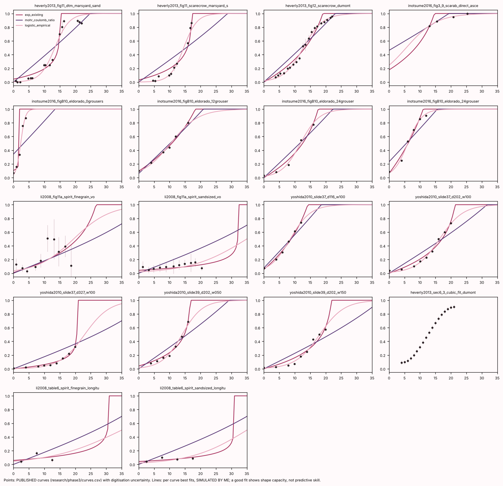
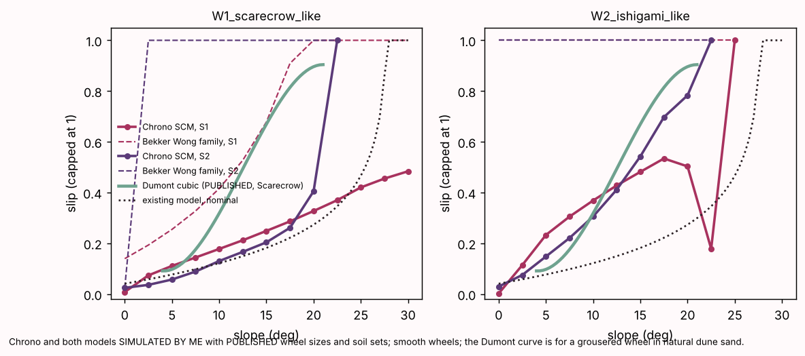
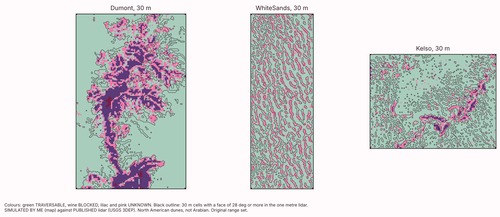
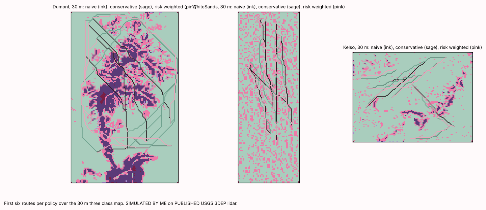
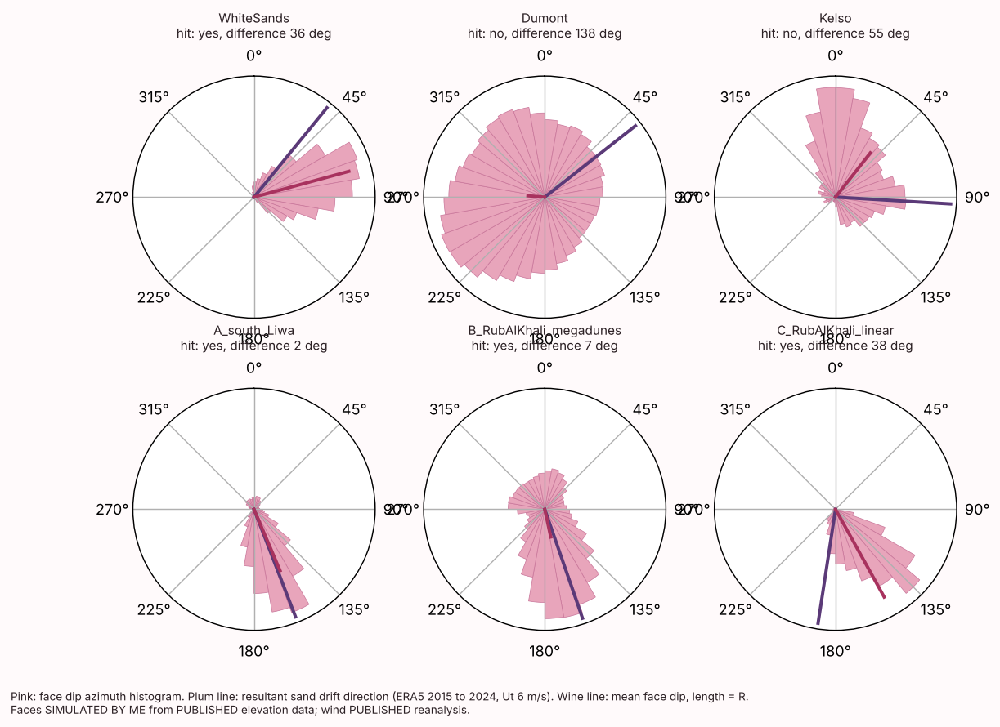
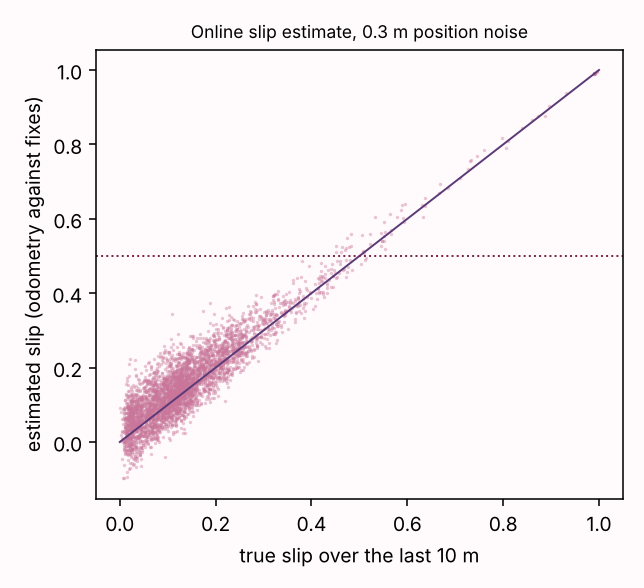

# How far can open data and textbook models predict wheeled rover slip on dune sand? An evidence synthesis, pre registered model validation, lidar and satellite laser tests, with an Arabian focus

**Huda Mueen** (independent researcher; repository `hudasol/dune-rover`)

Manuscript generated from the repository files by `scripts/build_manuscript.py` on 2026-10-21. Every number in the text is filled in from a result file or the evidence table; `scripts/check_manuscript_numbers.py` lists every number typed by hand and its justification. Labels: **PUBLISHED** (read in a retrieved source, with an evidence row id in brackets), **SIMULATED BY ME** (output of the repository's code, simulation only and model assumption dependent), **PLANNED** (not run). No field data of the author's own exist yet. No agreement, partnership or endorsement with any institution exists.

## Abstract

Small wheeled robots are being proposed for work on Gulf dune fields, yet no published slip against slope dataset exists for a wheeled robot on Arabian dune sand. This study asks how far open elevation data and textbook terramechanics can go without such data, registers every test before running it, and states every failure. A verified evidence table of 510 published results from 176 sources was built, each row re checked against its full text by an independent agent (7.5 % of the current rows had a material error before correction). Slip model families (SIMULATED BY ME) were calibrated and tested by leave one study out on digitised published slip against slope curves, first 17 curves from 4 studies and then, after a second round, 49 held out curves from 10 studies. No family met the pre registered bar (median held out error at most 0.15): errors were 0.20 to 0.22 slip for the three families run on every curve, an empirical curve did as well as the physics, the Bekker Wong family, the only one that uses wheel size and load, did worse on the expanded set (0.41), and two families built on the granular scaling laws did worse (0.31 to 0.34). Project Chrono (SIMULATED BY ME) with published soils predicted far less slip than the Dumont Dunes field curve (0.21 against about 0.49 at 12.5 degrees), and once calibrated on that curve up to 12.5 degrees it gave no usable prediction for steeper slopes (its slip fell as the slope steepened, and at 20 degrees a finer soil grid changed it from 0.24 to 0.53 while a lower wheel speed made the wheel slide backwards). Scored against one metre lidar of 6 North American dune fields, a slip face detector trained on synthetic dunes (SIMULATED BY ME) reached an AUC of 0.97 to 0.99 at 5 m but only 0.64 to 0.86 at 30 m, where a three class map labelled TRAVERSABLE 36 % to 80 % of the cells containing a steep face (7 % to 33 % at 10 m). Over Liwa and the Rub' al Khali, ICESat-2 laser profiles are consistent with steep ground that the 30 m map does not resolve: after a post hoc noise screen, 29 % to 52 % of the steep crossings fell in cells the map calls TRAVERSABLE (against more than 90 % of all segments), but an unknown share of the steep segments is noise, and the profile method with 10 m segments failed its own validation against lidar (20 m segments, which pass it on few steep segments, give similar shares). Route planning on 30 m maps was no safer than naive planning on three fields and only somewhat safer on three more, and in a closed loop simulation replanning on an online slip estimate had no effect on entrapment distinguishable from a control that stops and retries without replanning. The study concludes that a 10 m or finer surface and a measured slip curve for the actual vehicle are prerequisites for planning on dunes, and provides a pre registered field experiment, data sheets with a one command analysis, and a robotics project to obtain them.

## 1. Introduction

A wheeled ground vehicle climbing a dune slope loses traction as the slope rises. How much it slips, and at which slope it stops, depends on the vehicle, its wheels and the sand, and it decides whether a route is feasible. Dune fields cover large parts of the United Arab Emirates and the wider Arabian Peninsula (Liwa, the Rub' al Khali, the Wahiba Sands), and robots for survey, logistics and inspection there would need to plan routes over them. Two things are needed: a slip law that holds for the vehicle on that sand, and a terrain model fine enough to see the slopes that matter.

Neither exists in open form. The only published slip against slope curve on a natural Earth dune found in this study is for a 340 kg Mars rover test vehicle at Dumont Dunes, California, without soil parameters (FLD-HV13-1, FLD-HV13-2). The only Arabian wheeled robot field evidence is qualitative (FLD-042). Open elevation data for the region (Copernicus GLO 30, about 30 m posts) resolve dunes but not their slip faces.

This paper reports what can and cannot be said with open data and published models, with every prediction registered before its run and every miss reported. Its contributions are: (i) a verified, openly structured evidence table with an explicit error rate; (ii) a leave one study out validation of four slip model families on digitised published curves, repeated on an expanded set with two more families built on the granular scaling laws; (iii) an independent simulator cross check; (iv) the first test, to the author's knowledge, of a sub grid slip face detector and three class traversability map against real lidar dunes degraded to coarse resolution, on six fields; (v) a test of route planning policies against lidar truth; (vi) a test of whether ICESat-2 laser profiles can show Arabian slip faces, with the method's failed validation and the noise in its steep segments reported; (vii) a closed loop demonstration of online slip estimation and replanning, also as ROS 2 nodes; and (viii) a pre registered field experiment and analysis rule with a synthetic power study, data sheets and a one command analysis. It does not contribute field slip data, a validated slip model or an Arabian terrain validation; those are the gaps it measures.

## 2. Related work (from the evidence table)

**Terramechanics.** Bekker pressure sinkage and Janosi shear laws, assembled into rigid wheel models in the Wong and Reece tradition, describe drawbar pull and sinkage on level sand once fitted per soil; reported median drawbar errors are around a quarter of the measured value on two lunar simulant datasets but reach 135 % on a firm soil with a small light wheel (SIM-025 to SIM-027), and the Janosi shear modulus differs by about 75 times across the materials of one paper (TM-001 to TM-006, the largest value for poppy seeds) and is 0.07 m in the Toyoura sand model inputs of another (TM-IS09-2). Granular resistive force theory gives drawbar errors of a few newtons on medium sand (TM-001 to TM-004).

**Empirical vehicle mobility models.** The cone index based family (Waterways Experiment Station sand numerics and the NATO Reference Mobility Model) was built from military vehicle trials; its reported accuracy against field data is modest, for example a 30.1 % overall error in predicted traverse speed across several vehicles on mixed terrain (MOB-020), a 17.9 % drawbar pull error in coarse grained soils (MOB-021), and deviations of 73 and 109 % in the predicted maximum sand slope of two tracked vehicles (MOB-023).

**Field and planetary evidence.** Field slip on sand is large and patchy: Spirit measured 15 to 20 % slip at 19 degrees and 95 % at 16 degrees on look alike terrain 30 m apart (FLD-011, FLD-012); Perseverance exceeded 94 % at about 20 degrees (FLD-025); Curiosity's mission statistics and its Hidden Valley experience, Zhurong, Yutu 2 and Apollo rover data are in the PLN rows. Slip prediction from terrain properties on nine Curiosity sand sites had leave one site out errors of 20.4 to 30.3 percentage points, the larger for a slope only model (PLN-055, MAP-023).

**Terrain mapping.** Coarser elevation models lower the measured slope of steep terrain; satellite DEM errors grow on dune slopes (DUN rows). Risk aware planners improve success rates in simulation, but evidence on real dunes is thin (MAP rows).

**Other locomotion.** Published comparisons on sand favour tracks and wheel and crawler hybrids over plain wheels in some conditions (MOB-043, TM3-071), and small legged robots climb sand slopes slowly (LEG-007 to LEG-009); the rows differ in size, sand and metric and cannot be ranked (table below).

Wheeled, tracked and legged locomotion on sand (PUBLISHED rows only; vehicles, soils and metrics differ, so the rows are not comparable with each other).

| Row | Vehicle | Slope, deg | Metric | Value | Validation |
|---|---|---|---|---|---|
| MOB-043 | Military wheeled vehicles (and tracked for comparison) | 0 (level) | maximum drawbar pull on level sand as fraction of gross vehicle test weight (wh… | 20 and 40; 50 and 60 percent (ranges between) | field |
| TM3-067 | Four track platform rover with robotic arm, 120 kg, L153 x W154 x H11… | 0 (level) and 18 | steady state track slip on level ground and on an 18 deg sand slope | approximately 0.05 (level); approximately 0.3 (18 deg slope… | lab |
| TM3-071 | Model wheeled vehicle with independently driven front and back wheels… | 0 (level) | slip ratio of the wheeled vehicle without and with the intermediate crawler on… | 1 (wheels only, did not move); 0.065 (with crawler) ratio | lab |
| FLD-HV13-1 | Scarecrow (Mars weight MSL test rover, 340 kg, 50 cm diameter rigid g… | 4 to 21 (fit validity r… | Cubic fit coefficients c0; c1; c2; c3 (slip vs slope) | 26.197; -8.849; 1.281; -0.034 dimensionless polynomial coef… | field |
| FLD-025 | Perseverance (Mars 2020) | about 20 | slip | in excess of 94 % | field |
| LEG-007 | Hexapod with C-shaped legs (350 g, 22 cm x 10 cm; leg radius 4 cm, wi… | 0 | step-averaged speed parallel to surface | 15.7 cm/s | lab |
| LEG-008 | Same 350 g hexapod | 10 | step-averaged speed parallel to surface | 11.0 cm/s | lab |
| LEG-009 | Same 350 g hexapod | 24 | step-averaged speed parallel to surface | 5.6 cm/s | lab |
| LEG-013 | SpaceBok quadruped (22 kg), planar and point feet, static and trot | 25 | maximum slope traversed (testbed limit) | 25 deg | lab |

**Arabian sand and dunes.** Grain size, sorting and mineralogy of UAE, Qatari, Saudi and Omani dune sands are published (SND rows); a direct shear friction angle of 45 to 48 degrees was found for Dhahran dune sand in one thesis (SND-023), and no friction angle or slip face angle measured on UAE dunes was found. Drift potentials from Gulf stations exist (DUN rows).

## 3. Data and methods

### 3.1 Evidence table and verification

Rows were extracted by topic agents under a written brief (full text only, a live DOI or URL check, licence recorded, a comparability warning per row) and then re checked by fresh agents that saw only the claim fields and re opened the full text (`docs/SEARCH_PROTOCOL.md`). Corrections enter through a corrections file; unverifiable rows are dropped; the error rate is reported with Wilson intervals. A blinded random sample of 20 rows is prepared for a human rater with an agreement script (Cohen's kappa).

### 3.2 Published curves

Slip against slope curves were digitised reproducibly from figures (calibration files and marker coordinates committed, uncertainty from axis scale and marker spread) or copied from tables, 26 curves with 235 points from 7 sources in total (`docs/DATA_CATALOG.md`). Each carries the vehicle, wheel size, load, soil, preparation, test type and a judgement of comparability to loose dry dune sand. Unlike conditions are never pooled into one curve. A second round added 36 curves (164 points) from 7 further sources; a separate agent digitised a random third of them again from the same rasters with the same tools, which measures the repeatability of the reading. Not every curve enters the model validation: of the 26 first round curves, 18 are slip against slope (the others are level ground traction or sinkage curves, and one lateral slip curve), and of the 36 second round curves 35 were loaded (the Curiosity curve mixes longitudinal and lateral slip). Of these 53, the Dumont cubic fit duplicates the Dumont points and serves only as a target, and the three Scarab angle of attack curves are of a slope kind the families do not model, which leaves 49 held out curves from 10 studies (17 from 4 in the first round).

### 3.3 Model families and validation protocol

Four families share one interface: (a) the repository's quasi static model, slip = minus i0 ln(1 minus demand over capacity), with the friction circle demand; (b) a rigid wheel Bekker, Wong and Reece stress model in the form of Ishigami et al. 2007, which needs wheel radius, width and load; (c) a Mohr Coulomb demand ratio; (d) a two parameter logistic curve with no physics. Calibration uses a Gaussian likelihood with per point variance equal to the digitisation variance plus a fitted model variance, uniform priors, affine invariant MCMC for (a), (c) and (d) and maximum a posteriori with a bootstrap for (b). Validation is leave one study out: a family is calibrated on all other studies and predicts the held out study. The bar, fixed before the run, is a median held out root mean square error of at most 0.15 and at least 80 % of held out points inside the 90 % predictive interval. The validation was repeated unchanged on the expanded curve set for all four families, and two further families were built on the strength to load number of the granular scaling laws (density times gravity times wheel width times radius squared over load; Slonaker et al. 2017, Hu et al. 2025): (e) a drawbar equivalent exponential pull curve whose limit and resistance depend on that number, and (f) a logistic curve in the tangent of the slope whose midpoint depends on it. Because the Inotsume 2016 and Creager 2017 curves come from the same vehicle and tilt bed, the folds were also regrouped by test campaign as a post hoc check; the Yoshida 2010, Nakashima 2010 and Sutoh 2012 curves come from one laboratory's sand slope work and may share a rig and soil preparation, so a second post hoc check also held them out together.

### 3.4 Independent simulation

A single rigid smooth wheel with published dimensions (a Scarecrow like wheel, radius 0.25 m, width 0.40 m, 556 N; and the Ishigami test bed wheel, radius 0.055 m, width 0.064 m, 29.8 N) was driven at constant angular speed on Project Chrono's Soil Contact Model with gravity tilted to emulate the slope, for two published soil parameter sets (a lunar simulant set of Ishigami et al. 2007 and a discrete element calibrated set of Zhang et al. 2024, SIM-005), slopes 0 to 30 degrees. Grid and speed checks were run. In a second test the Janosi shear modulus and the friction angle were calibrated on a grid against the Dumont curve up to 12.5 degrees, and the calibrated model was asked to predict 15 to 20 degrees; the grid and speed checks were repeated at those slopes after a review (post hoc).

### 3.5 Traversability map

On Copernicus GLO 30, each cell's eight headings are passable or not under the slip model for each of 256 Latin hypercube parameter draws; the share of draws in which at least four headings pass gives TRAVERSABLE, BLOCKED or UNKNOWN, and a logistic sub grid detector trained on synthetic dunes gives the probability that an unresolved slip face of 28 degrees or more lies inside the cell. Global sensitivity of the passable share to the four parameters is estimated with Sobol indices.

### 3.6 Lidar terrain validation, wind and planning

USGS 3DEP one metre bare earth DEMs of Dumont Dunes (the field site of the Dumont curve), White Sands and Kelso Dunes were block averaged to 5, 10 and 30 m. Truth for a coarse cell is at least 10 square metres of one metre slope at 28 degrees or more. Slip face dip directions were compared with the resultant sand drift direction from ERA5 hourly wind (2015 to 2024). Three planning policies (naive, conservative over TRAVERSABLE cells only, risk weighted by face probability) were run between 40 origin and destination pairs per site and scored by resampling each route on the lidar surface. The test was repeated unchanged on three further fields (Great Sand Dunes, Algodones and Little Sahara), with windows chosen from 20 m slope images before any metric.

### 3.7 Satellite laser profiles over Arabian dunes

ICESat-2 photon heights were turned into 10 m segments (5 m step) by the public SlideRule Earth service. The along track slope of each segment was first compared with the one metre lidar on the same line at White Sands and Kelso, on passes near the lidar dates, against a bar fixed in advance (a correlation, a median absolute difference and, on steep lidar slopes, a median ratio; `docs/PREDICTIONS.md`, stage 19). Over the three Arabian windows, segments at 28 degrees or more were taken as slip face crossings, assigned the class of the 30 m map cell they fall in, and compared with the Copernicus slope along the same track. An along track slope is an apparent slope; a correction with the mean face dip direction from the 30 m surface (section 4.6) is reported beside the raw value. Post hoc, the share of all segments in each class was reported as a base rate, steep segments with no steep neighbour on the same pass were screened out as likely noise, and at Kelso the slope of steep ICESat-2 segments was compared with the one metre lidar and with the lidar averaged to 30 m on the same line.

### 3.8 Closed loop demonstration

A simulated rover drove the planned routes over the lidar surface, with its true slip given by the exponential model at the posterior medians plus a scatter, estimated its slip from wheel odometry against noisy position fixes, and replanned when the estimate passed a threshold (values in `demo/closed_loop.py`). After two reviews the comparison was repeated with the slip field fixed in space, a control that stops and retries without blocking any cell, and several independent slip fields (post hoc). The loop also runs as ROS 2 nodes.

### 3.9 Field experiment and analysis rule (PLANNED)

A slope ladder with one small four wheel rover on one dune stoss slope, calibration on runs up to 10 degrees, predictions committed before steeper runs, and a pass or fail rule whose power was studied on synthetic data. Data sheets, a one command analysis, a preregistration draft and protocols for a drone survey and sand tests are prepared.

## 4. Results

### 4.1 Evidence base

The table now holds 510 rows from 176 sources (166 lab, 133 field, 113 none, 40 simulation only, 35 simulation against laboratory, 23 simulation against field). Of the 323 rows added and merged in this round, 30 had a material error before correction (9.3 %, Wilson 95 % interval 6.6 to 12.9 %) and 25.4 % had any discrepancy; most material errors were a wrong validation type, not a wrong value. Across the whole current table, by each row's latest verdict, 38 of 510 rows carried a material error before correction (7.5 %); every material error is corrected.

### 4.2 No slip model family transfers between studies (SIMULATED BY ME against PUBLISHED curves)

Table 1. Model families on the published slip against slope curves (SIMULATED BY ME against PUBLISHED curves). Bar fixed before the run: median held out error at most 0.15 and coverage at least 0.80.

| Family | Held out curves | Median error, nominal | Median error, own fit | Median error, held out | 90 % interval coverage | Bar |
|---|---|---|---|---|---|---|
| Exponential (existing model) | 17 | 0.31 | 0.06 | 0.24 | 0.89 | fails |
| Bekker Wong rigid wheel | 8 | 0.26 | 0.08 | 0.20 | 0.71 | fails |
| Mohr Coulomb ratio | 17 | 0.24 | 0.10 | 0.23 | 0.85 | fails |
| Logistic, empirical | 17 | 0.19 | 0.03 | 0.24 | 0.86 | fails |

Fitted to one curve at a time, every family can match its shape (median error 0.03 for the logistic, 0.06 for the exponential model). Asked to predict a study it was not calibrated on, none can: held out errors are around 0.2 to 0.3 slip, the predictive intervals are wide enough to cover most points only because the fitted model error is about 0.26, and the empirical logistic curve does as well as the two lumped physics models. The Bekker Wong family, the only one that uses wheel size and load, came closest (0.20 on its 8 curves, against 0.23 for the logistic on the same curves): calibrated on the Inotsume curves (the El Dorado wheels and the Scarab rover) it predicted the Heverly curves with held out errors of 0.08 to 0.15, but calibrated on Heverly it predicted the Inotsume curves with errors of 0.20 to 0.56, and its intervals were too narrow. With its nominal parameters the repository's model misses the Dumont curve by 0.42 (root mean square). The Bekker Wong family with the published simulant set of Ishigami et al. 2007 does not even reproduce that paper's own drawbar pull curve (negative pull up to 0.6 slip against 1 to 25 N measured; `results/model_validation/bw_vs_ishigami2007.csv`), because the published parameters belong to an implementation with details not reproduced here.

The posterior of the exponential family over the 12 curves judged comparable to dune sand gives phi 36.93 (30.57 to 43.74) degrees, f_r 0.13 (0.03 to 0.32) and i0 0.63 (0.33 to 1.21) (median, 5 to 95 %). Used as the map's parameter ranges, it raises UNKNOWN at 30 m to 62.8 % in Liwa (A), 44.3 % in the Rub' al Khali megadunes (B) and 46.0 % in linear dunes (C), against 8.6 %, 10.9 % and 2.5 % under the original assumed ranges. About 5 % of the posterior draws cannot move on level ground; rejecting them (a post hoc choice) gives 25.1 %, 30.9 % and 4.2 %, so the Arabian UNKNOWN share itself depends strongly on that choice (by a factor of 1.4 in B and of more than ten in C).

With the second round of curves (49 held out curves from 10 studies), the verdict did not change: median held out errors were 0.22 (exponential), 0.20 (Mohr Coulomb) and 0.21 (logistic), with coverage 0.84 to 0.86; holding out the two Scarab campaigns together (post hoc) gave 0.20 to 0.22, and also holding out the three Toyoura sand studies of one laboratory together gave 0.20 to 0.22. On the 33 held out curves with wheel size, width and load, the Bekker Wong family did much worse than in the first round: median held out error 0.41 with coverage 0.46, against 0.22 for the logistic family on the same curves. The two families built on the strength to load number of the granular scaling laws did worse than the logistic curve without covariates (0.31 to 0.34 against 0.22 on the same curves). A post hoc look at the one study that varies only wheel width (Watanabe et al. 2026) shows why: on the lunar simulant the wider wheels slipped more, the opposite of what a larger number implies. The scaling laws are similarity laws for geometrically similar wheels in one material, as their authors state (SCL rows); they do not carry a slip curve across vehicles and sands.

### 4.3 An independent simulator does not rescue the models (SIMULATED BY ME)

With published soil sets and smooth wheels, Chrono's Soil Contact Model gives slip 0.21 at 12.5 degrees and 0.48 at 30 degrees for the Scarecrow sized wheel on the simulant set, against about 0.49 and embedding above 21 degrees on the Dumont field curve (root mean square difference 0.35). Grid halving and a fourfold lower speed changed slip by at most 0.02. The repository's Bekker Wong family, given the same wheels and soil sets, differs from Chrono by 0.44 to 0.75 (root mean square). Both rest on the same Bekker and Janosi laws, so the gap is a measure of implementation and model form uncertainty, not of physics. Calibrated on the Dumont curve up to 12.5 degrees (best shear modulus 0.08 m, friction angle 32 degrees, error 0.08), the simulator then predicted slip of 0.48, 0.44 and 0.24 at 15, 17.5 and 20 degrees against 0.67, 0.81 and 0.90 on the field curve (error 0.45). The slip of the calibrated run falls as the slope steepens, and other grid points gave slip above 1; repeated post hoc at 15 to 20 degrees, the grid and speed checks that changed the stage 14 results by at most 0.02 changed these by much more: at 17.5 degrees a fourfold lower wheel speed gave 0.18 against 0.44, and at 20 degrees a finer grid gave 0.53 against 0.24 while the lower speed made the wheel slide backwards (slip 31.30). The calibrated run was therefore speed sensitive at 15 degrees and not numerically stable at 17.5 and 20 degrees, so no usable prediction of the steep slopes was obtained; it is not evidence about the physics either way. At the calibration slopes (5 to 12.5 degrees) the same checks changed the slip by at most 0.03, so the calibrated fit itself is numerically stable (post hoc).

### 4.4 The slip face detector works much better at 10 m than at 30 m (SIMULATED BY ME on PUBLISHED lidar)

Table 2. Slip face detector and three class map against one metre lidar truth (SIMULATED BY ME on PUBLISHED USGS 3DEP data; North American dune fields).

| Site | Posting, m | AUC | True face rate | Mean predicted probability | TRAVERSABLE share | Share of TRAVERSABLE cells with a face | Share of UNKNOWN cells with a face | Miss rate (face cells called TRAVERSABLE) |
|---|---|---|---|---|---|---|---|---|
| Dumont | 5 | 0.98 | 23.0 % | 35.5 % | 59.3 % | 0.2 % | 51.4 % | 0 % |
| Dumont | 10 | 0.97 | 32.0 % | 29.9 % | 62.0 % | 3.6 % | 77.1 % | 7 % |
| Dumont | 30 | 0.86 | 48.0 % | 23.1 % | 67.8 % | 25.6 % | 95.1 % | 36 % |
| WhiteSands | 5 | 0.98 | 5.0 % | 10.2 % | 87.3 % | 0.1 % | 38.4 % | 3 % |
| WhiteSands | 10 | 0.97 | 10.8 % | 9.9 % | 86.0 % | 2.5 % | 61.6 % | 20 % |
| WhiteSands | 30 | 0.66 | 35.7 % | 14.6 % | 75.9 % | 28.6 % | 58.0 % | 61 % |
| Kelso | 5 | 0.98 | 5.5 % | 15.7 % | 79.1 % | 0.1 % | 26.4 % | 1 % |
| Kelso | 10 | 0.95 | 10.7 % | 13.0 % | 80.8 % | 1.8 % | 48.4 % | 13 % |
| Kelso | 30 | 0.70 | 34.0 % | 8.6 % | 88.4 % | 28.0 % | 79.5 % | 73 % |

At 5 and 10 m the detector, trained only on synthetic dunes, ranks real lidar faces well and the map's TRAVERSABLE class is nearly free of steep faces. At 30 m it underestimates how many cells contain a face: about one TRAVERSABLE cell in four contains at least 10 square metres steeper than 28 degrees, and 36 % to 73 % of the cells that contain such a face are called TRAVERSABLE. At 10 m that share is still 7 % to 20 %, so even a 10 m map leaves some faces unflagged. The steepest one metre slope inside a 30 m face cell exceeds the cell's own slope by a median of 29.0 degrees at White Sands, 27.6 at Dumont and 21.8 at Kelso. At Dumont the median steepest slope in face cells is 45.0 degrees, steeper than loose sand stands, so the truth there includes rock or lidar artefacts; at White Sands it is 32.6 degrees, matching published slip face angles. On three further fields the pattern held: across all 6 fields the detector's AUC was 0.97 to 0.99 at 5 m and 0.64 to 0.86 at 30 m, and the 30 m map labelled TRAVERSABLE 36 % to 80 % of the cells that contain a face (7 % to 33 % at 10 m). Great Sand Dunes, with the largest dunes, had the lowest 30 m false safe rate, against the registered expectation.

### 4.5 Planning on a 30 m map is at best slightly safer than naive planning (SIMULATED BY ME)

Under the registered event rule (any 3 m uphill grade above the nominal climbing limit of 25.5 degrees), 70.0 % of naive and 72.5 % of conservative routes at Dumont met such a grade at 30 m; the conservative policy cut face contacts per kilometre from 125 to 38 but doubled route length, and at White Sands and Kelso it did no better than naive. At 10 m, compared on matched pairs (only the pairs the conservative policy could route; a post hoc comparison), the conservative policy failed less often than naive at White Sands (61.1 % against 66.7 %) and Kelso (36.1 % against 63.9 %), and with a 10 m grade baseline (13.9 % against 25.0 %; 2.8 % against 11.1 %); at Dumont it could route only 15 of 40 pairs and was not safer on them. On the three further fields (registered unchanged), the conservative policy was safer than naive at 30 m at two sites, against the registered expectation: 85.0 % against 92.5 % of routed pairs failing on lidar truth at Great Sand Dunes and 57.5 % against 72.5 % at Little Sahara, and 40.0 % against 45.0 % at Algodones; most routes still failed at two of the three. Most failures at every resolution come from metre scale steep features that no map at these postings resolves.

### 4.6 Slip faces and wind (faces SIMULATED BY ME from PUBLISHED elevation; wind PUBLISHED reanalysis)

Slip face dip directions matched the resultant drift direction within 45 degrees at 4 of 6 sites (White Sands 36 degrees, Dumont 138, Kelso 55, Liwa 2, Rub' al Khali megadunes 7, linear dunes 38). With six sites this is a check of the method, not a test.

### 4.7 Sensitivity of the map (SIMULATED BY ME)

Under the original ranges the passable share hardly varies; its total Sobol indices are 0.55 for i0 and 0.45 for phi. Under the widened slip scale range i0 has the largest total index (0.67, with f_r at 0.48 and overlapping intervals), and first order indices sum to well below one: the parameters act through interactions. Rejecting parameter draws that cannot move on level ground removes the extreme UNKNOWN shares seen earlier (92.6 % in A falls to 33.3 %).

### 4.8 The planned field rule cannot separate a correct model from a collapse model (SIMULATED BY ME, synthetic data)

On synthetic data with the revised slope bins, the current rule accepts a correct model in 76 % of replicates and a model that collapses above 20 degrees in 53 %. Of three alternative rules, the two that reject the collapse model at least 80 % of the time (B and C) also reject the correct model more than half the time (accepting it in 39 % and 44 %); the third (A) rejects the collapse model in only 70 % of replicates. More runs in the steep bins are needed; the choice is left to the experimenter before any field day.

### 4.9 Arabian dunes from satellite laser profiles (PUBLISHED ICESat-2 data, SIMULATED BY ME scoring; method not validated)

Against lidar, the ICESat-2 segment slopes correlated at r = 0.81 at Kelso with a median absolute difference of 3.3 degrees, and only at r = 0.48 over the mostly flat White Sands tile; the method failed the bar fixed in advance at both sites, and the Kelso check rests on 3 beam passes. The steepest ICESat-2 segments overstate the slope: at Kelso the steepest segment was 45.9 degrees where the lidar on the same lines reached 30.6, and on the 45 segments at 28 degrees or more (2 passes) the median slope was 32.8 degrees from ICESat-2 against 24.0 from the one metre lidar and 20.5 from the lidar averaged to 30 m on the same line (post hoc). Over the three Arabian windows, 14217 (Liwa), 24231 (megadunes) and 1271 (linear dunes) segments were steeper than 28 degrees, and the original 30 m map had placed 71 %, 47 % and 67 % of them in TRAVERSABLE cells, against 93 %, 92 % and 98 % of all segments. About half or more of the steep segments (53 %, 58 % and 80 %) had no steep neighbour on the same pass although neighbouring segments overlap by half; keeping only crossings with a steep neighbour and no steeper than 35 degrees (post hoc), the map placed 52 %, 29 % and 49 % of them in TRAVERSABLE cells, 0.56, 0.31 and 0.51 times the base rate. On the steep crossings the Copernicus 30 m slope along the same track was lower by a median of 18.5 to 27.8 degrees. At Kelso most of the analogous gap came from selecting overstated segments, but with 20 m segments the Liwa gap is still 26.9 degrees, so its cause in Arabia is not established. With 20 m segments, which pass the lidar bar (the steep segment part of the bar rests on 1 lidar segment at White Sands and 49 at Kelso), the original map placed 65 %, 27 % and 51 % of the steep segments in TRAVERSABLE cells (registered sensitivity). The steepest slope per run of steep segments in Liwa had a median of 26.7 degrees raw, below the published range of angles of repose, and 30.1 corrected for the angle between track and face (28.0 to 42.7 when the weakly estimated face direction is moved by 30 degrees). These numbers are consistent with steep ground the 30 m map does not resolve, but with a method that failed its own validation and a noisy steep set they are indications only.

### 4.10 Closed loop demonstration (SIMULATED BY ME; the true rover is a model)

An online slip estimate from wheel odometry against position fixes with 0.3 m noise had a median error of 0.029 to 0.032, a value that follows almost directly from the assumed noise. The registered loop appeared to cut entrapment on 30 m routes sharply (55.0 % to 12.5 % at White Sands), but a review showed that this came from restarting with fresh random slip. With the slip field fixed in space and a control that stops and retries without blocking any cell (post hoc), one slip field gave on 30 m naive routes 55.0 % open loop, 50.0 % retry and 42.5 % replan at White Sands, and 57.5 %, 55.0 % and 50.0 % at Kelso. Repeated over 5 independent slip fields (post hoc, after a second review), replanning changed the entrapped share against retry by minus 6.0 points at White Sands (95 % interval minus 20.5 to plus 8.0) and plus 2.0 at Kelso (minus 12.5 to plus 16.0) on 30 m maps, and by minus 10.0 and plus 5.0 on 10 m maps; every one of these intervals includes zero. Against open loop, replanning raised entrapment on 10 m maps at Kelso (15.0 % to 30.5 %; interval of the difference plus 5.5 to plus 26.5 points). The retry control is itself not neutral, because a restart joins the route by a straight line from the rover's position, so path geometry is a confound. The same loop runs as ROS 2 nodes (one smoke test). Under these assumptions, slip feedback with replanning shows no benefit that can be told apart from stopping and retrying, and it is no substitute for a fine map.

## 5. Discussion

The results agree on one point from three directions: the uncertainty that matters for planning on dunes is not in the parameters of a chosen slip law but in which law, which implementation and which terrain resolution. Calibrating a slip model on other vehicles' curves gives held out errors of 0.2 slip or more whatever the family; two implementations of the same textbook laws disagree by more than the field scatter; and a 30 m map labels 36 % to 80 % of the cells that contain a steep face as TRAVERSABLE on six North American fields; satellite laser profiles over Arabian dunes are consistent with this but cannot confirm it. A small robot on a Gulf dune therefore needs, at minimum, (i) a slip curve measured for that vehicle on that sand, which the slope ladder provides, and (ii) a 10 m or finer surface of the operating area, from a drone survey or lidar, before a map based planner is trusted; onboard sensing remains necessary for metre scale features no map resolves.

These conclusions transfer to Arabian dunes only as indications. The lidar sites are North American, the Arabian test rests on a satellite method that failed its own validation, the field curves come from other vehicles and soils (and some from Mars), and Arabian dune sand has published grain size and mineralogy but, in the sources found, no UAE friction angle or measured slip face angle.

## 6. Threats to validity

- **Agent extraction and verification.** Both were done by language model agents; verifiers re opened the sources but may share blind spots with extractors, for example on values read from figures. A human spot check is prepared but not yet done.
- **Digitisation.** Figure points carry reading error and, for scatter plots, pooled run spread; two markers were lost in one figure and merged in another (`research/phase3/curves_notes.md`).
- **Selection of curves.** Only 4 studies supplied curves in the first round and 10 after the second; leave one study out with so few groups gives a coarse estimate, and two publications share one test campaign (handled by a post hoc regrouping).
- **Repeatability is not independence.** The second reading of the curves used the same rasters and tools, so it measures repeatability of the reading, not independent extraction.
- **Truth definitions.** The lidar truth counts any surface steeper than 28 degrees, including rock and artefacts; the planner's event rule depends on its baseline, which was varied post hoc.
- **Reanalysis wind.** ERA5 grid cells are tens of kilometres wide; local winds that shape dunes may differ.
- **Simulator settings.** Chrono's elastic stiffness and damping are example defaults, and the wheels are smooth.
- **Satellite laser profiles.** ICESat-2 segment slopes average over a footprint of about 11 m and carry a geolocation error of a few metres; only high confidence photons were used, which may thin the data on steep faces; Copernicus and ICESat-2 were acquired years apart, so small dunes may have moved.
- **Closed loop.** The true rover in the demonstration is itself a slip model with assumed scatter, and the first registered loop overstated the benefit of replanning (corrected post hoc after a review).
- **Grouping of studies.** Leave one study out treats publications as independent; the two Scarab campaigns and three Toyoura sand studies from one laboratory were regrouped post hoc without changing the verdict, but other shared practices between groups cannot be ruled out.
- **Hand typed numbers.** Numbers typed in the text (not filled from result files) are listed with a justification by token; the list is checked by script but a token's justification may not fit every place it occurs.
- **Pre registration.** Some predictions were informed by quick checks, disclosed in each stage; post hoc analyses are labelled.

## 7. Limitations

No field data of the author's own; Arabian terrain tested only through satellite laser profiles, with a method that did not pass its own validation bar; terrain resolution tested on six North American fields; the Bekker Wong family is calibrated with a coarse optimiser; the cone index family was not implemented because the needed vehicle cone index relations for sand were not retrieved in usable form; legged and tracked vehicles appear only through published rows.

## 8. Reproducibility

All code, digitisation calibrations, result tables and figures are in the repository; raw downloads (PDFs, lidar tiles, wind series, ICESat-2 segments) are not redistributed but are listed with their identifiers, licences and checksums (`docs/DATA_AND_LICENSES.md`). Every number in this manuscript is traced to its producing script and the SHA-256 of its input files in `docs/NUMBER_LEDGER.csv`, and `docs/PROVENANCE.md` maps sources to scripts, results and documents. Seeds are fixed and recorded in each result. The continuous integration checks rebuild the generated files and fail if they differ from the committed ones. The repository is public for reading; reuse requires the author's permission.

## 9. What this work is and is not

It is a verified map of the evidence, an honest validation of the available models with their failures, a resolution test of open terrain data against lidar, and a ready field protocol. It is not a validated slip model, not a traversability product, not field evidence from Arabia and not an endorsement by any institution.

## References

1. Agarwal S., Karsai A., Goldman D.I., Kamrin K. (2021). Surprising simplicity in the modeling of dynamic granular intrusion. Science Advances 7(17), eabe0631. https://doi.org/10.1126/sciadv.abe0631 (digitised curves or scaling law notes)
2. AMADEE-18 Mission Report V1.2 public version (Austrian Space Forum, Oman Dhofar Mars analog, Feb 2018) https://oewf.org/en/download/14445/ (rows FLD-042)
3. Analysis of Angle of Attack for Efficient Slope Ascent by Rovers (H. Inotsume, Master's thesis, 2016) https://publications.ri.cmu.edu/storage/publications/pub_files/2016/8/MSThesis_Hiroaki.pdf (digitised curves or scaling law notes)
4. Arvidson R. E. et al. (2014). Terrain physical properties derived from orbital data and the first 360 sols of Mars Science Laboratory Curiosity rover observations in Gale Crater. JGR Planets 119. https://doi.org/10.1002/2013JE004605 (digitised curves or scaling law notes)
5. Assessment of density and shear strength of Eastern Saudi sands using dynamic cone penetration test (DCPT) (A. M. Hamid, MSc thesis, November 2013) https://eprints.kfupm.edu.sa/id/eprint/139150/1/ASSESSMENT_OF_DENSITY_AND_SHEAR_STRENGTH_OF_EASTERN_SAUDI_SANDS_USING_DYNAMIC_CONE_PENETRATION_TESTING_%28DCPT%29.pdf (rows SND-023)
6. Caruso M., Giberna M., Gorner M., Gallina P., Seriani S. (2023). The Archimede Rover: A Comparison between Simulations and Experiments. Robotics 12(5), 125. https://doi.org/10.3390/robotics12050125 (digitised curves or scaling law notes)
7. Characterization of traverse slippage experienced by Spirit rover on Husband Hill at Gusev crater (Li et al.; JGR Planets 113, E12S35, 2008) https://doi.org/10.1029/2008JE003097 (digitised curves or scaling law notes)
8. Creager C. M., Jones L., Smith L. M. (2017). Effect of Angle of Attack on Slope Climbing Performance. NASA/TM 2017-219549. https://ntrs.nasa.gov/citations/20180000349 (digitised curves or scaling law notes)
9. Daca A., Skonieczny K. (2022). Evaluating 1-G testing methods for predicting planetary rover mobility in reduced gravity. 16th Symposium on Advanced Space Technologies in Robotics and Automation (ASTRA 2022), Noordwijk. https://robotics.estec.esa.int/ASTRA/Astra2022/24_Skonieczny-Krzysztof-24-109-Skonieczny-Krzysztof.pdf (digitised curves or scaling law notes)
10. Development and Evaluation of Mobility and Excavation Rover Toward Lunar Base Construction (Sutoh; Journal of Robotics and Mechatronics 2024, 36(2):334 to 342) https://doi.org/10.20965/jrm.2024.p0334 (rows TM3-067)
11. Failure Mechanisms and Risk Estimation for Legged Robot Locomotion on Granular Slopes https://arxiv.org/abs/2603.06928 (rows LEG-007, LEG-008, LEG-009)
12. Freitag D.R., Green A.J., Melzer K.J. (1970). Performance Evaluation of Wheels for Lunar Vehicles. Technical Report M-70-2, U.S. Army Engineer Waterways Experiment Station, Vicksburg. NTRS 19700020218. https://ntrs.nasa.gov/citations/19700020218 (digitised curves or scaling law notes)
13. Grouser wheel high-speed traction performance: DEM simulation and experimental result (Takehana et al.; Journal of Terramechanics 120, 2025, 101084) https://doi.org/10.1016/j.jterra.2025.101084 (digitised curves or scaling law notes)
14. Hu, W., Li, P., Rogg, A., Schepelmann, A., Chandler, S., Kamrin, K., Negrut, D. (2025). A study demonstrating that using gravitational offset to prepare extraterrestrial mobility missions is misleading. Journal of Field Robotics (author manuscript in NASA NTRS 20250001809). https://ntrs.nasa.gov/citations/20250001809 (digitised curves or scaling law notes)
15. Improving Slip Prediction on Mars Using Thermal Inertia Measurements (Cunningham, Nesnas, Whittaker; Robotics: Science and Systems XIII, 2017) https://roboticsproceedings.org/rss13/p38.pdf (rows MAP-023, PLN-055)
16. Knight S.J. and co author (1962). A Technique for Estimating the Slope-Climbing Ability of Wheeled Vehicles in Sand. WES Miscellaneous Paper 4-535. DTIC AD0744214. https://apps.dtic.mil/sti/pdfs/AD0744214.pdf (digitised curves or scaling law notes)
17. Mars Exploration Rover Surface Operations: Driving Spirit at Gusev Crater (Leger et al., 2005) https://www-robotics.jpl.nasa.gov/media/documents/leger_driving05.pdf (rows FLD-011, FLD-012)
18. McBryan T. (2022). Validating Granular Scaling Laws for Wheel/Screw Geometries. MSc thesis. https://keep.lib.asu.edu/system/files/c7/Mcbryan_asu_0010N_21996.pdf (digitised curves or scaling law notes)
19. Modeling of the interaction of rigid wheels with dry granular media (Agarwal et al., J. Terramechanics 2019 / arXiv 2019) https://arxiv.org/abs/1901.10667 (rows TM-001, TM-004, TM-006)
20. Nakashima, H., Fujii, H., Oida, A., Momozu, M., Kanamori, H., Aoki, S., Yokoyama, T., Shimizu, H., Miyasaka, J., Ohdoi, K. (2010). Discrete element method analysis of single wheel performance for a small lunar rover on sloped terrain. Journal of Terramechanics 47(5), 307 to 321. https://doi.org/10.1016/j.jterra.2010.04.001 (digitised curves or scaling law notes)
21. Omura T., Ishigami G. (2024). Granular Scaling Laws for Accurate Prediction of Wheel Mobility on Slopes in Low-Gravity Environments. Proceedings of the 21st International and 12th Asia-Pacific Regional Conference of the ISTVS, Yokohama, paper 9295 (EasyChair preprint 14770). https://doi.org/10.56884/dm46x2u9 (digitised curves or scaling law notes)
22. Performance of Wheel-Typed Vehicle with Crawlers in Between Front and Rear Wheels on Soft Ground (Eto, Satomi, Takahashi; Journal of Robotics and Mechatronics 2014, 26(2):261) https://doi.org/10.20965/jrm.2014.p0261 (rows TM3-071)
23. RoverDevKit: An open, physics-grounded tradespace toolkit for conceptual design of lunar micro-rovers (Reifschneider 2026) https://arxiv.org/abs/2606.21755 (rows SIM-025, SIM-027)
24. Roving on the Edge: Robotic Operations Power Perseverance's Ascent of Jezero Crater Rim (Maimone et al., AAS 08-138) https://robotics.jpl.nasa.gov/media/documents/2026_RO_AAS_final.pdf (rows FLD-025)
25. Slonaker J., Motley D.C., Zhang Q., Townsend S., Senatore C., Iagnemma K., Kamrin K. (2017). General scaling relations for locomotion in granular media. Physical Review E 95, 052901. https://doi.org/10.1103/PhysRevE.95.052901 (digitised curves or scaling law notes)
26. Slope traversal controls for planetary exploration rover on sandy terrain (Ishigami, Nagatani, Yoshida, J. Field Robotics 26(3) 264-286, 2009) https://doi.org/10.1002/rob.20277 (rows TM-IS09-2)
27. Sutoh M., Nagatani K., Yoshida K. (2012). Traveling performance evaluation of wheeled rover climbing various soil slopes. Proceedings of the JSME Conference on Robotics and Mechatronics (Robomec) 2012, 1A2-L06 (in Japanese). https://doi.org/10.1299/jsmermd.2012._1A2-L06_1 (digitised curves or scaling law notes)
28. Terramechanics-based model for steering maneuver of planetary exploration rovers on loose soil (Ishigami et al.; Journal of Field Robotics 24(3), 2007) https://doi.org/10.1002/rob.20187 (digitised curves or scaling law notes)
29. Thoesen A., McBryan T., Marvi H. (2019). Helically-driven granular mobility and gravity-variant scaling relations. RSC Advances 9(22), 12572 to 12579. https://doi.org/10.1039/c9ra00399a (digitised curves or scaling law notes)
30. Traction Performance Evaluation for a Rashid-1 Rover Wheel (Hurrell et al.; Space Science Reviews 221:37, 2025) https://doi.org/10.1007/s11214-025-01164-8 (digitised curves or scaling law notes)
31. Traction Performance of Wheel and Track for Soft-Soil Traversal (K. Yoshida, slides, ICRA 2010 Workshop on Planetary Rovers) https://ewh.ieee.org/conf/icra/2010/workshops/PlanetaryRovers/05-Yoshida-Traction/Yoshida-Traction.pdf (digitised curves or scaling law notes)
32. Trafficability of Soils: Tests on Coarse-Grained Soils with Self-Propelled and Towed Vehicles, 1958-1961, Technical Memorandum 3-240, Seventeenth Supplement (Rush; Waterways Experiment Station, May 1963) https://apps.dtic.mil/sti/pdfs/AD0409691.pdf (rows MOB-043)
33. Traverse Performance Characterization for the Mars Science Laboratory Rover (Heverly et al. 2013, J. Field Robotics 30(6), 835-846) https://doi.org/10.1002/rob.21481 (rows FLD-HV13-1, FLD-HV13-2)
34. Traversing Steep and Granular Martian Analog Slopes With a Dynamic Quadrupedal Robot https://arxiv.org/abs/2106.01974 (rows LEG-013)
35. Using high-fidelity discrete element simulation to calibrate an expeditious terramechanics model in a multibody dynamics framework (Zhang et al. 2024) https://arxiv.org/abs/2407.18903 (rows SIM-005)
36. Validation of the AMC-71 Mobility Model, Technical Report M-76-5 (Schreiner, Willoughby; Waterways Experiment Station, March 1976) https://apps.dtic.mil/sti/pdfs/ADA023609.pdf (rows MOB-020, MOB-021, MOB-023)
37. Watanabe, Maru, Kawaguchi, Tanaka (2026). Effects of wheel width on running performance of four-wheeled small lunar rover. Transactions of the JSME (in Japanese) 92(956). https://doi.org/10.1299/transjsme.25-00224 (digitised curves or scaling law notes)
38. U.S. Geological Survey, 3D Elevation Program one metre DEM tiles USGS_1M_11_x56y395_CA_FEMAR9Southeast_D24, USGS_1M_13_x37y364_NM_WhiteSandsNM_2020_D20, USGS_1M_11_x61y387_CA_FEMAR9Southeast_D24 (public domain), https://www.usgs.gov/3d-elevation-program, retrieved 2026-10-20.
39. European Space Agency and Airbus, Copernicus DEM GLO-30, https://spacedata.copernicus.eu/collections/copernicus-digital-elevation-model, retrieved 2026-10-11 and 2026-10-15 (licence in docs/DATA_AND_LICENSES.md).
40. ECMWF, ERA5 hourly reanalysis (Copernicus Climate Change Service), accessed through the Open-Meteo archive API, https://open-meteo.com (data CC BY 4.0), retrieved 2026-10-20.
41. U.S. Geological Survey, 3D Elevation Program one metre DEM tiles USGS_1M_13_x45y418_CO_SanLuisJuanMiguel_2020_D20, USGS_1M_11_x67y365_CA_SaltonSea_EarthMRI_2021_D21, USGS_1M_12_x38y440_UT_StatewideCenSouth_2020_A20 (public domain), https://www.usgs.gov/3d-elevation-program, retrieved 2026-10-21.
42. NASA, ICESat-2 ATL03 geolocated photon data, processed on demand into ATL06 style segments by the public SlideRule Earth service (Python client sliderule 5.6.3, BSD 3-Clause), https://slideruleearth.io, retrieved 2026-10-21 (docs/ICESAT2_GUIDE.md).
43. Project Chrono, pychrono 9.0.1, https://projectchrono.org (BSD 3-Clause).
44. emcee 3.1.6, affine invariant MCMC ensemble sampler (MIT licence).

Groups of rows cited by prefix (PLN, TM3, MOB, SND, DUN, MAP, ENV, SCL rows) are listed with their sources in `research/evidence.csv` and in Appendix C of `docs/REPORT.md`.
